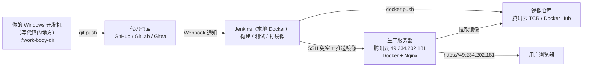

# 第 00 章 环境与基本功

> 难度：★☆☆　预计耗时：60~90 分钟（含动手）
> 本章目标：读完并动手做完，你能在一台陌生 Linux 服务器上，用命令回答这五个问题——**我是谁、机器什么配置、磁盘还剩多少、谁占了端口、服务为什么没起来**。

---

## 一、为什么需要这一章

先讲三个真实事故，全部发生在"只会写代码、不太熟 Linux"的开发者身上：

**事故一：一个回车符，三个小时的排查。**

小王在 Windows 上写了个部署脚本 `deploy.sh`，传到服务器执行，报错：

```
$ bash deploy.sh
deploy.sh: line 2: $'\r': command not found
```

他盯着第 2 行看了半天——那行明明是空的。真相是：Windows 的换行是 `\r\n`，Linux 只认 `\n`，那个多出来的 `\r` 被 shell 当成了一个命令。三个小时的排查，起因是一个看不见的字符。

**事故二：`sudo` 不是万能钥匙，root 更不是。**

小李图省事，所有操作都用 `root`。某天他执行了一条 `rm -rf /opt/apps/cicd-demo/releases/*`，手滑多按了一个空格，变成了 `rm -rf /opt/apps/cicd-demo /releases/*`。前者删版本目录，后者删了整个项目加上根目录下的 `releases`。root 权限下，系统连"你确定吗"都不会问。

**事故三：端口被占，服务起不来看日志看到怀疑人生。**

小张部署后端，容器起不来：

```
Error response from daemon: driver failed programming external connectivity on endpoint api:
Bind for 0.0.0.0:8000 failed: port is already allocated
```

他以为是 Docker 坏了，重装 Docker、重启服务器、换镜像版本——都没用。真相是：一台机器上早就有一个进程占着 8000，一条 `ss -tlnp | grep 8000` 就能看见。

> **这一章解决的就是这三类问题。** 后面 20 章会用到几百条命令，但真正的地基只有下面这些。学会它们，你在任何一台 Linux 机器上都不至于抓瞎。

---

## 二、先建立一个世界观：你有三个"厨房"

整套 CI/CD，本质上就是三个房间之间的协作：



把它想成一家餐厅：

| 现实中的东西 | 餐厅里的角色 | 它负责什么 |
| --- | --- | --- |
| Windows 开发机 | 老板的办公室 | 写菜单（代码）、下单（push） |
| 代码仓库 | 收银台 | 收单、存档、叫号（Webhook） |
| Jenkins | 中央厨房 | 备菜、炒菜、质检、打包（构建 + 测试 + 打镜像） |
| 镜像仓库 | 冷库 | 存放标准餐盒（镜像），随时取用 |
| 生产服务器 | 门店大堂 | 端菜上桌（跑容器）、迎客（Nginx 反代） |
| SSH | 员工通道 | 老板进后厨的那把钥匙，**要走安全通道，不能贴门口** |

三个房间之间只有两条通道：**Git**（代码怎么进去）和 **SSH**（命令怎么过去）。这一章先把 SSH 这条通道修好，后面所有章节都靠它。

---

## 三、动手前先认清一件事：命令在哪里执行

这是新手最容易混淆的地方。本书里每条命令我都会标注执行位置，只有三种：

| 标记 | 在哪敲 | 提示符长什么样 |
| --- | --- | --- |
| 【本地】 | 你 Windows 上的 PowerShell | `PS I:\work-body-dir>` |
| 【服务器】 | 通过 SSH 登录到腾讯云之后 | `ubuntu@VM-0-9-ubuntu:~$` |
| 【容器内】 | 进入某个 Docker 容器内部 | `root@3f2a1c9d8e7b:/app#` |

> **铁律：看到【服务器】标记的命令，绝对不要在本地 PowerShell 里敲。** 反过来也一样。本书 80% 的"照着做却报错"，都源于站错了房间。

---

## 四、动手步骤

### 步骤 1【本地】确认 SSH 别名能指向正确的机器

先看你的 SSH 配置文件。Windows 下路径是 `C:\Users\<你的用户名>\.ssh\config`：

```powershell
Get-Content $env:USERPROFILE\.ssh\config
```

应该能看到类似这样的一段（本书全程使用 `yengxun-yun` 这个别名）：

```text
Host yengxun-yun
    HostName 49.234.202.181
    User ubuntu
    Port 22
    IdentityFile ~/.ssh/id_ed25519
    ServerAliveInterval 60
```

逐行解释：

| 配置 | 含义 | 为什么需要 |
| --- | --- | --- |
| `Host` | 你给这台机器起的**代号** | 以后只需 `ssh yengxun-yun`，不用记 IP |
| `HostName` | 真实地址 | 换服务器时只改这里，其他脚本不用动 |
| `User` | 登录用户 | 腾讯云 Ubuntu 镜像默认 `ubuntu`，不是 `root` |
| `Port` | SSH 端口 | 默认 22，改了端口必须写 |
| `IdentityFile` | 用哪把私钥 | 不写的话 ssh 会按默认顺序试 |
| `ServerAliveInterval` | 每 60 秒发心跳 | 防止长时间编译时连接被掐断（**这个参数能救你无数次**） |

**验证连通性**（`BatchMode=yes` 表示"不许弹密码"，用来判断免密是否真的配好了）：

```powershell
ssh -o BatchMode=yes -o ConnectTimeout=10 yengxun-yun "echo OK; whoami; hostname"
```

预期输出：

```text
OK
ubuntu
VM-0-9-ubuntu
```

如果输出 `Permission denied (publickey,password)`，说明公钥还没推上去。执行下面这条（只需一次，会要你输密码）：

```powershell
type $env:USERPROFILE\.ssh\id_ed25519.pub | ssh ubuntu@49.234.202.181 "mkdir -p ~/.ssh && chmod 700 ~/.ssh && cat >> ~/.ssh/authorized_keys && chmod 600 ~/.ssh/authorized_keys && echo PUBKEY_OK"
```

> **原理**：SSH 免密登录是"挑战-应答"：服务器拿你 `authorized_keys` 里的**公钥**出一道题，只有你手里那把**私钥**能答对。所以可以放心把公钥发给任何人，**私钥（`id_ed25519`）一个字节都不能外传**。

### 步骤 2【服务器】第一句话：我在哪台机器上

```bash
whoami; hostname; cat /etc/os-release | head -3; uname -r; uptime
```

预期输出（示例）：

```text
ubuntu
VM-0-9-ubuntu
PRETTY_NAME="Ubuntu 24.04.1 LTS"
NAME="Ubuntu"
6.8.0-40-generic
 14:23:01 up 3 days,  2:11,  1 user,  load average: 0.05, 0.03, 0.00
```

这五个词各有用途：

- `whoami`：**我现在是谁**。决定了后面要不要加 `sudo`。
- `hostname`：**我在哪台机器**。同时开了三台服务器时不至于搞混（血泪教训）。
- `/etc/os-release`：**发行版和版本**。Ubuntu 用 `apt`，CentOS/RHEL 用 `dnf`，命令完全不同，装错一脸懵。
- `uname -r`：内核版本。Docker、内核参数调优时要用。
- `uptime` 里的 `load average`：三个数字分别是 1、5、15 分钟的平均负载。**超过 CPU 核数就说明在排队**。

### 步骤 3【服务器】机器有多少料：CPU、内存、磁盘

```bash
nproc                       # CPU 核数
free -h                     # 内存（人类可读）
df -h /                     # 根分区还剩多少
df -i /                     # inode 还剩多少（磁盘没满却写不进去时看这个）
du -sh /var/lib/docker      # Docker 吃了多少（镜像多了必查）
```

`free -h` 的输出要会读，这是最容易误判的一条：

```text
               total        used        free      shared  buff/cache   available
Mem:           1.7Gi       620Mi        80Mi       4.0Mi       1.0Gi       900Mi
Swap:          2.0Gi          0B       2.0Gi
```

| 列 | 意思 | 看它干什么 |
| --- | --- | --- |
| `total` | 物理内存总量 | 2G 的机器实际显示 1.7Gi，正常（内核占用） |
| `used` | **已经分配出去**的内存 | 高不一定是问题，Linux 喜欢用内存做缓存 |
| `free` | 完全空闲 | **低不代表内存不够**，别被它吓到 |
| `buff/cache` | 可回收的缓存 | 需要时会自动让出来 |
| `available` | **真正还能给新程序用的** | **只看这个！** 低于 100Mi 就该警惕 OOM |
| `Swap` | 交换分区 | `used` 持续不为 0 说明内存已经在靠磁盘硬扛，性能会崩 |

> **本章最重要的一条经验：判断内存够不够，只看 `available`，不看 `free`。**
> 我们在选机阶段就遇到过一台机器：`free` 还有 54Mi、`buff/cache` 76Mi，但 `available` 只剩 **14Mi**——这种机器看起来"还有内存"，实际上一启动新服务就会触发 OOM Killer，随机杀进程。

### 步骤 4【服务器】谁在占着我的端口

这是后端工程师用得最多的一组命令：

```bash
ss -tlnp                 # 所有 TCP 监听端口 + 进程（-t TCP -l 监听 -n 数字端口 -p 进程）
ss -tlnp | grep 8000     # 谁占了 8000
sudo ss -tlnp | grep :80 # 不带 sudo 看不到别人进程的 PID
```

`ss` 是 `netstat` 的现代替代品（Ubuntu 24.04 默认不再预装 netstat）。输出长这样：

```text
State  Recv-Q Send-Q Local Address:Port  Peer Address:Port Process
LISTEN 0      511          0.0.0.0:80         0.0.0.0:*     users:(("nginx",pid=891,fd=11))
LISTEN 0      1024         0.0.0.0:22         0.0.0.0:*     users:(("sshd",pid=1280,fd=3))
```

看到 `0.0.0.0:80` 已属于 `nginx`，就说明**你的站点不能再用 80**，要么改端口，要么复用这个 nginx。

配套三件套，按顺序查：

```bash
ss -tlnp | grep :端口号        # ① 端口被谁占
ps -ef | grep 进程名           # ② 进程还在不在（含 PID、启动命令）
sudo journalctl -u 服务名 -n 50 --no-pager   # ③ systemd 服务为什么挂了（最后 50 行日志）
```

### 步骤 5【服务器】权限这件事：`sudo`、`chmod`、`chown`

云服务器给你的 `ubuntu` 用户不是 root，但它能通过 `sudo` 临时借权限：

```bash
sudo -n true && echo "免密 sudo" || echo "sudo 需要密码"
sudo whoami        # 输出 root 说明提权成功
```

| 命令 | 作用 | 什么时候用 |
| --- | --- | --- |
| `sudo 命令` | 以 root 身份执行**一条**命令 | 安装软件、改系统配置 |
| `sudo -i` | 切到 root 的交互 shell | 连续做很多系统级操作（**做完记得 `exit`**） |
| `sudo -u 用户名 命令` | 以指定用户执行 | 以应用用户跑脚本，避免产生 root 所有文件 |
| `chmod +x 脚本.sh` | 加执行权限 | 脚本报 `Permission denied` 时 |
| `chown -R ubuntu:ubuntu 目录` | 改归属 | 文件被 root 写过，导致应用无权访问 |
| `ls -l` | 看权限位 | 排查"为什么读不了/跑不了" |

权限位读法（`-rwxr-xr--`）：第一位是类型（`-` 普通文件、`d` 目录），之后每三位一组：**属主 / 属组 / 其他人**，每组 `rwx` 分别是读/写/执行。`-rwxr-xr--` 就是"属主全权，同组可读可执行，其他人只可读"。

> **本书的做法**：服务器上永远用 `ubuntu` 用户操作，需要时加 `sudo`，**不直接登录 root**。第 11 章会解释为什么，并配置"禁用密码登录"。

### 步骤 6【服务器】看懂日志，等于会半个运维

```bash
sudo journalctl -u nginx -n 50 --no-pager     # 某服务最近 50 行
sudo journalctl -u docker --since "10 min ago" # 按时间过滤
sudo tail -f /var/log/nginx/error.log          # 实时跟踪文件日志（Ctrl+C 退出）
docker logs --tail 100 -f 容器名                # 跟容器日志
dmesg -T | tail -30                            # 内核日志，找 OOM Killer 就靠它
```

`dmesg -T` 里如果出现这种行，就是进程被系统杀了：

```text
[Wed Nov 11 13:20:01 2026] Out of memory: Killed process 35173 (node) total-vm:1832400kB
```

**看到 `Out of memory` 不要怀疑代码 bug，先查内存。**

### 步骤 7【本地】Windows 特有的三个坑，先处理掉

**坑 1：换行符（CRLF）。** 已在项目根目录放好 `.gitattributes`，内容包括：

```text
* text=auto eol=lf
*.sh text eol=lf
```

再给本机 Git 设一下，双保险：

```powershell
git config --global core.autocrlf input
```

如果已经踩坑（脚本在服务器报 `$'\r': command not found`），两招修复：

```bash
sed -i 's/\r$//' deploy.sh          # 【服务器】就地转换
```

```powershell
# 【本地】或者用 VS Code 右下角把 CRLF 改成 LF 再保存
```

**坑 2：路径分隔符与盘符。** Windows 是 `I:\work-body-dir`，Linux 是 `/opt/apps`。脚本里**绝对不要写 Windows 路径**，容器里更不存在 `I:` 盘。本书所有脚本统一用 `/opt/apps/cicd-demo`。

**坑 3：编码。** 用 UTF-8 无 BOM 保存脚本。PowerShell 5.1 默认写 UTF-16/BOM，被 Linux 读到会在第一行报 `#!/bin/bash^M: bad interpreter`。VS Code 右下角确认显示 `UTF-8`（不是 `UTF-8 with BOM`）。

---

## 五、完整实例：写一个能自己检查环境的脚本

目标：在服务器上放一个脚本，一条命令输出"这台机器适不适合跑我们的应用"。

**①【本地】创建文件 `scripts/hello-env.sh`：**

```bash
#!/usr/bin/env bash
# 用途：一眼看清这台机器的家底；只读，不做任何修改
set -euo pipefail

echo "===== 我是谁 ====="
echo "用户: $(whoami)    主机: $(hostname)    时间: $(date '+%F %T %Z')"

echo "===== 系统 ====="
grep -E '^(PRETTY_NAME|VERSION_ID)=' /etc/os-release

echo "===== 资源 ====="
echo "CPU 核数: $(nproc)"
free -h | awk 'NR<=2'
df -h / | awk 'NR<=2'

echo "===== 端口占用（前 10 个）====="
ss -tlnp 2>/dev/null | head -11

echo "===== 结论 ====="
avail_mb=$(free -m | awk '/^Mem:/{print $7}')
if [ "$avail_mb" -lt 200 ]; then
  echo "警告：可用内存仅 ${avail_mb}MiB，随时可能 OOM，请先腾内存"
else
  echo "可用内存 ${avail_mb}MiB，可以继续"
fi
```

**②【本地】语法检查**（不用连服务器就能查错，养成习惯）：

```powershell
bash -n scripts/hello-env.sh && echo "语法 OK"
```

**③【本地】传到服务器并执行：**

```powershell
scp scripts/hello-env.sh yengxun-yun:/tmp/
ssh yengxun-yun "chmod +x /tmp/hello-env.sh && bash /tmp/hello-env.sh"
```

**④ 预期输出：**

```text
===== 我是谁 =====
用户: ubuntu    主机: VM-0-9-ubuntu    时间: 2026-11-11 14:31:07 CST
===== 系统 =====
PRETTY_NAME="Ubuntu 24.04.1 LTS"
VERSION_ID="24.04"
===== 资源 =====
CPU 核数: 2
               total        used        free      shared  buff/cache   available
Mem:           1.9Gi       310Mi       1.2Gi       4.0Mi       420Mi       1.4Gi
===== 结论 =====
可用内存 1433MiB，可以继续
```

**⑤ 验证成功的标准**：脚本最后一行打印"可以继续"；如果打印"警告"，先去第 11 章处理内存，再回来。

> **这个脚本的写法值得记住三点**：`set -euo pipefail`（出错就停，别带病往下跑）、只读不写（随便跑，跑一百次也没副作用）、结论明确（不是丢一堆数据让人自己判断）。

---

## 六、坑与排错

| 现象 | 根因 | 解法 |
| --- | --- | --- |
| `$'\r': command not found` | 脚本是 CRLF 换行 | `sed -i 's/\r$//' 文件名`，并检查 `.gitattributes` |
| `Permission denied (publickey,password)` | 公钥没推、或私钥权限过宽 | 重新推公钥；`chmod 600 ~/.ssh/id_ed25519` |
| `WARNING: REMOTE HOST IDENTIFICATION HAS CHANGED` | 服务器重装/换 IP，指纹变了 | 确认是你自己的机器后：`ssh-keygen -R 49.234.202.181` |
| `Permission denied` 执行脚本时 | 没有执行权限 | `chmod +x 脚本.sh`，或 `bash 脚本.sh` 绕过 |
| `sudo: a terminal is required` | 非交互环境执行 sudo | 用 `ssh -t` 分配终端，或给该命令配 NOPASSWD |
| `bind: address already in use` | 端口被占 | `sudo ss -tlnp \| grep 端口` 找到进程，换端口或停它 |
| `No space left on device` 但 `df -h` 还有空间 | inode 用尽 | `df -i` 确认，清理小文件（常见于 Docker 日志） |
| `bash: 脚本: /bin/bash^M: bad interpreter` | 文件带 BOM 或 CRLF | 用 UTF-8 无 BOM 重存，`sed -i '1s/^\xEF\xBB\xBF//'` 去 BOM |

---

## 七、横向对照：同一批命令在三个平台怎么跑

| 要做的事 | Jenkins（本地 Docker） | GitHub Actions | GitLab CI |
| --- | --- | --- | --- |
| 执行 shell 命令 | `sh '命令'` | `run: 命令` | `script:` 下直接写 |
| 设置环境变量 | `environment { KEY = 'v' }` | `env:` | `variables:` |
| 失败即中止 | 默认（`set -e` 风格） | 默认 | 默认 |
| 用哪个用户跑 | 容器内 `jenkins` 用户 | `runner` 用户 | `gitlab-runner` 用户 |
| 访问生产机 | 凭据里存私钥 + `sshagent` | `secrets.SSH_KEY` + `ssh-agent` | CI/CD Variables（File 类型） |

> 记住一句话：**流水线平台只是"帮你把 shell 命令搬到另一台机器上执行"**。shell 基本功扎实，换平台只是换语法糖。

---

## 八、本章检查清单与练习

### 检查清单（全部能打勾再往下走）

- [ ] `ssh -o BatchMode=yes yengxun-yun "echo OK"` 能输出 `OK`，不需要输密码
- [ ] 能说出 `free -h` 里哪一列才决定"内存够不够"
- [ ] 能用一条命令找到占用 80 端口的进程
- [ ] 知道 `sudo`、`chmod +x`、`chown` 分别在什么时候用
- [ ] 本地项目有 `.gitattributes`，且 `git config --global core.autocrlf input` 已设置
- [ ] `hello-env.sh` 能在服务器上跑通并输出结论

### 练习

**练习 1**：不看笔记，写出"查 8000 端口被谁占、然后杀掉它"的完整命令。
<details><summary>参考要点</summary>

`sudo ss -tlnp | grep :8000` 拿到 PID → `sudo kill -15 PID`（先温和，不行再 `-9`）→ 再查一次确认已释放。
</details>

**练习 2**：服务器上 `df -h` 显示还有 20G，但写文件报 `No space left on device`，怎么查？
<details><summary>参考要点</summary>

`df -i` 看 inode 是否 100%；常见元凶是 `/var/lib/docker/containers/*/*-json.log` 海量小日志和 `node_modules` 小文件。处理：日志轮转 + `docker system prune`。
</details>

**练习 3**：为什么教程坚持用 `ubuntu` 用户 + `sudo`，而不是直接 root 登录？
<details><summary>参考要点</summary>

① 防手滑：破坏性命令前有 sudo 这道"确认"；② 可审计：`/var/log/auth.log` 记录谁提权做了什么；③ 可撤销：私钥泄露时只需删一个普通用户的 key，不用重装系统；④ 最小权限原则。
</details>

---

## 下一章预告

地基打完了，第 01 章回答一个更根本的问题：**为什么非要做 CI/CD？** 我们会用一家外卖餐厅的完整一天，把"构建""制品""环境""发布""回滚"这五个词一次性讲透，并告诉你哪些团队其实不需要 CI/CD（是的，有些团队真的不需要）。
