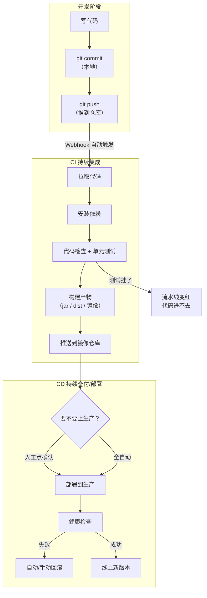

# 第 01 章 CI/CD 到底是什么

> 难度：★☆☆　预计耗时：45 分钟
> 本章目标：能用一句人话向产品经理解释 CI/CD；能准确说出构建、制品、环境、发布、回滚五个词的区别；能判断自己团队需不需要它。

---

## 一、为什么需要这一章

先看一个真实的时间线，主角是一个三人小团队，产品是一个内部管理系统。

**周一 10:00**　后端小张改完一个接口，本地测通了，把代码推到 Git。
**周一 14:00**　他想发布，于是开始做发布前准备：登上服务器、备份数据库、把 jar 包 scp 上去、重启服务。
**周一 14:20**　服务器上 `java -jar` 报错：`UnsupportedClassVersionError`。他本地是 JDK 21，服务器是 JDK 8。
**周一 15:40**　换成 JDK 17 重新打包，再传一遍（2M 带宽，包 80MB，传了 7 分钟）。
**周一 16:10**　服务起来了，但登录一直失败。查了半天，发现服务器上的配置文件和本地不一样：`DB_HOST` 还指向测试库。
**周一 17:30**　改完配置重启，页面 502。Nginx 配置里 `proxy_pass` 的端口和实际不一致。
**周一 18:20**　终于好了。小张在群里发："上线完成。"产品经理问："那个小需求什么时候上？"小张说："已经上了啊。"
**周二 09:30**　线上出现新 bug，需要回滚。小张翻了半天，**找不到上一版的包**——他一直在原地覆盖。
**周二 11:00**　只能连夜改了再上，越改越乱。

六小时上线一次，退回一次要重写，这是绝大多数团队的真实起点。

再看有 CI/CD 之后同一件事：

**周一 10:00**　小张提交代码，推送。
**周一 10:01**　流水线自动启动：拉代码 → 装依赖 → 单元测试 → 构建 → 打镜像 → 推仓库。
**周一 10:04**　流水线推送镜像成功，通知"可以发布"。
**周一 10:05**　小张在 Jenkins 点了"部署生产"（也可以全自动）。
**周一 10:06**　服务器拉取新镜像、健康检查通过、流量切换。
**周一 10:07**　小张在群里发一个链接，上面写着：本次变更 3 个提交、镜像 tag `a1b2c3d`、部署耗时 68 秒、当前线上版本、一键回滚按钮。

同样一件事，从 6 小时 + 不可回滚，变成 **7 分钟 + 30 秒回滚**。

> 差的不是勤奋，是**流水线**。这一章先把概念讲透，否则后面全是背命令。

---

## 二、原理图解：一条完整的流水线长什么样



关键点：**这条链上任何一环失败，整条链就停下，坏东西不会流到下一环**。这就是流水线最大的价值——它把"检查"放在"上线之前"，而不是"用户投诉之后"。

---

## 三、五个词，一次讲透

### 3.1 构建（Build）

把"人写的代码"变成"机器能跑的东西"的过程。

- 前端：`npm run build` → 一堆 `.js/.css/.html` 静态文件
- 后端 Java：`mvn package` → 一个 `app.jar`
- 后端 Python：不需要编译，但要把依赖装进镜像里
- 镜像构建：`docker build` → 一个可以到处运行的镜像

> **餐厅比喻**：构建 = 把生食材做成能上桌的菜。**生食材不能直接端给客人，源码也不能直接扔给服务器。**

**关键认知：构建必须发生在 CI 机器上，不能在生产服务器上。** 原因有三：生产机不该装 JDK/Node（安全 + 干净）；生产机要留给业务（内存）；构建过程可能失败，绝不能在生产机上失败。

### 3.2 制品（Artifact）

构建的**产物**，且必须是**不可变的**。

| 项目类型 | 典型制品 | 存在哪 |
| --- | --- | --- |
| 前端 | `dist/` 打成的 tar.gz | 服务器 `releases/` 目录 / 对象存储 |
| Java | `app.jar` | Nexus / 服务器 `releases/` |
| 任意语言 | Docker 镜像 | 镜像仓库（GHCR / SWR / Docker Hub） |
| 附带的 | 测试报告、覆盖率报告、SBOM | 流水线归档区 |

**"不可变"是什么意思？** 一旦发布，`app-v1.2.3-20261111.tar.gz` 这个文件名就再也不能被别的构建覆盖。想改？出个新版本号。

为什么必须不可变：回滚的前提是"旧版本还在"。如果每次发布都往同一个文件名上覆盖，你就永远回不去——这正是第一节故事里小张的困境。

> **餐厅比喻**：制品 = 真空封装的餐盒，盒上印着生产日期和批次号。**绝不能把新菜倒回旧餐盒里。**

### 3.3 环境（Environment）

同一套代码，跑在不同"房间"里：

| 环境 | 谁在用 | 数据 | 部署频率 |
| --- | --- | --- | --- |
| 开发（dev） | 开发者自己 | 假数据 | 随时 |
| 测试（test/staging） | 测试同学 | 近似真实数据 | 每次合并 |
| 生产（prod） | 真实用户 | 真数据，**丢了就没了** | 审批后 |

**核心矛盾**：环境之间最大的差别不是机器，而是**配置**（数据库地址、密钥、第三方账号）。

本书的做法：**同一份镜像 + 不同的环境变量**。镜像从测试到生产一个字都不改，只换 `.env`。这样才能保证"测试环境跑通 = 生产环境能跑"。

> 反例：给测试和生产分别构建两次镜像。结果是"测试通过的东西"和"上生产的东西"根本不是同一个，出了问题查不清。

### 3.4 发布（Release）

把新版本**暴露给用户**的动作。

要注意"部署"和"发布"不是一回事：

- **部署**：技术动作，新版本已经在服务器上跑起来了，但可能只有内部能访问。
- **发布**：业务动作，用户能看到新功能了。

所以才有灰度发布：先部署，再按 5% → 50% → 100% 逐步"发布"。

### 3.5 回滚（Rollback）

新版本出问题时，把线上**恢复到上一个可用版本**。

回滚能不能做到 30 秒，取决于三件事：

1. 旧版本镜像/制品还在（制品不可变）
2. 目录结构支持快速切换（`releases/` + `current` 软链接）
3. 数据库变更**向前兼容**（这条最容易被忽略，第 14 章专门讲）

> **餐厅比喻**：回滚 = 客人投诉这道菜，厨房立刻把上一版菜重新端上桌。如果上一版已经倒掉了（被覆盖），那就只能让客人等着重做，还可能是同一批坏食材。

---

## 四、CI、CD、CD：三个"持续"到底差在哪

| 缩写 | 全称 | 一句话 | 人工介入点 |
| --- | --- | --- | --- |
| CI | 持续集成 Continuous Integration | 每次提交都自动构建 + 测试，保证代码"合进来是好的" | 无 |
| CD | 持续交付 Continuous **Delivery** | 每次通过 CI 的产物**随时可以**上线，但要人点一下按钮 | 点"部署生产" |
| CD | 持续部署 Continuous **Deployment** | 通过 CI 就**自动**上线，不需要人 | 无（靠监控与自动回滚兜底） |

用餐厅打比方：

- **CI**：每来一单，后厨自动试做一份并质检。做坏了立刻退回，不会端给客人。
- **持续交付**：质检合格的菜摆在传菜口，服务员（人）按一下铃才端出去。
- **持续部署**：质检合格直接自动端出去，服务员只负责处理投诉（监控 + 回滚）。

**大多数团队应该停在"持续交付"**。不是因为技术做不到持续部署，而是因为业务上需要"什么时候上线"的决定权（比如避开大促、配合运营活动）。

---

## 五、动手：亲手串一条"最小流水线"

概念听懂了不算懂。这一节我们用 4 个脚本，在**本地**模拟一条流水线，你会看到 CI/CD 的本质：**不过是把一串命令按顺序串起来，任何一步失败就停。**

> 工具会换（Jenkins / Actions / GitLab CI），但"串命令 + 失败即停"这个本质永远不变。理解这个，后面学 Jenkins 只是在学"怎么用界面和 YAML 描述这串命令"。

### 步骤 1【本地】准备目录

在 Git Bash 里执行（Windows 开始菜单搜 "Git Bash"）：

```bash
mkdir -p /i/work-body-dir/cicd-tutorial-labs/mini-pipeline && cd /i/work-body-dir/cicd-tutorial-labs/mini-pipeline
```

### 步骤 2【本地】创建流水线脚本

文件：`pipeline.sh`

```bash
#!/usr/bin/env bash
# 最小流水线演示：构建 → 测试 → 打包 → 发布（发布是模拟的）
set -euo pipefail

APP_NAME="demo-app"
# 真实流水线里版本号来自 git 提交：VERSION=$(git rev-parse --short HEAD)
VERSION="$(date +%Y%m%d-%H%M%S)"
ARTIFACT="dist/${APP_NAME}-${VERSION}.tar.gz"

echo "======================================"
echo "流水线开始  应用=$APP_NAME  版本=$VERSION"
echo "======================================"

echo "[1/4] 构建：生成可运行文件"
mkdir -p build
cat > build/app.js <<'EOF'
// 模拟一个"应用"
console.log("app is running, version = " + (process.env.APP_VERSION || "dev"));
EOF
echo "    构建完成：build/app.js"

echo "[2/4] 测试：跑一个最小断言"
if APP_VERSION="$VERSION" node build/app.js | grep -q "version = $VERSION"; then
  echo "    测试通过"
else
  echo "    测试失败：输出不符合预期"
  exit 1
fi

echo "[3/4] 打包：产出不可变制品"
mkdir -p dist
tar -czf "$ARTIFACT" -C build .
echo "    制品：$ARTIFACT  大小 $(du -h "$ARTIFACT" | cut -f1)"

echo "[4/4] 发布：模拟把制品送到服务器"
echo "    部署 $ARTIFACT 到 /opt/apps/${APP_NAME}/releases/ ..."
echo "    切换软链接 current -> releases/${VERSION}"
echo "    健康检查 /healthz ... 200 OK"

echo "======================================"
echo "流水线成功，耗时约 ${SECONDS} 秒"
echo "======================================"
```

### 步骤 3【本地】执行它

```bash
chmod +x pipeline.sh
bash -n pipeline.sh && echo "语法 OK"
bash pipeline.sh
```

预期输出：

```text
======================================
流水线开始  应用=demo-app  版本=20261111-143205
======================================
[1/4] 构建：生成可运行文件
    构建完成：build/app.js
[2/4] 测试：跑一个最小断言
    测试通过
[3/4] 打包：产出不可变制品
    制品：dist/demo-app-20261111-143205.tar.gz  大小 4.0K
[4/4] 发布：模拟把制品送到服务器
...
流水线成功，耗时约 1 秒
```

### 步骤 4 亲手制造一次失败

把测试那行里的 `grep -q "version = $VERSION"` 改成 `grep -q "version = never-match"`，再跑一次。

你会看到：

```text
[2/4] 测试：跑一个最小断言
    测试失败：输出不符合预期
```

然后脚本**停在这里**，没有继续打包，没有发布。

> **这就是 CI/CD 最核心的机制：门禁。** 测试挂了，坏东西就流不到生产。你后面学的 Jenkins 的 `stage`、Actions 的 `needs`、GitLab 的 `stage`，全都只是在描述"这个门禁"。

### 步骤 5 观察"制品不可变"

再跑一次 `bash pipeline.sh`，注意 `dist/` 里现在有两个包：

```bash
ls -lh dist/
```

```text
demo-app-20261111-143205.tar.gz
demo-app-20261111-143512.tar.gz
```

两个包同时存在，互不覆盖。这就是回滚的基础：线上出问题，把 `current` 指回上一个包即可。

**验证成功的标准**：你能说清"为什么第二个包没有覆盖第一个包"，以及"如果被覆盖了，回滚还能不能做"。

---

## 六、坑与排错

| 坑 | 表现 | 正确做法 |
| --- | --- | --- |
| 把 CI 当成了"自动打包" | 流水线只构建不测试，照样天天出事 | 测试、检查、扫描都放进流水线，且**失败必须阻断** |
| 在生产机上构建 | 服务器内存被编译吃光，业务被 OOM 杀掉 | 构建只在 CI 机；生产机只拉镜像 |
| 每次发布覆盖同一个包名 | 出问题无法回滚 | 版本号必带 `git sha` 或时间戳，制品不可变 |
| 测试环境和生产环境各构建一次 | "测试通过"和"上线的"不是同一个东西 | 同一镜像 + 不同环境变量 |
| 一上来就追求全自动上生产 | 出事故没兜底，团队从此不敢用流水线 | 先"持续交付"（人工点确认），跑稳了再谈自动 |
| 把密钥写进流水线脚本 | 仓库泄露 = 全家泄露 | 用平台凭据/Secrets，脚本里只引用变量名 |
| 流水线跑 40 分钟 | 没人愿意等，于是绕过流水线直接上线 | 优化缓存与并行（第 16 章），目标 3~5 分钟 |

---

## 七、横向对照：五组概念在三平台的叫法

| 概念 | Jenkins | GitHub Actions | GitLab CI |
| --- | --- | --- | --- |
| 流水线定义 | `Jenkinsfile` | `.github/workflows/*.yml` | `.gitlab-ci.yml` |
| 阶段 | `stage('构建')` | 一个 `job` | `stage: build` |
| 并行任务 | `parallel { }` | 多个 job 自动并行 | 同 stage 的 job 自动并行 |
| 步骤 | `steps { sh '...' }` | `steps: - run: ...` | `script:` |
| 失败即停 | 默认中断，`post` 收尾 | 默认中断 | 默认中断 |
| 制品 | `archiveArtifacts` | `actions/upload-artifact` | `artifacts:paths` |
| 凭据 | Credentials（ID 引用） | `secrets.XXX` | CI/CD Variables |
| 触发器 | Webhook / `cron` | `on: push` | `rules:` / `only:` |

> 表里最重要的不是语法，而是**每一行都对应同一个概念**。学会一个平台，另一个只是查语法。

---

## 八、本章检查清单与练习

### 检查清单

- [ ] 能用自己的话解释"构建"和"制品"的区别
- [ ] 能说清"部署"和"发布"的区别
- [ ] 能说出回滚能快速完成的三个前提
- [ ] 能解释持续交付与持续部署的差别，以及为什么多数团队选前者
- [ ] 亲手把 `pipeline.sh` 跑成功，并制造过一次"测试失败阻断流水线"

### 练习

**练习 1**：你的团队现在每次上线要 2 小时，一周上线一次。请列出三个最能省时间的改造点，并说明理由。
<details><summary>参考要点</summary>

① 构建自动化（省掉手工打包传包）；② 配置外置（消除"本地能跑服务器不能跑"）；③ 制品不可变 + 软链接切换（回滚从 2 小时变 30 秒）。先做①和③，投入最小、收益最大。
</details>

**练习 2**：如果给 `pipeline.sh` 加一个 `[2.5/4] 代码规范检查` 阶段，要求"发现 `var` 关键字就失败"，你会怎么写？
<details><summary>参考要点</summary>

在测试后插入：`if grep -rn "\bvar\b" build/; then echo "发现 var，规范检查失败"; exit 1; fi`。重点在于**失败时要 `exit 1`**，否则流水线不会变红。
</details>

**练习 3**：为什么本书坚持"生产机上不装 JDK / Node"？
<details><summary>参考要点</summary>

① 减少攻击面（少装一个运行时少一类漏洞）；② 节省内存（2G 机器经不起）；③ 保证"构建环境一致"，构建只在 CI 一处发生；④ 生产机职责单一，出问题好定位。
</details>

---

## 下一章预告

概念清楚了，但流水线要触发，得先有规范的提交。第 02 章讲 Git 工作流：为什么需要分支模型、`main` 为什么必须受保护、`feat:` 和 `fix:` 这些前缀到底影响什么，以及 Tag 与"版本号"的关系。
