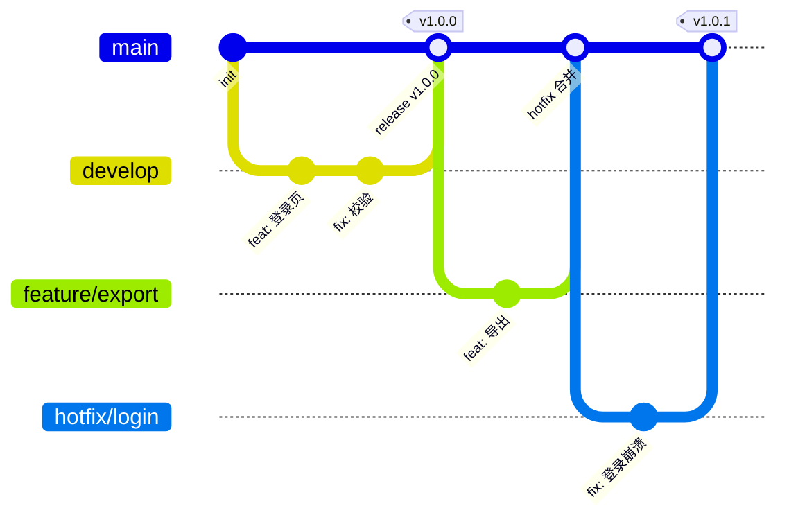

# 第 02 章 Git 工作流

> 难度：★★☆　预计耗时：120 分钟（含 GitHub 配置实操）
> 本章目标：搭起一套"流水线能依赖"的 Git 规范——分支模型、**GitHub 仓库与分支保护的完整配置**、提交信息、版本 Tag；并把 `git switch`、`git tag` 和常用命令讲透，让后面 18 章不再因为 Git 操作卡壳。

---

## 一、为什么需要这一章

流水线不是凭空启动的，它需要一个**触发器**。而触发器背后是一套约定：

- 推到 `main` → 这是要上生产的代码 → 触发生产流水线
- 推到 `feature/xxx` → 这是开发中的代码 → 只跑测试，不部署
- 打了 `v1.2.0` 的 Tag → 这是一个正式版本 → 打镜像、归档、发 Release

**如果没有这套约定，流水线就是一台没有开关的机器。**

三个真实事故：

**事故一：直接往 main 推，把别人的代码冲掉了。**
小赵本地有个陈旧的分支，`git push origin main --force`，同事三天的提交原地蒸发。没有保护分支，Git 连警告都不给。

**事故二：Tag 被重打，回滚回了"不存在的版本"。**
`v1.2.0` 发布后发现有 bug，改完又打了一次 `v1.2.0`（而不是 `v1.2.1`）。结果两批不同的镜像用了同一个 tag，线上到底跑的哪个版本，谁也说不清。

**事故三：提交信息全是"update"。**
线上出问题要查"最近改了什么"，`git log` 输出 200 行 `update`、`fix bug`、`111`。最后只能靠时间猜。

> **餐厅比喻**：Git 仓库是餐厅的**订单系统**。分支是"不同的订单"，分支保护是"只有厨师长签字的订单才能进后厨"，Tag 是"已封存的成品编号（不可涂改）"，提交信息是"订单备注（写清是加辣还是免葱）"。这一章就是把订单系统立起来。

---

## 二、原理图解：三种主流分支模型



| 模型 | 长什么样 | 适合谁 | 流水线怎么配 |
| --- | --- | --- | --- |
| **GitHub Flow** | 只有 `main` + 短生命周期 `feature/*`，全部走 PR | 大多数团队、持续交付、Web 项目 | main 合并即部署测试环境；打 Tag 部署生产 |
| **GitLab Flow** | `main` + 环境分支（`pre-production`/`production`） | 需要"多环境分别对应分支"的团队 | 推 `production` 分支 = 部署生产 |
| **Trunk-based** | 只有 `main`，功能靠开关（Feature Flag）藏在代码里 | 成熟团队、高频发布（一天多次） | main 每次合并都部署，靠开关控制可见性 |
| **Git Flow** | `main` + `develop` + `release/*` + `hotfix/*` | 版本型产品（客户端、需要长期维护多版本） | 复杂，本书不推荐新手用 |

**本书采用 GitHub Flow 的简化版**：

```text
main（受保护，永远可发布）
  └── feature/xxx   （开发新功能，1~3 天，合并后删除）
  └── fix/xxx       （修 bug）
  └── hotfix/xxx    （线上紧急修复，从 Tag 拉出）
```

理由：分支少、心智负担低、天然适配 CI/CD。Git Flow 的 `develop` 分支在持续交付场景里纯属多余负担。

> 本教程的实际仓库就是这套模型的样板：`git@github.com:yuxmgit/cicd-tutorial.git`，只有 `main` 一条长期分支，练习分支随用随删。

---

## 三、动手步骤

### 步骤 1【本地】初始化仓库并做基础配置

在项目根目录执行：

```powershell
cd I:\work-body-dir\cicd-tutorial
git init -b main
git config user.name "你的名字"
git config user.email "you@example.com"
```

如果这台机器第一次用 Git，把这几项全局配置一次性设好（第 00 章讲过 CRLF 的原因）：

```powershell
git config --global core.autocrlf input      # 提交时 CRLF→LF，检出时不动
git config --global init.defaultBranch main  # 新仓库默认分支叫 main
git config --global pull.rebase true         # pull 用变基，不产生无意义 merge 提交
git config --global core.quotepath false     # 中文文件名不转义成 \344\275\240
```

**每项配置到底改了什么**：

| 配置 | 作用域 | 不加会怎样 |
| --- | --- | --- |
| `user.name` / `user.email` | 本仓库 | 提交记录里作者是"unknown"，平台不认领提交、不计入贡献 |
| `core.autocrlf=input` | 全局 | Windows 上提交的 shell 脚本带 `\r`，进容器就报 `$'\r': command not found` |
| `init.defaultBranch` | 全局 | 新仓库叫 `master`，与平台默认分支不一致，首次 push 多绕一步 |
| `pull.rebase` | 全局 | 每次 pull 都产生 `Merge branch 'main' of ...` 垃圾提交 |
| `core.quotepath` | 全局 | `git status` 里中文文件名显示为八进制乱码 |

> 查看当前所有配置：`git config --list --show-origin`（`--show-origin` 会告诉你这条配置来自哪个文件，排查"为什么我的配置不生效"时必用）。

### 步骤 2【本地】写好 `.gitignore`

流水线会因为 `.gitignore` 写错而出各种怪事（把 `node_modules` 传上去导致构建超时、把 `.env` 传上去导致密钥泄露）。项目根目录的 `.gitignore`：

```gitignore
# 依赖
node_modules/
__pycache__/
*.pyc
.venv/
venv/

# 构建产物（流水线会重新构建，不要入库）
dist/
build/
*.tar.gz
*.jar

# 环境与密钥（最重要的一行）
.env
.env.*
!.env.example

# 日志与临时文件
*.log
.DS_Store
Thumbs.db
.idea/
.vscode/*
!.vscode/extensions.json

# 数据库文件（SQLite 数据不入库）
*.db
*.db-wal
*.db-shm
```

> **为什么 `dist/` 不能入库**：构建产物入库会导致"仓库里的 dist 和代码不一致"，而且每次构建都产生巨大 diff。产物应该由流水线生成并归档到制品库。

**验证匹配规则**（不确定某文件为什么被忽略时）：

```powershell
git check-ignore -v demos/frontend/node_modules/vue/index.js
# 输出：.gitignore:2:node_modules/	demos/frontend/node_modules/vue/index.js
#        ↑ 规则来自哪个文件第几行
```

### 步骤 3【本地】第一次提交

```powershell
git add .
git status
git commit -m "chore: 初始化 CI/CD 教程项目骨架"
git log --oneline
```

预期输出：

```text
a1b2c3d (HEAD -> main) chore: 初始化 CI/CD 教程项目骨架
```

### 步骤 4【本地】分支命名与功能开发

命名规范（流水线可以据此决定行为）：

| 前缀 | 用途 | 流水线行为 |
| --- | --- | --- |
| `feature/` | 新功能 | 只跑测试与构建，不部署 |
| `fix/` | 普通 bug 修复 | 同上 |
| `hotfix/` | 线上紧急修复 | 跑全量测试，合并后立即允许上生产 |
| `chore/` | 杂活（依赖升级、配置） | 跑测试 |
| `docs/` | 只改文档 | 可以跳过构建（省时间） |

实操：

```powershell
git switch -c feature/add-health-page     # 创建并切换（等价于 checkout -b）
```

改点东西（比如新建一个文件），然后：

```powershell
git add .
git commit -m "feat(web): 增加健康检查展示页"
git push -u origin feature/add-health-page   # 首次推送用 -u 建立追踪关系
```

`git switch` 的完整用法见本章 **4.1**，这里先记住三件事：

- `git switch -c xxx` = 新建并切换（`-c` 是 create）
- `git switch xxx` = 切换到已有分支
- `git switch -` = 回到上一个分支（像 cd - 一样）

### 步骤 5【平台】GitHub 仓库配置全流程（重点）

这是本书唯一需要"点网页"的环节。路径会随 GitHub 改版微调，但**配置项的逻辑是不变的**，认准名字即可。

#### 5.1 建仓库与首次推送

你已经有仓库了（`yuxmgit/cicd-tutorial`），流程是：**先在网页建空仓库 → 本地加 remote → 推**。标准动作：

```powershell
# 本地已有提交历史的情况
git remote add origin git@github.com:yuxmgit/cicd-tutorial.git
git branch -M main                      # 确保本地分支叫 main
git push -u origin main

# 如果 remote 已经存在但地址错了
git remote set-url origin git@github.com:yuxmgit/cicd-tutorial.git
git remote -v                           # 确认 fetch/push 两行都是对的
```

**建仓库时四个勾选项的含义**（新建仓库页面）：

| 选项 | 含义 | 本书选择 |
| --- | --- | --- |
| Description | 仓库简介，会显示在仓库首页 | 写一句"CI/CD 教程：Jenkins 主线 + 单机部署实战" |
| Public / Private | 公开任何人可读；私有需授权 | 教程项目选 Public 便于分享；公司项目一律 Private |
| Add a README | 自动生成 README 并**产生一个初始提交** | **已有本地项目时不要勾**，否则首次 push 要处理"历史不相关" |
| Add .gitignore / license | 自动生成文件 | 同上，本地已有就不要勾，避免冲突 |

> **"历史不相关"报错**：`git push` 时报 `Updates were rejected because the remote contains work that you do not have locally`。原因就是网页端建仓库时勾了 README，远端已有一个提交。两种解法：`git pull --rebase origin main` 合并后再推（推荐），或 `git push -f origin main` 覆盖（**仅在确认远端那个提交无价值时用**）。

#### 5.2 SSH 密钥配置（Windows 实操）

用 SSH 而不是 HTTPS 的原因：不用每次输密码/令牌，Jenkins 也能直接复用。

```powershell
# 1. 看有没有现成的密钥（有就跳过生成）
ls $env:USERPROFILE\.ssh\id_ed25519*
#    没有则生成（一路回车，密码可留空）
ssh-keygen -t ed25519 -C "yuxiangming@ata.net.cn"

# 2. 复制公钥内容（.pub 才是公钥，无后缀的是私钥，永不外传）
Get-Content $env:USERPROFILE\.ssh\id_ed25519.pub

# 3. 粘到 GitHub：Settings → SSH and GPG keys → New SSH key
#    Title 写清机器（如 "work-windows"），Key type 选 Authentication Key

# 4. 验证
ssh -T git@github.com
#    成功输出：Hi yuxmgit! You've successfully authenticated, but GitHub does not provide shell access.
#    ↑ 出现 "Hi 你的用户名" 就通了，"does not provide shell access" 是正常提示，不是错误
```

**多台机器/多个 GitHub 账号**（本机连了服务器又连 GitHub 时尤其有用）：`~/.ssh/config` 里给主机起别名：

```text
Host github.com
    HostName github.com
    User git
    IdentityFile ~/.ssh/id_ed25519
    IdentitiesOnly yes

Host yengxun-yun
    HostName 49.234.202.181
    User ubuntu
    IdentityFile ~/.ssh/id_ed25519
```

有了这个文件，`ssh yengxun-yun`、`git push origin main` 都不用再指定密钥——Jenkins 容器挂载 `~/.ssh` 后也是靠它连服务器（第 03 章）。

**常见 SSH 报错对照**：

| 报错 | 根因 | 解法 |
| --- | --- | --- |
| `Permission denied (publickey)` | 公钥没上传 / 传错账号 / 私钥权限过宽 | 重传公钥；`ssh -T` 看返回的 `Hi 谁` 是不是你要的账号 |
| `git@github.com: Permission denied` 但 `ssh -T` 正常 | remote 用的是 HTTPS 地址却配了 SSH 密钥 | `git remote -v` 检查，用 `set-url` 改成 `git@github.com:...` |
| `Host key verification failed` | 首次连接没确认过指纹 | `ssh-keyscan github.com >> ~/.ssh/known_hosts` |
| 私钥被读走的风险 | 私钥存在共享目录/云盘 | 私钥文件权限 600，绝不放仓库、不放共享盘 |

#### 5.3 仓库基础设置（Settings → General）

| 设置项 | 位置 | 建议值 | 为什么和流水线有关 |
| --- | --- | --- | --- |
| Default branch | Settings → General → Default branch | `main` | 默认分支决定 PR 的目标分支，也决定 Webhook 默认监听的分支 |
| Allow merge commits | Settings → General → Pull Requests | 关闭 | 保留线性历史，`git log` 一眼看清 |
| Allow squash merging | 同上 | **开启并设为默认** | 一个 PR 压成一个提交，主分支历史干净，回滚粒度 = 一个功能 |
| Allow rebase merging | 同上 | 可选 | 适合要求"每个提交都要有意义"的团队 |
| Automatically delete head branches | 同上 | **开启** | PR 合并后自动删源分支，避免分支列表长成丛林 |
| Allow auto-merge | 同上 | 可开 | 流水线绿了自动合并，减少等待 |
| Actions permissions | Settings → Actions → General | 未用 Actions 时选 "Disable actions" | 减少攻击面（本项目用 Jenkins） |
| Danger Zone → Change visibility | Settings 底部 | 谨慎 | 误把私有仓库转公开 = 代码泄露 |

**Squash 为什么是本书默认**：一个 `feature/*` 分支里可能有"改错字""再改一次""忘了提交文件"这类噪音提交。压成一个提交后，主干上每个提交都对应一个完整功能，第 12 章的"回滚到某个版本"和 `git bisect` 排查才有意义。

#### 5.4 分支保护：新版 Rulesets（推荐）

GitHub 有**两套**等价机制：老版 "Branch protection rules"（Settings → Branches）和新版 "Rulesets"（Settings → Rules）。新版功能更全（支持多分支通配、Tag 规则、旁路名单），**新仓库建议直接用 Rulesets**。

**操作路径**：

```text
仓库 → Settings → Rules → Rulesets → New ruleset → New branch ruleset
```

逐项配置（照抄即可）：

| 配置项 | 值 | 作用 / 为什么必须 |
| --- | --- | --- |
| Ruleset Name | `protect-main` | 命名清晰，出问题好排查 |
| Enforcement status | **Active**（先选 Evaluate 观察也行） | Evaluate 只记录不阻断，适合先在老仓库试水 |
| Bypass list | 空（或只放仓库管理员） | 有空位等于留后门；真要紧急绕过，让管理员操作并留 audit log |
| Target branches → Add target → Include default branch | 勾选 | 保护 `main`；也可用 `Include by pattern` 写 `release/*` |
| ✅ Restrict deletions | 勾选 | 禁止删分支（防 `git push origin :main`） |
| ✅ Block force pushes | 勾选 | 禁止 force push（事故一的直接防线） |
| ✅ Require a pull request before merging | 勾选 | **核心**：main 只能通过 PR 进入 |
| └ Required approvals | `1`（团队 ≥3 人时 `2`） | 至少一人评审 |
| └ Dismiss stale pull request approvals when new commits are pushed | 勾选 | 评审后又推新代码，旧批准作废（防"批准完偷改"） |
| └ Require review from Code Owners | 有 CODEOWNERS 文件时勾选 | 关键目录（如 `deploy/`）必须由指定人评审 |
| └ Require approval of the most recent reviewable push | 勾选 | 最后推代码的人不能自己批准 |
| ✅ Require status checks to pass | 见 5.5 | 流水线不绿不许合并 |
| ✅ Require conversation resolution before merging | 勾选 | PR 里提的问题必须被标记解决 |
| ✅ Require linear history | 勾选 | 禁止 merge commit，配合 5.3 的 squash 策略 |
| ⬜ Require signed commits | 团队有 GPG 规范时勾 | 本书不强制，教学环境配了反而添堵 |
| ⬜ Require deployments to succeed | 有 GitHub Environments 时用 | 本书部署由 Jenkins 做，不适用 |

**老版路径**（如果你看到的是旧界面）：`Settings → Branches → Add branch protection rule` → Branch name pattern 填 `main` → 勾选项含义与上表一一对应，只是名字略有差异（`Require a pull request before merging`、`Require approvals`、`Require status checks to pass before merging`、`Do not allow bypassing the above settings`）。

> **两个高频踩坑**：
> 1. `Do not allow bypassing the above settings`（老版）**必须勾**，否则管理员仍能直推，保护形同虚设。
> 2. Ruleset 的 **Bypass list 留空**。默认会给 "Repository admin" 留旁路，团队里任何人成为 admin 就能破规矩——小团队可以接受，但要知道这件事。

#### 5.5 状态检查（Require status checks）与 Jenkins 的真实关系

这一项是"红的流水线不许合并"的开关，但它有一个**前提条件**：

```text
Require status checks to pass
   └── 必须先在列表里选出一个"已经运行过一次"的检查名
```

**检查名从哪来**？来自 CI 系统回传给 GitHub 的 check run：

| CI 系统 | 典型检查名 |
| --- | --- |
| GitHub Actions | 工作流里的 job 名，如 `build`、`test` |
| Jenkins（GitHub Branch Source / Checks 插件） | `continuous-integration/jenkins/pr-merge` 或自定义 stage 名 |
| 其他（GitLab CI 走 external status） | 自定义 context 名 |

**本项目教学阶段的真实情况（必须说清）**：Jenkins 跑在你本机 `localhost:8080`，GitHub 的公网服务器**无法回调**这个地址，所以：

- 状态检查列表里**不会出现** Jenkins 的名字（因为一次都没回调成功过）；
- 如果硬要勾一个不存在的检查，PR 会永远卡在 "Expected — Waiting for status to be reported"，**谁也无法合并**。

所以本书的分阶段做法：

| 阶段 | 分支保护配置 | 部署控制靠什么 |
| --- | --- | --- |
| 阶段一（本地 Jenkins） | 必须 PR + 1 人评审 + 禁 force push + 禁删分支 + 线性历史 | Jenkinsfile 里 `when { branch 'main' }` + 人工点"批准发布"（第 15/18 章） |
| 阶段二（Jenkins 有公网地址） | 追加 Require status checks，勾上 Jenkins 的检查名 | GitHub 侧强制：检查不绿，合并按钮直接灰掉 |

**如何让阶段二成立**（任选其一，第 05 章详述）：

1. 内网穿透（ngrok / frp / cloudflared）把 `8080` 映射成公网 HTTPS 地址，GitHub Webhook 指向它；
2. 把 Jenkins 部署到有公网 IP 的云主机；
3. 改用 GitHub Actions 跑测试、Jenkins 只做部署（混合模式）。

> **一句话结论**：分支保护里的"必须 PR/必须评审/禁 force push"是**立刻生效**的硬防线；"必须流水线绿"要先解决网络可达性，别急着勾。

#### 5.6 Tag 保护（防止 v1.0.0 被重打）

Tag 是发布版本的身份证，必须防篡改。配置路径：

```text
Settings → Rules → Rulesets → New ruleset → New tag ruleset
  Target tags → Include by pattern → v*
  ✅ Restrict deletions
  ✅ Block force pushes
```

老版路径：`Settings → Tags → Add rule`（Pattern 填 `v*`，同样禁止更新与删除）。

配好后验证——尝试重打已推送的 tag 应该失败：

```powershell
git tag -f v1.0.0              # 本地强制重打（本地仍会成功）
git push origin v1.0.0 -f       # 远端应被拒绝
# remote: error: GH013: Repository rule violations found for refs/tags/v1.0.0
```

#### 5.7 Webhook 与 Secrets（预告，第 05 章展开）

| 项 | 路径 | 用途 |
| --- | --- | --- |
| Webhook | Settings → Webhooks → Add webhook | 让 GitHub 在 push/PR 时通知 Jenkins |
| Payload URL | `http://<你的公网地址>:8080/github-webhook/` | 本地 Jenkins 需要内网穿透地址 |
| Content type | `application/json` | Jenkins 插件按 JSON 解析 |
| Secret | 与 Jenkins 里配置的一致 | 防伪造请求 |
| Events | Just the push event / Let me select（勾 Pull requests） | 只订阅需要的事件，减少噪音 |
| Secrets（Actions 用） | Settings → Secrets and variables → Actions | 阶段二若用 Actions 才需要 |
| Deploy keys | Settings → Deploy keys | 给 CI 只读拉代码的 SSH key（比给个人 key 安全） |

#### 5.8 验证分支保护是否真的生效

配置完必须**亲手撞一次墙**，否则你不知道自己配的是"看起来保护了"还是"真的保护了"：

```powershell
# 1. 直接推 main，应该被拒
git switch main
echo "# test" >> README.md
git commit -am "test: 验证保护是否生效"
git push origin main
```

预期报错（新版 Rulesets）：

```text
remote: error: GH013: Repository rule violations found for refs/heads/main.
remote: - Changes must be made through a pull request.
remote: - Required status check "..." is expected.
```

老版报错：

```text
remote: error: GH006: Protected branch update failed for refs/heads/main.
remote: error: Changes must be made through a pull request.
```

```powershell
# 2. 撤销这次本地提交（保护生效了，代码还在本地）
git reset --hard HEAD~1

# 3. 走一次正常 PR 流程验证放行
git switch -c test/protect-check
git commit --allow-empty -m "test: 验证 PR 流程"
git push -u origin test/protect-check
#    网页上开 PR → 观察是否显示 "Review required" / "Merging is blocked"
#    自己批准自己应被拒绝（如果勾了 Require approval of the most recent reviewable push）
```

**验收标准**：① 直推 main 被拒；② PR 未评审时合并按钮不可用；③ 合并非 PR 的 force push 被拒；④ 分支删除被拒。

### 步骤 6【本地】提交信息规范：Conventional Commits

格式：

```text
<类型>(<范围>): <简短描述>

<可选正文>

<可选脚注>
```

类型必须从下表选：

| 类型 | 含义 | 会不会触发版本号变化 |
| --- | --- | --- |
| `feat` | 新功能 | 次版本号 +1（1.2.0 → 1.3.0） |
| `fix` | 修 bug | 修订号 +1（1.2.0 → 1.2.1） |
| `perf` | 性能优化 | 修订号 +1 |
| `refactor` | 重构（不改行为） | 不变 |
| `docs` | 文档 | 不变 |
| `test` | 测试 | 不变 |
| `build` / `ci` | 构建或流水线配置 | 不变 |
| `chore` | 杂活 | 不变 |
| `revert` | 回滚某次提交 | 视情况 |

**破坏性变更**用 `!` 标记，会触发主版本号 +1：

```text
feat(api)!: 移除 v1 登录接口

BREAKING CHANGE: /api/v1/login 已删除，请改用 /api/v2/auth/login
```

为什么要这么较真？因为后面可以让流水线**自动算版本号、自动生成 changelog**。提交信息是机器的输入，不是写给人看的散文。

### 步骤 7【本地】语义化版本与 Tag（基础操作）

语义化版本：`主版本.次版本.修订号`（`1.4.2`）

- 主版本：不兼容的改动（用户必须改代码）
- 次版本：向下兼容的新功能
- 修订号：向下兼容的 bug 修复

最小可用动作：

```powershell
git tag -a v1.0.0 -m "首个可发布版本：登录 + 任务列表"   # 打附注标签
git push origin v1.0.0                                # 推送单个 tag
git tag -l                                            # 列出
```

**三条铁律**（后面不再重复）：

1. **Tag 一旦推送，永不修改**。有 bug 就发 `v1.0.1`，不要重打 `v1.0.0`。
2. 正式发布一律用**附注标签**（`-a`），轻量标签只做临时标记。
3. Tag 名统一带 `v` 前缀，流水线用 `v*` 通配符匹配触发器。

`git tag` 的完整用法（查看、删除、从历史提交打、按模式筛选、签名、与 Release 的关系）见 **4.2**。

### 步骤 8【本地】线上紧急修复：hotfix 流程

线上炸了，但 `main` 上已经有一堆没测完的新功能，不能直接发。做法：

```powershell
git fetch --tags                          # 先把远端 tag 拉到本地
git switch -c hotfix/login-500 v1.0.0     # 从上一个正式版本的 Tag 拉分支
# 改代码、验证
git commit -am "fix(auth): 修复登录接口 500"
git push -u origin hotfix/login-500
```

然后在平台上：hotfix → PR 到 `main` → 流水线跑通 → 合并 → 打 `v1.0.1` → 部署生产。

最后把修复同步回正在开发的版本（避免下次发布又踩同一个坑）：

```powershell
git switch main
git pull
git merge hotfix/login-500     # 若 PR 已合并，这步通常已包含
```

---

## 四、Git 命令详解

前面是"按流程走"，这一节是"按问题查"。**三个最容易混的命令族：`switch` vs `checkout` vs `restore`、`reset` vs `revert`、`merge` vs `rebase`**，全部讲清楚。

### 4.1 `git switch`：只管切分支（Git 2.23+）

**背景**：老版本用 `git checkout` 一个命令干三件事——切分支、恢复文件、游离头指针。三件事混在一起，误操作率极高（`git checkout file` 一不小心就把没提交的修改丢了）。Git 2.23 把它拆成两个职责清晰的命令：

| 老命令 | 新命令 | 职责 |
| --- | --- | --- |
| `git checkout <分支>` | **`git switch <分支>`** | 切换分支 |
| `git checkout -b <分支>` | **`git switch -c <分支>`** | 创建并切换 |
| `git checkout -- <文件>` | **`git restore <文件>`** | 丢弃工作区修改 |
| `git checkout <commit> -- <文件>` | **`git restore --source=<commit> <文件>`** | 从某次提交恢复文件 |
| （无直接对应） | **`git restore --staged <文件>`** | 取消暂存（回到未 add） |

**`git switch` 必会的 6 种用法**：

```powershell
# ① 切到已有分支
git switch main
git switch feature/task-list

# ② 创建并切换（最常用）
git switch -c feature/pay            # 基于当前 HEAD
git switch -c hotfix/x v1.0.0        # 基于某个 tag
git switch -c fix/y origin/fix/y     # 基于远端分支（本地没有时自动建追踪）

# ③ 回到上一个分支（像 cd -）
git switch -

# ④ 切到某个提交（游离头指针，只读查看用，不要在这里提交）
git switch --detach v1.0.0           # 冻结版本排查线上问题
#    看完回主分支：git switch main

# ⑤ 强制切换（丢弃当前分支的未提交修改，危险）
git switch -f main                   # 有未提交改动时会拒绝，-f 才强来

# ⑥ 让本地分支与远端同步（等价 git reset --hard origin/main，会丢本地提交）
git switch -C main origin/main       # -C 是"覆盖创建"
```

**`switch` 比 `checkout` 安全在哪**：工作区有未提交修改时，`git switch <分支>` 会**拒绝执行**并提示 `error: Your local changes would be overwritten`。而 `git checkout <文件>` 会**直接覆盖**你的修改且不可恢复。所以：**切分支用 switch，弃改动用 restore，永远别用 `checkout <文件>`**。

**典型误区**：以为 `git switch` 能"切到某个文件的历史版本"——不能，那是 `git restore --source`。`switch` 的对象永远是**分支或提交**。

### 4.2 `git tag`：版本身份证

#### 两种标签的本质区别

| | 轻量标签（lightweight） | 附注标签（annotated） |
| --- | --- | --- |
| 命令 | `git tag v1.0.0` | `git tag -a v1.0.0 -m "说明"` |
| Git 对象类型 | 只是一个指向提交的**引用** | 是一个**独立对象**（含打标签人、日期、说明、可签名） |
| 验证方式 | `git cat-file -t v1.0.0` 输出 `commit` | 输出 `tag` |
| 可签名 | 否 | 是（`-s`） |
| 适合 | 临时标记"这里有个点" | **正式发布（本书一律用这个）** |

用 `git cat-file -t` 亲手验证一次，这个区别就再也忘不掉：

```powershell
git tag v-light                                   # 轻量
git tag -a v-annotated -m "带说明"                 # 附注
git cat-file -t v-light        # commit
git cat-file -t v-annotated    # tag
git show v-annotated --no-patch   # 能看到 tagger、日期、说明
git show v-light --no-patch       # 只有提交本身，没有 tagger
```

#### Tag 全命令清单

```powershell
# —— 创建 ——
git tag -a v1.0.0 -m "首个发布版本"              # 给当前 HEAD 打附注标签
git tag -a v1.0.1 -m "修复登录" 9f2c1a7          # 给指定提交补打标签（补历史）
git tag -s v1.1.0 -m "签名版本"                  # GPG 签名（团队有规范时用）

# —— 查看 ——
git tag                                          # 全部 tag
git tag -l "v1.*"                                # 按模式筛选（通配符必须带引号）
git tag -n5                                      # 带说明，最多 5 行
git tag --sort=-v:refname                        # 按版本号倒序（最近版本在最上）
git show v1.0.0                                  # 看 tag 详情 + 对应提交 diff
git describe --tags                              # 当前提交"离最近 tag 有多远"（v1.0.0-3-g9f2c1a7）
git log --oneline --decorate                     # 提交历史里显示 tag 标记

# —— 推送（重要：tag 默认不会被 push 带上去）——
git push origin v1.0.0                           # 推单个 tag（推荐）
git push origin --tags                           # 推所有本地 tag（慎用，容易把实验 tag 推上去）
git push --follow-tags                           # 推提交时带上附注 tag（推荐的日常做法）

# —— 删除 ——
git tag -d v1.0.0                                # 删本地
git push origin --delete v1.0.0                  # 删远端（等价 git push origin :refs/tags/v1.0.0）
#    ⚠️ 远端已有保护规则时会被拒绝——这是好事

# —— 移动/重打（只在"打错且未推送"时允许）——
git tag -f v1.0.0 9f2c1a7                        # 强制移动（本地）
#    已推送的 tag 一律不重打：发 v1.0.1 才是正解
```

**为什么 `git push` 不自动带 tag**：这是 Git 的保护设计——tag 代表"已发布的事实"，不能因为一次普通推送就悄悄出现或改变。所以发布必须有一步显式的 `git push origin v1.0.0`。

#### Tag 与流水线、Release 的关系

| 场景 | GitHub | Jenkins | GitLab |
| --- | --- | --- | --- |
| 打 tag 触发构建 | `on: push: tags: ['v*']` | `when { tag 'v*' }` | `rules: - if: $CI_COMMIT_TAG =~ /^v/` |
| 用 tag 命名镜像 | `${{ github.ref_name }}` | `env.TAG_NAME` | `$CI_COMMIT_TAG` |
| 生成发布页 | Releases → Draft a new release，选 tag，自动附 changelog | 归档制品 + 写台账 | Releases |

```powershell
# 标准发布动作（第 15 章会用到）
git switch main && git pull
git tag -a v1.0.0 -m "v1.0.0 首个可发布版本"
git push origin v1.0.0
# 网页：Releases → 选中 v1.0.0 → Generate release notes → Publish
```

**为什么 Release 要基于 tag 而不是分支**：分支会继续前进，tag 永远停在发布那一刻。三个月后回看"v1.0.0 到底包含哪些提交"，只有 tag 能给出确定答案。

### 4.3 常用命令逐条解释

#### 配置与初始化

| 命令 | 作用 | 什么时候用 |
| --- | --- | --- |
| `git config --list --show-origin` | 列出所有配置并标注来源文件 | 配置"不生效"时第一件事 |
| `git config --global user.name "X"` | 设置全局提交者 | 新机器必做 |
| `git config core.autocrlf input` | 换行符策略 | Windows 开发、脚本要进 Linux 容器 |
| `git init -b main` | 初始化仓库并指定分支名 | 新项目 |
| `git clone <url>` | 克隆仓库 | 拿到已有项目 |
| `git clone --depth 1 <url>` | 只克隆最近一次提交（浅克隆） | CI 里拉代码，省时间省带宽 |

#### 日常提交

| 命令 | 作用 | 注意 |
| --- | --- | --- |
| `git status` | 看工作区/暂存区状态 | 每次提交前必看 |
| `git status -sb` | 精简模式，含分支与追踪关系 | 日常最爱用 |
| `git add <文件>` | 暂存指定文件 | 比 `git add .` 更可控 |
| `git add -p` | 逐块选择要暂存的改动 | 一个文件里有两件事时用它拆开提交 |
| `git add -u` | 只暂存已跟踪文件的修改/删除 | 不误加新文件 |
| `git diff` | 工作区 vs 暂存区 | 提交前自查 |
| `git diff --staged` | 暂存区 vs 最近提交 | 确认"这次到底提交了什么" |
| `git commit -m "feat: ..."` | 提交 | 信息遵循 Conventional Commits |
| `git commit -am "..."` | 暂存已跟踪文件并提交 | 新文件不会被带上，别滥用 |
| `git commit --amend` | 修补上一次提交（信息或内容） | **只能用于未推送的提交** |
| `git commit --amend --no-edit` | 补文件但不改信息 | 忘了加文件的救急 |

#### 分支与切换

| 命令 | 作用 |
| --- | --- |
| `git branch` | 列出本地分支（`*` 是当前分支） |
| `git branch -vv` | 列出分支 + 上游追踪 + 领先/落后提交数（排查"为什么推不上去"必用） |
| `git branch -a` | 含远端分支 |
| `git branch -d <分支>` | 删除已合并分支（`-D` 强删未合并，慎用） |
| `git branch -m <新名>` | 重命名当前分支 |
| `git switch <分支>` / `-c` / `-` | 切换 / 创建并切换 / 回上一个（见 4.1） |
| `git switch --detach <tag或commit>` | 游离头指针，只读检查历史版本 |

#### 查询历史（排障核心技能）

| 命令 | 作用 | 典型用法 |
| --- | --- | --- |
| `git log --oneline --graph --all` | 图形化看所有分支 | 搞清楚"合并关系到底怎么长的" |
| `git log -5 --stat` | 最近 5 次的改动文件统计 | 快速了解最近动了什么 |
| `git log --author="张三" --since="1 week ago"` | 按人/时间过滤 | 交接、追责、周报 |
| `git log -S "关键字"` | 搜索"哪次提交增删了这段代码" | 找某个函数是谁引入的（比 grep 强） |
| `git log -p -- app/main.py` | 某文件的完整变更历史 | 定位某文件何时被改坏 |
| `git show <commit>` | 看某次提交的完整 diff | 审查单个提交 |
| `git blame <文件>` | 逐行标注最后修改者与提交 | 定位"这行烂代码谁写的"（对事不对人） |
| `git diff main...feature/x` | 两分支分叉后的差异 | 评审 PR 前自查 |
| `git bisect start/good/bad` | 二分查找引入 bug 的提交 | 100 个提交里定位问题，7 次即可 |

#### 撤销与恢复（最容易搞错的一组）

先记住一句话：**改坏了先看"改坏了什么"，再选命令，不要凭记忆敲 `reset --hard`。**

| 想做的事 | 命令 | 影响范围 | 危险度 |
| --- | --- | --- | --- |
| 丢弃工作区某文件的修改 | `git restore <文件>` | 工作区 | ⚠️ 不可恢复 |
| 取消暂存（保留修改） | `git restore --staged <文件>` | 暂存区 | 安全 |
| 从某次提交取回文件内容 | `git restore --source=<commit> <文件>` | 工作区 | 覆盖当前修改 |
| 撤销最近一次提交，**保留改动在暂存区** | `git reset --soft HEAD~1` | 只动 HEAD | 安全 |
| 撤销提交，**保留改动在工作区** | `git reset HEAD~1`（默认 mixed） | HEAD + 暂存区 | 较安全 |
| 彻底丢弃最近一次提交及改动 | `git reset --hard HEAD~1` | HEAD + 暂存区 + 工作区 | 🔴 高危 |
| **生成一个反向提交**（已推送时唯一正确做法） | `git revert <commit>` | 新增一次提交 | 安全 |
| 恢复被误删的分支/提交 | `git reflog` → `git switch -c rescue <hash>` | — | 救命命令 |

**`reset` vs `revert` 的选择**：

- **还没推送** → `reset`（干净利落，历史仿佛没发生）
- **已经推送** → `revert`（新增反向提交，别人拉下来不会历史冲突）
- 在共享分支上 `reset` 后强推 = 事故一的重演

**`git reflog` 是后悔药**：它记录 HEAD 的每一次移动（包括 reset、rebase、切分支），默认保留 90 天。误操作后第一件事永远是 `git reflog` 看历史，而不是慌。

#### 远端协作

| 命令 | 作用 | 注意 |
| --- | --- | --- |
| `git remote -v` | 查看远端地址 | 推不上去先看这个 |
| `git remote add origin <url>` | 添加远端 | 一个仓库可有多个远端（origin/upstream） |
| `git remote set-url origin <url>` | 改远端地址 | HTTPS 换 SSH 时用 |
| `git remote prune origin` | 清理已删除的远端分支引用 | 分支列表出现"幽灵分支"时 |
| `git fetch` | 拉取远端更新但**不合并** | 最安全的"看看远端有什么" |
| `git fetch --tags` | 连同 tag 一起拉 | hotfix 从 tag 拉分支前必做 |
| `git pull` | fetch + merge（配了 rebase 则 fetch + rebase） | 有本地修改时先 stash |
| `git pull --rebase` | 拉取并把本地提交"接"到最新之后 | 保持线性历史 |
| `git push -u origin <分支>` | 首次推送并建立追踪 | 之后可直接 `git push` |
| `git push --force-with-lease` | 强推但"远端没被别人动过"才允许 | 比 `--force` 安全一个量级，仍属危险操作 |
| `git push origin --delete <分支>` | 删远端分支 | 合并后清理 |

#### 暂存与临时切换

| 命令 | 作用 |
| --- | --- |
| `git stash` | 把未提交改动暂存起来，工作区变干净 |
| `git stash -u` | 连未跟踪文件一起暂存（新文件也能藏） |
| `git stash list` | 列出所有 stash |
| `git stash pop` | 恢复最近一次并删除该 stash |
| `git stash apply stash@{2}` | 恢复指定 stash 但保留（可多次应用） |
| `git stash drop` | 丢弃最近一次 stash |

**典型场景**：正在 `feature/a` 改到一半，线上要紧急 hotfix——`git stash -u` → `git switch -c hotfix/x v1.0.0` → 修完 → `git switch feature/a` → `git stash pop`。

#### 合并与变基

| 命令 | 结果 | 什么时候用 |
| --- | --- | --- |
| `git merge <分支>` | 产生一个合并提交（保留两条线） | 合并 PR（平台默认行为） |
| `git merge --squash <分支>` | 把对方所有提交压成一个未提交改动 | 想要"一个功能一个提交"但平台不支持 squash 时 |
| `git rebase main` | 把自己的提交"搬"到 main 最新之后，历史变直 | 推 PR 前整理自己的分支 |
| `git rebase -i HEAD~3` | 交互式整理最近 3 个提交（合并/改信息/删除） | 提交历史太碎，合并前收拾干净 |
| `git cherry-pick <commit>` | 把某个提交单独"摘"到当前分支 | 把 hotfix 单独摘到另一个版本分支 |

**铁律**：`rebase` 只用于**自己的、未共享的**分支。对别人也在用的分支 rebase + 强推，等于改写他人历史。

### 4.4 危险命令红黑榜

| 命令 | 危险点 | 安全替代 |
| --- | --- | --- |
| `git reset --hard` | 丢弃未提交改动，无提示 | 先 `git stash -u`，或 `git restore` 精细处理 |
| `git push --force` | 覆盖他人提交 | `--force-with-lease`；共享分支干脆别用 |
| `git clean -fdx` | 删除所有未跟踪文件（含 `node_modules`、本地 `.env`） | 先 `git clean -nd`（dry-run）看清单 |
| 对共享分支 `rebase` | 历史冲突、需强推 | 只 rebase 自己的分支 |
| `git filter-repo` 改历史 | 所有协作者必须重新 clone | 提前通知 + 备份裸仓库 |
| `rm -rf .git` | 仓库历史全丢 | 用 `git init` 重建 + 从远端重新 clone |
| 在保护分支上 `--no-verify` 跳钩子 | 绕过本地检查 | 让检查在 CI 上强制执行（第 09 章） |

---

## 五、完整实例：一次完整的迭代

目标：走完 `feature → PR → 合并 → 打 Tag`，并让每一步都能被流水线识别。

```powershell
# 1. 从最新的 main 拉功能分支
git switch main
git pull
git switch -c feature/task-list

# 2. 改两个文件，分两次提交（提交粒度小，回滚才精准）
git add demos/backend/app/main.py
git commit -m "feat(api): 增加任务列表接口 GET /api/tasks"

git add demos/frontend/src/App.vue
git commit -m "feat(web): 任务列表页对接后端接口"

# 3. 推送并创建 PR
git push -u origin feature/task-list
```

到平台上点 "New pull request"，**PR 描述模板**建议固定成这三段：

```markdown
## 改了什么
- 新增 GET /api/tasks 接口
- 前端任务列表页对接真实数据

## 怎么验证
1. 本地 `docker compose up`，访问 http://localhost:5173
2. 列表应显示 3 条示例任务

## 风险与回滚
- 只新增接口，无破坏性变更
- 回滚方式：镜像回退到上一 tag
```

合并后：

```powershell
git switch main
git pull
git tag -a v1.0.0 -m "v1.0.0 首个可发布版本"
git push origin v1.0.0
```

**验证成功的标准**：

- 平台上 `main` 分支显示保护图钉，直接 push 被拒绝（步骤 5.8 撞过墙）
- PR 页面对未评审的 PR 显示 "Review required"，合并按钮不可点
- 强行 `git push -f origin main` 被拒绝
- 强行 `git push -f origin v1.0.0` 被拒绝（Tag 规则生效）
- `git log --oneline --graph` 能看到干净的一条主线
- `git tag -l` 能看到 `v1.0.0`，`git cat-file -t v1.0.0` 输出 `tag`

---

## 六、坑与排错

| 现象 | 根因 | 解法 |
| --- | --- | --- |
| `rejected: non-fast-forward` | 远端有你本地没有的提交 | `git pull --rebase` 后再推；**不要** `--force` |
| `rejected ... remote contains work that you do not have locally` | 建仓库时勾了 README，远端已有提交 | `git pull --rebase origin main` 后推，或（确认远端提交无用）强推 |
| force push 覆盖了同事代码 | 在共享分支强推 | 通知团队；`git reflog` 找回旧提交建 rescue 分支；默认加 `--force-with-lease` |
| `remote: error: GH006 / GH013 ... must be made through a pull request` | 分支保护生效 | **这是预期行为**，改走 PR 流程 |
| PR 显示 "Expected — Waiting for status to be reported" 永远挂着 | 勾了状态检查但 CI 从未回调（本地 Jenkins 无公网地址） | 先取消该检查，或做内网穿透（5.5） |
| 自己不能批准自己的 PR | 勾了 "Require approval of the most recent reviewable push" | 找同事评审；单人项目临时在 Ruleset 里设 Bypass |
| `git push origin v1.0.0` 报 tag 已存在 | 本地重打了 tag 但远端有保护 | 不要重打，发 `v1.0.1` |
| 打了 tag 但流水线没触发 | 推送时没带 tag（`git push` 默认不推 tag） | `git push origin v1.0.0` 或 `--follow-tags` |
| Tag 打错 / 需要重打 | 版本号没规划好 | 没推送就 `git tag -d`；已推送则**发新版本号**，不要动老 tag |
| `git switch` 报 "Your local changes would be overwritten" | 有未提交修改，切换会冲突 | 提交、`git stash -u`、或 `git switch -f`（会丢修改） |
| 想丢弃某文件的修改，用了 `git checkout file` | 老命令会静默覆盖 | 改用 `git restore <file>` |
| 提交了 `.env` | `.gitignore` 漏了 | 立即改密钥（已泄露）；`git rm --cached .env`；历史清理用 `git filter-repo` |
| 大文件把仓库撑爆 | 把 `node_modules`/`dist` 入库 | `.gitignore`；已入库用 `git filter-repo --path 路径 --invert-paths` |
| 合并冲突解决完代码跑不起来 | 只看了冲突标记，没跑测试 | 解决后必须本地跑一遍构建 + 测试再提交 |
| `git pull` 每次都产生 merge 提交 | 没配 rebase | `git config --global pull.rebase true` |
| 中文文件名显示乱码 | `core.quotepath` | `git config --global core.quotepath false` |
| 推送后作者显示为陌生人 | `user.email` 与本机 GitHub 账号不一致 | 修正 email；已推送的历史需要 rebase 才能改（通常不值得） |
| 克隆很慢 / CI 拉代码超时 | 全量历史太大 | `git clone --depth 1`；`git gc --prune=now` 清理 |

---

## 七、横向对照：三家平台的等价操作

| 操作 | GitHub | GitLab | Gitea |
| --- | --- | --- | --- |
| 提合并请求 | Pull Request | Merge Request | Pull Request |
| 保护分支入口 | Settings → Rules（Rulesets）或 Branches（经典） | Settings → Repository → Protected branches | 仓库设置 → 分支保护 |
| 必须流水线通过 | Require status checks | Pipelines must succeed | 状态检查 |
| 禁止强推 | Block force pushes | 默认禁止 | 勾选 |
| 必须有评审 | Require approvals（含 stale 失效、最后推送人不能自批） | Approvals required | 启用审批 |
| Tag 保护 | Rulesets → New tag ruleset | Protected tags | 标签保护 |
| 合并策略 | Squash / Merge / Rebase 三选（可关） | Squash / Merge commit（项目设置） | 可配 |
| 打 Tag 后触发发布 | `on: push: tags: ['v*']` | `rules: - if: $CI_COMMIT_TAG` | Gitea Actions 同 GitHub |
| 自动生成 Release | Releases 页面 + Actions | Releases + CI | Releases |
| Webhook 地址 | Settings → Webhooks | Settings → Webhooks | 仓库设置 → Web 钩子 |

> 注意：Jenkins 不在这个表里，因为 Jenkins 通常**不自带仓库**，它靠 Webhook 从上面三家接收通知。第 05 章会讲三种仓库怎么分别接 Jenkins。

---

## 八、本章检查清单与练习

### 检查清单

**Git 基础**

- [ ] `main` 已设为保护分支，直接 push 会被拒绝（亲手撞过墙）
- [ ] `.gitignore` 覆盖了 `node_modules/`、`dist/`、`.env`，且会用 `git check-ignore -v` 验证
- [ ] 最近 5 条提交信息符合 Conventional Commits
- [ ] 说得出 `feature/`、`fix/`、`hotfix/` 三种分支的区别与对应流水线行为
- [ ] 会用 `git log --oneline --graph` 和 `git reflog` 两个排障命令

**GitHub 配置**

- [ ] 本地 `ssh -T git@github.com` 返回 `Hi yuxmgit!`
- [ ] 仓库默认分支是 `main`，开启 squash merge 与自动删源分支
- [ ] Ruleset 已启用：禁删分支、禁强推、必须 PR、1 人评审、评审后新提交作废、线性历史
- [ ] Tag 规则已启用（`v*` 禁删禁改）
- [ ] 知道"Require status checks"为什么本地 Jenkins 阶段先不开

**git switch / git tag**

- [ ] 能说出 `switch`、`restore`、`checkout` 三者分工，并解释为什么不再用 `checkout <文件>`
- [ ] 会用 `git switch -c` / `switch -` / `switch --detach`
- [ ] 能说出轻量标签与附注标签的本质区别，并会用 `git cat-file -t` 验证
- [ ] 会打附注标签、推单个标签、按模式列出、安全删除
- [ ] 知道 `git push` 默认不推 tag，以及为什么不重打已发布的 tag

### 练习

**练习 1**：同事在你不知情的情况下 force push 覆盖了 `main`，怎么找回丢失的提交？
<details><summary>参考要点</summary>

在**本地还有旧提交**的机器上：`git reflog` 找到覆盖前的提交哈希 → `git branch rescue <哈希>` → 推上去。服务器端可查 `git reflog`（裸仓库也有）或用平台的"活动/审计日志"。
</details>

**练习 2**：为什么"打完 tag 发现有 bug，改完再打同一个 tag"是危险操作？
<details><summary>参考要点</summary>

同一个 tag 对应两个不同镜像/制品，破坏"制品不可变"；线上跑的版本无法用 tag 精确追溯；回滚会回到不确定内容。正确做法：发 `v1.0.1`。GitHub 侧再由 tag 规则从机制上阻止。
</details>

**练习 3**：设计一套规则，让"只改文档的提交"不触发镜像构建。
<details><summary>参考要点</summary>

GitHub Actions 用 `paths-ignore: ['docs/**', '*.md']`；GitLab 用 `rules: changes:`；Jenkins 用 `when { changeset "docs/**" }` 取反。核心是**在触发条件层面就过滤掉**，而不是跑完再判断。
</details>

**练习 4**：你在 `feature/a` 改到一半（未提交），线上要紧急修 bug。写出完整命令序列，并说明每步的替代方案。
<details><summary>参考要点</summary>

`git stash -u`（连新文件）→ `git switch -c hotfix/x v1.0.0` → 修完提交推送 → `git switch feature/a` → `git stash pop`。替代方案：把半成品先 WIP 提交（`git commit -m "wip"`）再切分支，之后 `git reset --soft HEAD~1` 恢复；不推荐 `switch -f`（会丢修改）。
</details>

**练习 5**：为什么 `git reset --hard` 在共享分支上特别危险，而 `git revert` 安全？
<details><summary>参考要点</summary>

reset 是**改写历史**：提交从分支上消失，别人的本地仍指向旧提交，下次 pull/push 就会冲突甚至覆盖。revert 是**新增一次反向提交**，历史只增不改，所有人都能正常合并。规则：未推送用 reset，已推送用 revert。
</details>

**练习 6**：现在要让 GitHub 在 PR 里显示"Jenkins 构建通过"才能合并，需要做哪几件事？（按顺序）
<details><summary>参考要点</summary>

① 让 Jenkins 公网可达（内网穿透或公网主机）；② Jenkins 装 GitHub 相关插件并配置 GitHub Server/凭据；③ 建 Multibranch 或 Organization 文件夹 Job，自动化创建 PR 检查；④ 首次 PR 跑出一次检查后，GitHub 的状态检查列表才会出现该名称；⑤ 到 Ruleset 勾选 Require status checks 并选中该名称。缺任一步都会卡在 "Expected — Waiting for status"。
</details>

---

## 下一章预告

Git 规范立好了，第 03 章正式开始 Jenkins：为什么它必须跑在你本地而不是那台 2G 的服务器上（一张内存核算表说服你）、用 Docker 十分钟装好、以及第一次登录后必须改的五个设置。
