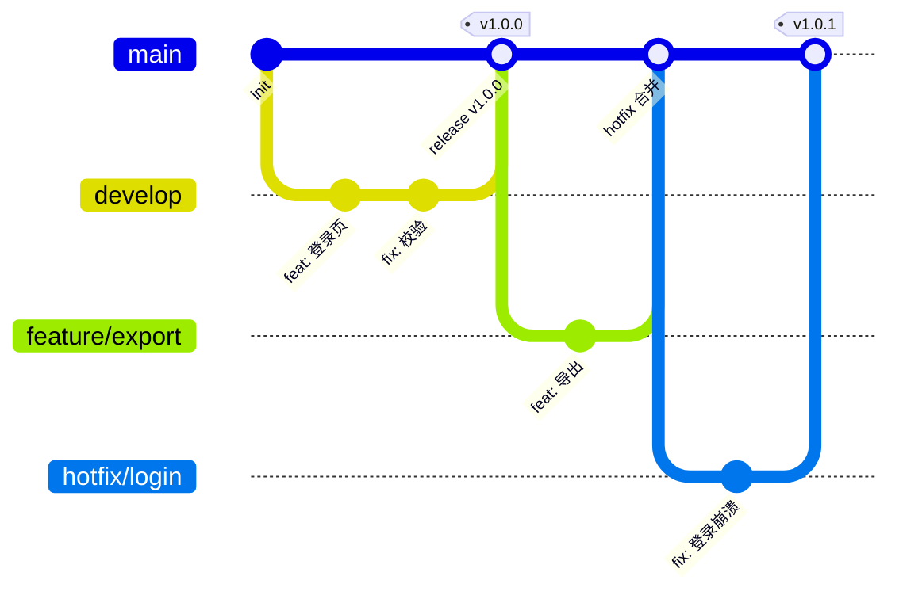

# 第 02 章 Git 工作流

> 难度：★☆☆　预计耗时：60 分钟
> 本章目标：搭起一套"流水线能依赖"的 Git 规范——分支模型、保护分支、提交信息、版本 Tag。做完之后，你的仓库能回答一个关键问题：**这次提交到底该不该上生产？**

---

## 一、为什么需要这一章

流水线不是凭空启动的，它需要一个**触发器**。而触发器背后是一套约定：

- 推到 `main` → 这是要上生产的代码 → 触发生产流水线
- 推到 `feature/xxx` → 这是开发中的代码 → 只跑测试，不部署
- 打了 `v1.2.0` 的 Tag → 这是一个正式版本 → 打镜像、归档、发 Release

**如果没有这套约定，流水线就是一台没有开关的机器。**

三个真实事故：

**事故一：直接往 main 推，把别人的代码冲掉了。**
小赵本地有个陈旧的分支，`git push origin main --force`，同事三天的提交原地蒸发。没有保护分支，Git 连警告都不给。

**事故二：Tag 被重打，回滚回了"不存在的版本"。**
`v1.2.0` 发布后发现有 bug，改完又打了一次 `v1.2.0`（而不是 `v1.2.1`）。结果两批不同的镜像用了同一个 tag，线上到底跑的哪个版本，谁也说不清。

**事故三：提交信息全是"update"。**
线上出问题要查"最近改了什么"，`git log` 输出 200 行 `update`、`fix bug`、`111`。最后只能靠时间猜。

> 这一章要建立的，就是让流水线"看得懂、靠得住"的 Git 规范。

---

## 二、原理图解：三种主流分支模型



| 模型 | 长什么样 | 适合谁 | 流水线怎么配 |
| --- | --- | --- | --- |
| **GitHub Flow** | 只有 `main` + 短生命周期 `feature/*`，全部走 PR | 大多数团队、持续交付、Web 项目 | main 合并即部署测试环境；打 Tag 部署生产 |
| **GitLab Flow** | `main` + 环境分支（`pre-production`/`production`） | 需要"多环境分别对应分支"的团队 | 推 `production` 分支 = 部署生产 |
| **Trunk-based** | 只有 `main`，功能靠开关（Feature Flag）藏在代码里 | 成熟团队、高频发布（一天多次） | main 每次合并都部署，靠开关控制可见性 |
| **Git Flow** | `main` + `develop` + `release/*` + `hotfix/*` | 版本型产品（客户端、需要长期维护多版本） | 复杂，本书不推荐新手用 |

**本书采用 GitHub Flow 的简化版**：

```text
main（受保护，永远可发布）
  └── feature/xxx   （开发新功能，1~3 天，合并后删除）
  └── fix/xxx       （修 bug）
  └── hotfix/xxx    （线上紧急修复，从 Tag 拉出）
```

理由：分支少、心智负担低、天然适配 CI/CD。Git Flow 的 `develop` 分支在持续交付场景里纯属多余负担。

---

## 三、动手步骤

### 步骤 1【本地】初始化仓库并做基础配置

在项目根目录执行：

```powershell
cd I:\work-body-dir\cicd-tutorial
git init -b main
git config user.name "你的名字"
git config user.email "you@example.com"
```

如果这台机器第一次用 Git，把换行符策略一次性设好（第 00 章讲过原因）：

```powershell
git config --global core.autocrlf input
git config --global init.defaultBranch main
git config --global pull.rebase true
```

三行分别解决：CRLF 事故、默认分支名五花八门、`git pull` 产生无意义的 merge 提交。

### 步骤 2【本地】写好 `.gitignore`

流水线会因为 `.gitignore` 写错而出各种怪事（把 `node_modules` 传上去导致构建超时、把 `.env` 传上去导致密钥泄露）。项目根目录的 `.gitignore`：

```gitignore
# 依赖
node_modules/
__pycache__/
*.pyc
.venv/
venv/

# 构建产物（流水线会重新构建，不要入库）
dist/
build/
*.tar.gz
*.jar

# 环境与密钥（最重要的一行）
.env
.env.*
!.env.example

# 日志与临时文件
*.log
.DS_Store
Thumbs.db
.idea/
.vscode/*
!.vscode/extensions.json

# 数据库文件（SQLite 数据不入库）
*.db
*.db-wal
*.db-shm
```

> **为什么 `dist/` 不能入库**：构建产物入库会导致"仓库里的 dist 和代码不一致"，而且每次构建都产生巨大 diff。产物应该由流水线生成并归档到制品库。

### 步骤 3【本地】第一次提交

```powershell
git add .
git status
git commit -m "chore: 初始化 CI/CD 教程项目骨架"
git log --oneline
```

预期输出：

```text
a1b2c3d (HEAD -> main) chore: 初始化 CI/CD 教程项目骨架
```

### 步骤 4【本地】分支命名与功能开发

命名规范（流水线可以据此决定行为）：

| 前缀 | 用途 | 流水线行为 |
| --- | --- | --- |
| `feature/` | 新功能 | 只跑测试与构建，不部署 |
| `fix/` | 普通 bug 修复 | 同上 |
| `hotfix/` | 线上紧急修复 | 跑全量测试，合并后立即允许上生产 |
| `chore/` | 杂活（依赖升级、配置） | 跑测试 |
| `docs/` | 只改文档 | 可以跳过构建（省时间） |

实操：

```powershell
git switch -c feature/add-health-page
```

改点东西（比如新建一个文件），然后：

```powershell
git add .
git commit -m "feat(web): 增加健康检查展示页"
git push -u origin feature/add-health-page
```

### 步骤 5【平台】配置分支保护（这一步决定流水线有没有权威）

以最常见的三家为例，配置位置不同，但**保护项必须一致**：

| 保护项 | 作用 | GitHub | GitLab | Gitea |
| --- | --- | --- | --- | --- |
| 禁止直接 push | main 只能通过 PR/MR 进入 | Settings → Branches → Add rule | Settings → Repository → Protected branches | 仓库设置 → 分支保护 |
| 必须通过流水线 | 红的流水线不许合并 | Require status checks | Pipelines must succeed | 启用状态检查 |
| 至少 1 人评审 | 防自己给自己合并 | Require approvals | Approvals required | 启用审批 |
| 禁止 force push | 防历史被改写 | 默认禁止 | 默认禁止 | 勾选 |
| 合并后删分支 | 保持仓库干净 | 自动删除选项 | 默认 | 手动 |

**验证方式**：配好后，直接在本地 `git push origin main` 推一次，应该被拒绝：

```text
remote: error: GH006: Protected branch update failed for refs/heads/main.
remote: error: Changes must be made through a pull request.
```

看到这个报错，说明保护生效了——**这正是你想要的**。

### 步骤 6【本地】提交信息规范：Conventional Commits

格式：

```text
<类型>(<范围>): <简短描述>

<可选正文>

<可选脚注>
```

类型必须从下表选：

| 类型 | 含义 | 会不会触发版本号变化 |
| --- | --- | --- |
| `feat` | 新功能 | 次版本号 +1（1.2.0 → 1.3.0） |
| `fix` | 修 bug | 修订号 +1（1.2.0 → 1.2.1） |
| `perf` | 性能优化 | 修订号 +1 |
| `refactor` | 重构（不改行为） | 不变 |
| `docs` | 文档 | 不变 |
| `test` | 测试 | 不变 |
| `build` / `ci` | 构建或流水线配置 | 不变 |
| `chore` | 杂活 | 不变 |
| `revert` | 回滚某次提交 | 视情况 |

**破坏性变更**用 `!` 标记，会触发主版本号 +1：

```text
feat(api)!: 移除 v1 登录接口

BREAKING CHANGE: /api/v1/login 已删除，请改用 /api/v2/auth/login
```

为什么要这么较真？因为后面可以让流水线**自动算版本号、自动生成 changelog**。提交信息是机器的输入，不是写给人看的散文。

### 步骤 7【本地】语义化版本与 Tag

语义化版本：`主版本.次版本.修订号`（`1.4.2`）

- 主版本：不兼容的改动（用户必须改代码）
- 次版本：向下兼容的新功能
- 修订号：向下兼容的 bug 修复

打 Tag 的规矩：

```powershell
# 附注标签（推荐，能带说明、有签名、有日期）
git tag -a v1.0.0 -m "首个可发布版本：登录 + 任务列表"
git push origin v1.0.0
```

**三条铁律**：

1. **Tag 一旦推送，永不修改**。有 bug 就发 `v1.0.1`，不要重打 `v1.0.0`。
2. 轻量标签（`git tag v1.0.0`）只适合临时标记，正式发布一律用附注标签。
3. Tag 名统一带 `v` 前缀，流水线用 `v*` 通配符匹配触发器。

如果手滑打错了（还没推送到远端）：

```powershell
git tag -d v1.0.0            # 删本地
git push origin :refs/tags/v1.0.0   # 如果已推送，删远端（危险，团队协作时先沟通）
```

### 步骤 8【本地】线上紧急修复：hotfix 流程

线上炸了，但 `main` 上已经有一堆没测完的新功能，不能直接发。做法：

```powershell
git fetch --tags
git switch -c hotfix/login-500 v1.0.0    # 从上一个正式版本的 Tag 拉分支
# 改代码、验证
git commit -am "fix(auth): 修复登录接口 500"
git push -u origin hotfix/login-500
```

然后在平台上：hotfix → PR 到 `main` → 流水线跑通 → 合并 → 打 `v1.0.1` → 部署生产。
最后把 `main` 上的修复也合回开发分支（避免下次发布又踩同一个坑）：

```powershell
git switch main
git merge hotfix/login-500     # 如果还没合并
```

---

## 四、完整实例：一次完整的迭代

目标：走完 `feature → PR → 合并 → 打 Tag`，并让每一步都能被流水线识别。

```powershell
# 1. 从最新的 main 拉功能分支
git switch main
git pull
git switch -c feature/task-list

# 2. 改两个文件，分两次提交（提交粒度小，回滚才精准）
git add demos/backend/app/main.py
git commit -m "feat(api): 增加任务列表接口 GET /api/tasks"

git add demos/frontend/src/App.vue
git commit -m "feat(web): 任务列表页对接后端接口"

# 3. 推送并创建 PR
git push -u origin feature/task-list
```

到平台上点 "New pull request"，**PR 描述模板**建议固定成这三段：

```markdown
## 改了什么
- 新增 GET /api/tasks 接口
- 前端任务列表页对接真实数据

## 怎么验证
1. 本地 `docker compose up`，访问 http://localhost:5173
2. 列表应显示 3 条示例任务

## 风险与回滚
- 只新增接口，无破坏性变更
- 回滚方式：镜像回退到上一 tag
```

合并后：

```powershell
git switch main
git pull
git tag -a v1.0.0 -m "v1.0.0 首个可发布版本"
git push origin v1.0.0
```

**验证成功的标准**：

- 平台上 `main` 分支显示"受保护"图标，且直接 push 会被拒绝
- PR 页面上能看到流水线状态（第 05 章会真正接上 Jenkins）
- `git log --oneline --graph` 能看到干净的一条主线
- `git tag -l` 能看到 `v1.0.0`

---

## 五、坑与排错

| 现象 | 根因 | 解法 |
| --- | --- | --- |
| `rejected: non-fast-forward` | 远端有你本地没有的提交 | `git pull --rebase` 后再推；**不要** `--force` |
| force push 覆盖了同事代码 | 在共享分支强推 | 立即通知团队；`git reflog` 找回旧提交，`git push --force-with-lease` 兜底（仍危险） |
| Tag 打错 / 需要重打 | 版本号没规划好 | 没推送就 `git tag -d`；已推送则**发新版本号**，不要动老 tag |
| 提交了 `.env` | `.gitignore` 漏了 | 立即改密钥（已泄露）；`git rm --cached .env`；历史清理用 `git filter-repo` |
| 大文件把仓库撑爆 | 把 `node_modules`/`dist` 入库 | `.gitignore`；已入库用 `git filter-repo --path 路径 --invert-paths` |
| 合并冲突解决完代码跑不起来 | 只看了冲突标记，没跑测试 | 解决后必须本地跑一遍构建 + 测试再提交 |
| `git pull` 每次都产生 merge 提交 | 没配 rebase | `git config --global pull.rebase true` |
| 中文文件名显示乱码 | `core.quotepath` | `git config --global core.quotepath false` |

---

## 六、横向对照：三家平台的等价操作

| 操作 | GitHub | GitLab | Gitea |
| --- | --- | --- | --- |
| 提合并请求 | Pull Request | Merge Request | Pull Request |
| 保护分支入口 | Settings → Branches | Settings → Repository → Protected branches | 仓库设置 → 分支保护 |
| 必须流水线通过 | Require status checks | Pipelines must succeed | 状态检查 |
| 打 Tag 后触发发布 | `on: push: tags: ['v*']` | `rules: - if: $CI_COMMIT_TAG` | Gitea Actions 同 GitHub |
| 自动生成 Release | Releases 页面 + Actions | Releases + CI | Releases |
| Webhook 地址 | Settings → Webhooks | Settings → Webhooks | 仓库设置 → Web 钩子 |

> 注意：Jenkins 不在这个表里，因为 Jenkins 通常**不自带仓库**，它靠 Webhook 从上面三家接收通知。第 05 章会讲三种仓库怎么分别接 Jenkins。

---

## 七、本章检查清单与练习

### 检查清单

- [ ] `main` 已设为保护分支，直接 push 会被拒绝
- [ ] `.gitignore` 覆盖了 `node_modules/`、`dist/`、`.env`
- [ ] 最近 5 条提交信息符合 Conventional Commits
- [ ] 会打附注标签，并知道为什么 Tag 不能重打
- [ ] 说得出 `feature/`、`fix/`、`hotfix/` 三种分支的区别与对应流水线行为

### 练习

**练习 1**：同事在你不知情的情况下 force push 覆盖了 `main`，怎么找回丢失的提交？
<details><summary>参考要点</summary>

在**本地还有旧提交**的机器上：`git reflog` 找到覆盖前的提交哈希 → `git branch rescue <哈希>` → 推上去。服务器端可查 `git reflog`（裸仓库也有）或用平台的"活动/审计日志"。
</details>

**练习 2**：为什么"打完 tag 发现有 bug，改完再打同一个 tag"是危险操作？
<details><summary>参考要点</summary>

同一个 tag 对应两个不同镜像/制品，破坏"制品不可变"；线上跑的版本无法用 tag 精确追溯；回滚会回到不确定内容。正确做法：发 `v1.0.1`。
</details>

**练习 3**：设计一套规则，让"只改文档的提交"不触发镜像构建。
<details><summary>参考要点</summary>

GitHub Actions 用 `paths-ignore: ['docs/**', '*.md']`；GitLab 用 `rules: changes:`；Jenkins 用 `when { changeset "docs/**" }` 取反。核心是**在触发条件层面就过滤掉**，而不是跑完再判断。
</details>

---

## 下一章预告

Git 规范立好了，第 03 章正式开始 Jenkins：为什么它必须跑在你本地而不是那台 2G 的服务器上（一张内存核算表说服你）、用 Docker 十分钟装好、以及第一次登录后必须改的五个设置。
