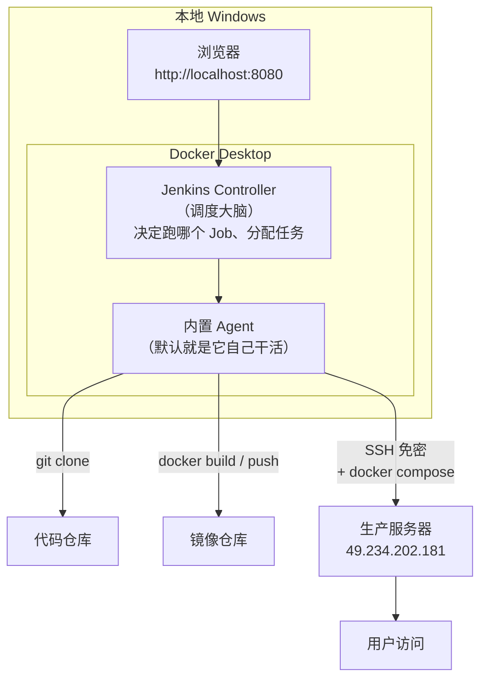

# 第 03 章 Jenkins 落地

> 难度：★★☆　预计耗时：60 分钟
> 本章目标：在你自己的 Windows 电脑上用 Docker 跑起一个 Jenkins，登录进去，并跑通第一条流水线。同时，你能用一张内存核算表，说服任何想把 Jenkins 装到生产服务器上的人。

---

## 一、为什么需要这一章

### 1.1 2026 年了，为什么还学 Jenkins？

你可能听过："Jenkins 又老又丑，早该用 GitHub Actions 了。"这话对一半。

| 场景 | 更合适的选择 | 原因 |
| --- | --- | --- |
| 开源项目、代码在 GitHub、公开仓库 | GitHub Actions | 免运维、额度够用、生态好 |
| 代码在自建 GitLab，团队已用 GitLab | GitLab CI | 一体机，配置就在仓库里 |
| **代码在内网 / 私有 Git / 需要访问内网生产机** | **Jenkins** | 云厂商的托管 Runner 摸不到你的内网 |
| **构建需要大内存 / GPU / 特殊硬件** | **Jenkins（自建 Agent）** | 托管 Runner 资源固定、费用高 |
| **需要精细到"谁能点部署生产"的权限** | **Jenkins** | 插件化的权限体系成熟 |
| 传统企业已有 Jenkins 资产 | **Jenkins** | 沉没成本也是成本 |

国内大量企业的真实情况是：代码在自建 GitLab 或 Gitea，生产机在内网，Jenkins 已经在跑了。**学会 Jenkins，等于能接住 70% 的国内岗位需求。** 而 GitHub Actions 的语法，你学完 Jenkins 再看，半小时就能上手（第 06 章会逐段对照）。

### 1.2 反面教材：为什么绝对不能把 Jenkins 装在这台服务器上

我们手上有一台 2 核 2G 的华为云 ECS，探测结果如下（真实输出）：

```text
Mem:           1.7Gi       1.7Gi        54Mi       4.0Mi        76Mi        14Mi
```

`used` 已经 1.7Gi，`available` 只剩 **14Mi**。再看内存都去哪儿了：

| 常驻进程 | 估算内存 | 说明 |
| --- | --- | --- |
| 系统 + SSH + 日志 | 350~450 MB | 省不掉 |
| Docker daemon | 80~120 MB | 要跑容器就必须有 |
| 宝塔面板 | 60~100 MB | 面板自身 + Python 进程 |
| 邮件服务（Postfix + Dovecot + Rspamd） | 300~500 MB | 占了 6 个端口 |
| MySQL 容器 | 300~400 MB | 业务数据 |
| Nginx | 20~30 MB | 反代 |
| **小计（在装 Jenkins 之前）** | **约 1.1~1.6 GB** | 已经接近 1.7G 上限 |

现在再加 Jenkins：

| 新增项 | 估算内存 | 说明 |
| --- | --- | --- |
| Jenkins JVM（Controller） | 600~800 MB | 官方建议 `-Xmx` 至少 512m，实际跑插件后 800m 起步 |
| 一次 `npm ci` 构建 | 300~600 MB | Node 装依赖时内存峰值很高 |
| 一次 `docker build` | 200~500 MB | 取决于基础镜像与层数 |
| **小计** | **1.1~1.9 GB** | 还没算操作系统页缓存 |

**结论：1.1~1.6 GB（现有）+ 1.1~1.9 GB（Jenkins）= 2.2~3.5 GB，而机器只有 1.7 GB 可用。** 唯一的结局是 OOM Killer 随机杀进程——它不会挑"不重要的"杀，大概率把你的 MySQL 或 SSH 会话干掉。

> **这就是本书的架构决策：Jenkins 跑在你本地 Windows 的 Docker 里，生产服务器只负责跑业务。**
> CI 与生产分离不是"讲究"，是 2G 机器的生存法则。

---

## 二、原理图解：Jenkins 到底是怎么干活的



两个角色，一定要分清：

- **Controller（控制器）**：大脑。存任务配置、调度、发指令、展示结果。它**不应该干重活**（编译、打包）。
- **Agent（代理/节点）**：手脚。真正执行 `sh` 命令的地方。默认情况下一台机器既当大脑又当手脚，就是"单机 Jenkins"。

> **餐厅比喻**：Controller 是店长（排班、接单、看板），Agent 是厨师（真正炒菜）。店长只有一个，厨师可以加。等你的流水线多到排队，就加厨师（第 17 章）。

---

## 三、动手步骤

### 步骤 1【本地】确认 Docker Desktop 可用，并给它足够内存

```powershell
docker version
docker compose version
```

预期能看到 `Server: Docker Desktop ...` 与 `Docker Compose version v2.x`。

**关键一步：调大 Docker Desktop 的内存。** 默认往往只有 2GB，装 Jenkins 后一跑构建就卡死。

Docker Desktop → 右上角齿轮 Settings → Resources → Memory 调到 **4GB 以上**（你机器有 16G 就调到 6~8G）→ Apply & Restart。

验证：

```powershell
docker info --format "{{.MemTotal}}"
```

输出应为 `4294967296`（4G）或更大。如果是 `2147483648`（2G），回去调。

### 步骤 2【本地】启动 Jenkins

项目里已备好 compose 文件 `pipelines/jenkins/docker-compose.jenkins.yml`，核心内容：

```yaml
services:
  jenkins:
    image: jenkins/jenkins:lts-jdk17
    container_name: jenkins
    restart: unless-stopped
    user: root
    ports:
      - "8080:8080"
      - "50000:50000"
    environment:
      TZ: Asia/Shanghai
      JAVA_OPTS: >-
        -Duser.timezone=Asia/Shanghai
        -Dfile.encoding=UTF-8
        -Xmx768m
        -XX:MaxMetaspaceSize=256m
    volumes:
      - jenkins-home:/var/jenkins_home
volumes:
  jenkins-home:
    name: jenkins-home
```

逐项解释（每一行都有原因，别照抄了不知道为什么）：

| 配置 | 为什么 |
| --- | --- |
| `jenkins/jenkins:lts-jdk17` | LTS 稳定版；带 JDK 17，跑现代插件不报"不支持 Java 8" |
| `container_name: jenkins` | 后面 `docker logs jenkins` 方便 |
| `user: root` | 避开 Windows 卷权限问题；企业环境应改成 `uid:gid` |
| `8080:8080` | Web 界面；宿主机 8080 被占就改左边，如 `18080:8080` |
| `50000:50000` | Agent 通信端口，第 17 章才用得上 |
| `TZ` + `-Duser.timezone` | 双保险：否则日志时间差 8 小时，定时任务在半夜跑 |
| `-Xmx768m` | 限制 JVM 堆，防止 Jenkins 吃光 Docker 的内存 |
| `-Xver...` 省略 | 本书不加多余参数 |
| 命名卷 `jenkins-home` | 所有配置、任务、凭据都在这；**删了它等于恢复出厂** |

启动：

```powershell
docker compose -f pipelines/jenkins/docker-compose.jenkins.yml up -d
docker compose -f pipelines/jenkins/docker-compose.jenkins.yml logs -f jenkins
```

首次启动要装插件，等待日志出现这一行（`Ctrl+C` 退出日志跟踪，不影响容器）：

```text
Jenkins initial setup is required. An admin user has been created and a password generated.
```

### 步骤 3【本地】取初始密码并登录

```powershell
docker exec jenkins cat /var/jenkins_home/secrets/initialAdminPassword
```

复制输出的一长串，浏览器打开 http://localhost:8080 ，粘贴。

> 如果提示"无法访问"，先 `docker ps` 看容器是不是 `Up`，再 `docker logs jenkins | Select-Object -Last 30` 看是否还在启动。

### 步骤 4【本地】装插件：只装你用得上的

界面会问"安装推荐的插件"还是"选择插件"。**选"选择插件"，先不装任何推荐插件**，然后按下面清单勾选（搜索框逐个搜）：

| 插件 | 干什么 | 哪一章用 |
| --- | --- | --- |
| Pipeline | 流水线核心（Declarative 语法） | 第 04 章 |
| Git | 拉代码 | 第 04 章 |
| Credentials Binding | 在流水线里安全引用凭据 | 第 05 章 |
| SSH Agent | 用 SSH 私钥连生产机 | 第 12 章 |
| Blue Ocean | 好看的流水线可视化界面 | 第 05 章 |
| Docker Pipeline | 流水线里 `docker.build` | 第 10 章 |
| GitHub Branch Source | 接 GitHub 多分支 | 第 05 章 |
| GitLab | 接 GitLab 的 Webhook 与多分支 | 第 05 章 |
| Workspace Cleanup | 每次构建前清理工作区（防脏缓存） | 第 16 章 |
| Timestamper | 给每行日志加时间戳（排错救命） | 全程 |
| AnsiColor | 日志带颜色 | 第 15 章 |
| Role-based Authorization Strategy | 细粒度权限（谁能部署生产） | 第 17 章 |

> **为什么不装"推荐插件"**：推荐清单有 100+ 个，装完 Jenkins 又慢又重，还容易版本冲突。用哪个装哪个，用完可以卸。

如果插件下载卡住（国内常见），可以在 **Manage Jenkins → Plugins → Advanced → Update Site** 把 URL 换成清华镜像：

```text
https://mirrors.tuna.tsinghua.edu.cn/jenkins/updates/update-center.json
```

> 镜像偶尔滞后于官方，装不上最新插件时换回来即可。

### 步骤 5【本地】建管理员、改三个设置

1. **创建第一个管理员用户**（不要跳过，也别用 `admin/admin`）。
2. **Manage Jenkins → System → 系统配置**
   - `Jenkins URL` 填 `http://localhost:8080/`（后面接 Webhook 时要改成公网可达地址）
   - `时区` 选 `Asia/Shanghai`
3. **Manage Jenkins → Security**：授权策略先用 `Logged-in users can do anything`（单机学习阶段），第 17 章再收紧。

### 步骤 6【本地】跑通第一条流水线

首页 → 新建任务 → 名称 `hello-pipeline` → 选 **Pipeline** → 确定。

在 Pipeline 脚本框里粘贴：

```groovy
pipeline {
    agent any

    options {
        timestamps()
        timeout(time: 5, unit: 'MINUTES')
    }

    stages {
        stage('打招呼') {
            steps {
                echo "你好，流水线！当前构建号：${env.BUILD_NUMBER}"
            }
        }
        stage('看看我在哪台机器上') {
            steps {
                sh 'whoami; hostname; uname -a; date'
            }
        }
        stage('故意失败一次（可选）') {
            when { expression { false } }
            steps {
                sh 'exit 1'
            }
        }
    }

    post {
        success { echo "构建成功，耗时 ${currentBuild.durationString}" }
        failure { echo "构建失败，去看日志" }
        always  { echo "无论成败都会执行：清理临时文件" }
    }
}
```

点 **立即构建** → 点构建号 → **Console Output**。预期：

```text
Started by user admin
[Pipeline] Start of Pipeline
[2026-11-11T14:52:01.123+08:00] [Pipeline] node
[Pipeline] stage
[Pipeline] { (打招呼)
[Pipeline] echo
你好，流水线！当前构建号：1
...
+ whoami
+ hostname
jenkins
+ uname -a
Linux jenkins 6.10.14-linuxkit ...
+ date
Wed Nov 11 14:52:02 CST 2026
[Pipeline] End of Pipeline
Finished: SUCCESS
```

**三个观察点**：

1. `whoami` 输出 `jenkins`（不是 `root`，虽然我们设了 `user: root`，容器内 Jenkins 进程仍是 jenkins 用户），说明**命令跑在容器里，不是你的 Windows 上**。
2. 时间显示 `CST`，说明时区配置生效。
3. 每一行日志前面有时间戳，这是 `timestamps()` 的功劳——**排错时没有它，你会疯**。

### 步骤 7【本地】备份与升级（现在做一次，以后感谢自己）

备份（PowerShell，注意 `${PWD}` 要能正确展开）：

```powershell
docker run --rm -v jenkins-home:/data -v "${PWD}:/backup" alpine tar czf /backup/jenkins-home-20261111.tar.gz -C /data .
dir jenkins-home-*.tar.gz
```

恢复（危险操作，先停容器）：

```powershell
docker compose -f pipelines/jenkins/docker-compose.jenkins.yml down
docker run --rm -v jenkins-home:/data -v "${PWD}:/backup" alpine sh -c "rm -rf /data/* && tar xzf /backup/jenkins-home-20261111.tar.gz -C /data"
docker compose -f pipelines/jenkins/docker-compose.jenkins.yml up -d
```

升级：

```powershell
docker compose -f pipelines/jenkins/docker-compose.jenkins.yml pull
docker compose -f pipelines/jenkins/docker-compose.jenkins.yml up -d
```

> **升级前必做备份**。Jenkins 大版本升级偶尔会破坏插件兼容，回滚靠的就是这个 tar.gz。

---

## 四、完整实例：从零到"看到自己的第一条流水线"

把上面步骤串成一条可复制的命令序列（假设 Docker Desktop 已启动）：

```powershell
cd I:\work-body-dir\cicd-tutorial

# 1. 启动
docker compose -f pipelines/jenkins/docker-compose.jenkins.yml up -d

# 2. 等它就绪（看到 Jenkins is fully up and running）
docker compose -f pipelines/jenkins/docker-compose.jenkins.yml logs -f jenkins

# 3. 另开一个终端，取密码
docker exec jenkins cat /var/jenkins_home/secrets/initialAdminPassword

# 4. 浏览器打开 http://localhost:8080 ，粘贴密码，按步骤 4/5 配置

# 5. 验证容器与卷
docker ps --filter name=jenkins
docker volume inspect jenkins-home
```

**验证成功的标准**（缺一不可）：

- `docker ps` 里 `jenkins` 状态是 `Up (healthy)`
- 浏览器能进入 Jenkins 首页，右上角显示你创建的用户名
- `hello-pipeline` 构建号 #1 是绿色，Console Output 里有 `你好，流水线！`
- 日志时间与你的系统时间一致（都是 CST 的当前时间）

---

## 五、坑与排错

| 现象 | 根因 | 解法 |
| --- | --- | --- |
| `port is already allocated`（8080） | 本机有别的程序占 8080 | 改 compose 端口为 `18080:8080`，访问 http://localhost:18080 |
| 页面一直"Jenkins 正在启动" | 内存不足或插件初始化慢 | `docker stats jenkins` 看内存；给 Docker 加到 4G+；首次启动等 2~3 分钟 |
| `initialAdminPassword` 文件不存在 | 容器还没初始化完 | 等日志出现 `Please use the following password`；或 `docker logs jenkins` 里直接找 |
| 插件安装全部失败 | 网络访问不了 update center | 换清华镜像；或在 Docker Desktop 里配代理 |
| 构建卡在 `sh` 步骤 | 容器里缺命令（如 `docker`、`node`） | 基础镜像只有 Java + 少量工具；第 10 章会做专用镜像 |
| 日志时间差 8 小时 | 时区没生效 | 检查 `TZ` 与 `-Duser.timezone`；重启容器 |
| 重启 Docker Desktop 后 Jenkins 配置没了 | 用了 `down -v` 或没挂卷 | 只能重新配置，然后学会备份（步骤 7） |
| Windows 上 `sh` 步骤报 CRLF 错误 | 脚本是 CRLF | 仓库根有 `.gitattributes`；Jenkinsfile 里避免直接写多行 shell |
| 中文日志乱码 | 编码不是 UTF-8 | `-Dfile.encoding=UTF-8`（compose 里已有） |

---

## 六、横向对照：三个平台的"装"成本

| 维度 | Jenkins | GitHub Actions | GitLab CI |
| --- | --- | --- | --- |
| 初始成本 | 装 Docker + 拉镜像 + 配插件，约 30 分钟 | 零：建个 yml 就能跑 | 零（GitLab 自带） |
| 运行位置 | 你的机器 / 你的服务器 | GitHub 的机器 | GitLab 的 Runner 或自建 |
| 内网访问能力 | 强（就在你网里） | 弱（要自建 Runner） | 中（可自建 Runner） |
| 资源成本 | 自己出（内存/磁盘） | 免费额度 + 超额付费 | 免费额度 + 自建 Runner |
| 维护成本 | **高**：插件升级、磁盘清理、备份 | 低 | 中 |
| 定制上限 | 极高（Groovy 能写任意逻辑） | 中（受平台限制） | 中 |
| 适合场景 | 内网、复杂流程、老企业 | 开源、公开项目、快速起步 | GitLab 用户 |

> 一句话选型：**代码在内网、或者构建要碰内网机器，就 Jenkins；否则优先托管方案。** 本书两个都教，主推 Jenkins。

---

## 七、本章检查清单与练习

### 检查清单

- [ ] `docker ps` 里 Jenkins 是 `Up (healthy)`
- [ ] 能用 `docker exec` 取到初始密码，并成功登录
- [ ] 只装了清单里的 12 个插件，不是"推荐的 100 个"
- [ ] `hello-pipeline` 跑通，日志有时间戳、有 `whoami` 输出
- [ ] 做过一次备份，并知道恢复命令
- [ ] 能复述"为什么 Jenkins 不能装在 2G 生产机上"的三条理由

### 练习

**练习 1**：把 `hello-pipeline` 里的 `when { expression { false } }` 改成 `true`，重新构建，观察流水线变红时 `post` 段的执行顺序。
<details><summary>参考要点</summary>

`post` 中 `failure` 与 `always` 都会执行；`success` 不执行。顺序是 `failure` → `always`。这就是"构建失败也要清理现场"的落点。
</details>

**练习 2**：同事说他机器上 Jenkins 每次重启后任务全没了，可能是什么原因？给两条排查方向。
<details><summary>参考要点</summary>

① 启动时用了 `docker run` 没挂卷（数据在容器可写层，容器删了就没了）；② 用了 `docker compose down -v`。正确做法：命名卷或宿主机目录挂载 `/var/jenkins_home`，并定期备份。
</details>

**练习 3**：为什么 Jenkins 容器内 `whoami` 是 `jenkins`，即使 compose 里写了 `user: root`？
<details><summary>参考要点</summary>

镜像的 entrypoint 脚本会切到 `jenkins` 用户执行进程；`user: root` 只改变容器初始用户，不改变 Jenkins 进程身份。想以 root 跑流水线要额外配置（不推荐，安全性差）。
</details>

---

## 下一章预告

Jenkins 起来了，但界面里那串 Groovy 语法还没讲透。第 04 章拆解 Declarative Pipeline 的每个关键字：`agent` 有几种、`post` 为什么重要、`options` 里的超时和重试怎么救命、`input` 审批怎么做。学完你能写出结构清晰的 100 行 Jenkinsfile。
