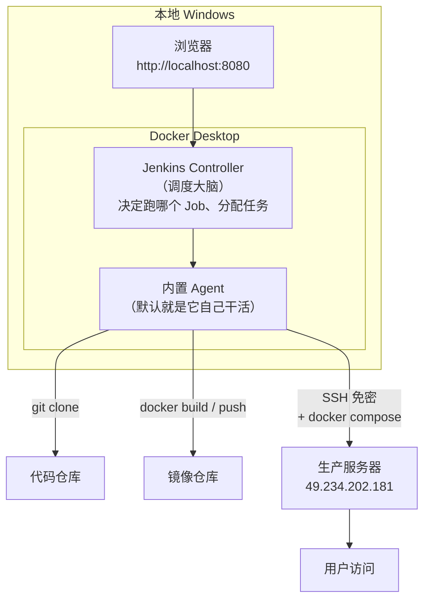

# 第 03 章 Jenkins 落地

> 难度：★★☆　预计耗时：60 分钟
> 本章目标：在你自己的 Windows 电脑上用 Docker 跑起一个 Jenkins，登录进去，并跑通第一条流水线。同时，你能用一张内存核算表，说服任何想把 Jenkins 装到生产服务器上的人。

---

## 一、为什么需要这一章

### 1.1 2026 年了，为什么还学 Jenkins？

你可能听过："Jenkins 又老又丑，早该用 GitHub Actions 了。"这话对一半。

| 场景 | 更合适的选择 | 原因 |
| --- | --- | --- |
| 开源项目、代码在 GitHub、公开仓库 | GitHub Actions | 免运维、额度够用、生态好 |
| 代码在自建 GitLab，团队已用 GitLab | GitLab CI | 一体机，配置就在仓库里 |
| **代码在内网 / 私有 Git / 需要访问内网生产机** | **Jenkins** | 云厂商的托管 Runner 摸不到你的内网 |
| **构建需要大内存 / GPU / 特殊硬件** | **Jenkins（自建 Agent）** | 托管 Runner 资源固定、费用高 |
| **需要精细到"谁能点部署生产"的权限** | **Jenkins** | 插件化的权限体系成熟 |
| 传统企业已有 Jenkins 资产 | **Jenkins** | 沉没成本也是成本 |

国内大量企业的真实情况是：代码在自建 GitLab 或 Gitea，生产机在内网，Jenkins 已经在跑了。**学会 Jenkins，等于能接住 70% 的国内岗位需求。** 而 GitHub Actions 的语法，你学完 Jenkins 再看，半小时就能上手（第 06 章会逐段对照）。

### 1.2 反面教材：为什么绝对不能把 Jenkins 装在这台服务器上

我们手上有一台 2 核 2G 的华为云 ECS，探测结果如下（真实输出）：

```text
Mem:           1.7Gi       1.7Gi        54Mi       4.0Mi        76Mi        14Mi
```

`used` 已经 1.7Gi，`available` 只剩 **14Mi**。再看内存都去哪儿了：

| 常驻进程 | 估算内存 | 说明 |
| --- | --- | --- |
| 系统 + SSH + 日志 | 350~450 MB | 省不掉 |
| Docker daemon | 80~120 MB | 要跑容器就必须有 |
| 宝塔面板 | 60~100 MB | 面板自身 + Python 进程 |
| 邮件服务（Postfix + Dovecot + Rspamd） | 300~500 MB | 占了 6 个端口 |
| MySQL 容器 | 300~400 MB | 业务数据 |
| Nginx | 20~30 MB | 反代 |
| **小计（在装 Jenkins 之前）** | **约 1.1~1.6 GB** | 已经接近 1.7G 上限 |

现在再加 Jenkins：

| 新增项 | 估算内存 | 说明 |
| --- | --- | --- |
| Jenkins JVM（Controller） | 600~800 MB | 官方建议 `-Xmx` 至少 512m，实际跑插件后 800m 起步 |
| 一次 `npm ci` 构建 | 300~600 MB | Node 装依赖时内存峰值很高 |
| 一次 `docker build` | 200~500 MB | 取决于基础镜像与层数 |
| **小计** | **1.1~1.9 GB** | 还没算操作系统页缓存 |

**结论：1.1~1.6 GB（现有）+ 1.1~1.9 GB（Jenkins）= 2.2~3.5 GB，而机器只有 1.7 GB 可用。** 唯一的结局是 OOM Killer 随机杀进程——它不会挑"不重要的"杀，大概率把你的 MySQL 或 SSH 会话干掉。

> **这就是本书的架构决策：Jenkins 跑在你本地 Windows 的 Docker 里，生产服务器只负责跑业务。**
> CI 与生产分离不是"讲究"，是 2G 机器的生存法则。

---

## 二、原理图解：Jenkins 到底是怎么干活的



两个角色，一定要分清：

- **Controller（控制器）**：大脑。存任务配置、调度、发指令、展示结果。它**不应该干重活**（编译、打包）。
- **Agent（代理/节点）**：手脚。真正执行 `sh` 命令的地方。默认情况下一台机器既当大脑又当手脚，就是"单机 Jenkins"。

> **餐厅比喻**：Controller 是店长（排班、接单、看板），Agent 是厨师（真正炒菜）。店长只有一个，厨师可以加。等你的流水线多到排队，就加厨师（第 17 章）。

---

## 三、动手步骤

### 步骤 1【本地】确认 Docker Desktop 可用，并给它足够内存

```powershell
docker version
docker compose version
```

预期能看到 `Server: Docker Desktop ...` 与 `Docker Compose version v2.x`。

**关键一步：调大 Docker Desktop 的内存。** 默认往往只有 2GB，装 Jenkins 后一跑构建就卡死。

Docker Desktop → 右上角齿轮 Settings → Resources → Memory 调到 **4GB 以上**（你机器有 16G 就调到 6~8G）→ Apply & Restart。

验证：

```powershell
docker info --format "{{.MemTotal}}"
```

输出应为 `4294967296`（4G）或更大。如果是 `2147483648`（2G），回去调。

### 步骤 2【本地】启动 Jenkins

项目里已备好 compose 文件 `pipelines/jenkins/docker-compose.jenkins.yml`，核心内容：

```yaml
services:
  jenkins:
    image: jenkins/jenkins:lts-jdk21
    container_name: jenkins
    restart: unless-stopped
    user: root
    ports:
      - "8080:8080"
      - "50000:50000"
    environment:
      TZ: Asia/Shanghai
      JAVA_OPTS: >-
        -Duser.timezone=Asia/Shanghai
        -Dfile.encoding=UTF-8
        -Xmx768m
        -XX:MaxMetaspaceSize=256m
    volumes:
      - jenkins-home:/var/jenkins_home
volumes:
  jenkins-home:
    name: jenkins-home
```

逐项解释（每一行都有原因，别照抄了不知道为什么）：

| 配置 | 为什么 |
| --- | --- |
| `jenkins/jenkins:lts-jdk21` | LTS 稳定版；带 JDK 21（JDK 17 已进入 EOL，Jenkins 2026-03 后不再支持，新装直接上 21） |
| `container_name: jenkins` | 后面 `docker logs jenkins` 方便 |
| `user: root` | 避开 Windows 卷权限问题；企业环境应改成 `uid:gid` |
| `8080:8080` | Web 界面；宿主机 8080 被占就改左边，如 `18080:8080` |
| `50000:50000` | Agent 通信端口，第 17 章才用得上 |
| `TZ` + `-Duser.timezone` | 双保险：否则日志时间差 8 小时，定时任务在半夜跑 |
| `-Xmx768m` | 限制 JVM 堆，防止 Jenkins 吃光 Docker 的内存 |
| `-Xver...` 省略 | 本书不加多余参数 |
| 命名卷 `jenkins-home` | 所有配置、任务、凭据都在这；**删了它等于恢复出厂** |

启动：

```powershell
docker compose -f pipelines/jenkins/docker-compose.jenkins.yml up -d
docker compose -f pipelines/jenkins/docker-compose.jenkins.yml logs -f jenkins
```

首次启动要装插件，等待日志出现这一行（`Ctrl+C` 退出日志跟踪，不影响容器）：

```text
Jenkins initial setup is required. An admin user has been created and a password generated.
```

### 步骤 3【本地】取初始密码并登录

```powershell
docker exec jenkins cat /var/jenkins_home/secrets/initialAdminPassword
```

复制输出的一长串，浏览器打开 http://localhost:8080 ，粘贴。

> 如果提示"无法访问"，先 `docker ps` 看容器是不是 `Up`，再 `docker logs jenkins | Select-Object -Last 30` 看是否还在启动。

### 步骤 4【本地】装插件：只装你用得上的

界面会问"安装推荐的插件"还是"选择插件"。**选"选择插件"，先不装任何推荐插件**，然后按下面清单勾选（搜索框搜**插件 ID**，不是界面显示名）：

| 插件（显示名） | **搜索用插件 ID** | 干什么 | 哪一章用 |
| --- | --- | --- | --- |
| Pipeline | `workflow-aggregator` | 流水线核心（Declarative 语法） | 第 04 章 |
| Git | `git` | 拉代码 | 第 04 章 |
| Credentials Binding | `credentials-binding` | 在流水线里安全引用凭据 | 第 05 章 |
| SSH Agent | `ssh-agent` | 用 SSH 私钥连生产机 | 第 12 章 |
| Blue Ocean | `blueocean` | 流水线可视化界面（**已停止活跃维护**，可选） | 第 05 章 |
| Docker Pipeline | `docker-workflow` | 流水线里 `docker.build` | 第 10 章 |
| GitHub Branch Source | `github-branch-source` | 接 GitHub 多分支 | 第 05 章 |
| GitLab | `gitlab-plugin` | 接 GitLab 的 Webhook 与多分支 | 第 05 章 |
| Workspace Cleanup | `ws-cleanup` | 每次构建前清理工作区（防脏缓存） | 第 16 章 |
| Timestamper | `timestamper` | 给每行日志加时间戳（排错救命） | 全程 |
| AnsiColor | `ansicolor` | 日志带颜色 | 第 15 章 |
| Role-based Authorization Strategy | `role-strategy` | 细粒度权限（谁能部署生产） | 第 17 章 |

> **为什么不装"推荐插件"**：推荐清单有 100+ 个，装完 Jenkins 又慢又重，还容易版本冲突。用哪个装哪个，用完可以卸。

**三个名字搜不到的插件，这样解决**（都是高频踩坑）：

| 你搜的 | 为什么搜不到 | 正确做法 |
| --- | --- | --- |
| `AnsiColor` | 显示名是连写的 `AnsiColor`，搜索索引按 ID `ansicolor` 匹配 | 搜 `ansi` 或 `ansicolor` |
| `Docker Pipeline` | 搜索按 ID 匹配，ID 是 `docker-workflow`，和显示名完全不同 | 搜 `docker-workflow` 或 `workflow`，在结果里认显示名 "Docker Pipeline" |
| `Blue Ocean` | 它是 60+ 个子插件的聚合包，且官方已宣布**停止活跃开发**，新版插件中心可能归入 Deprecated 分组排到很后面 | ① 搜 `blueocean`；② 还没有就手动装（见下）；③ **它不是必需品**——Jenkins 自带的 Stage View（构建页左侧）已够本书所有章节使用，实在装不上可以跳过 |

**兜底方案：手动上传 .hpi 安装**（镜像源滞后或搜索索引异常时）：

```text
1. 打开 https://plugins.jenkins.io/ 搜插件名（如 AnsiColor）
2. 进插件页 → Releases → 下载最新 .hpi 文件
3. Jenkins → Manage Jenkins → Plugins → Advanced settings
   → 拉到底 "Deploy Plugin" → 上传 .hpi → 勾 Restart
4. 容器方式额外一步：装完重启容器
   docker restart jenkins
```

> 手动装聚合包（如 Blue Ocean）时，`.hpi` 会自动带上依赖，一次性下齐，不用逐个装子插件。

**仍然搜不到任何插件的通用排查**：

```powershell
# 1. 先确认插件中心元数据加载成功（国内网络问题占八成）
#    Manage Jenkins → Plugins → Updates 页 → 点 "Check now"
#    若一直转圈或报错，按上面的清华镜像改 Update Site 后重试

# 2. 看容器日志有没有 update center 报错
docker logs jenkins | Select-String -Pattern "update|plugin" | Select-Object -Last 20

# 3. 改镜像后必须重启才生效
docker restart jenkins
```

如果插件下载卡住（国内常见），先**确认镜像地址还活着**再改，不要照抄网上过期链接（实测：清华的 `update-center.json` 路径已 404）：

```powershell
# 从容器里测三个地址，谁的 HTTP 码是 200/302 就用谁
docker run --rm --entrypoint curl jenkins/jenkins:lts-jdk21 -s -o /dev/null -m 20 -w "official: %{http_code}`n" "https://updates.jenkins.io/update-center.json?version=2.541.3"
docker run --rm --entrypoint curl jenkins/jenkins:lts-jdk21 -s -o /dev/null -m 20 -w "jenkins-zh: %{http_code}`n" "https://updates.jenkins-zh.cn/update-center.json?version=2.541.3"
```

> 2026-11 实测：官方源 302（可用，慢但能下）、`jenkins-zh` 不可达、清华该路径 404。**结论：优先用官方源 + 下面的 `jenkins-plugin-cli` 重试**，比折腾镜像稳。
>
> 若确实要换镜像：**Manage Jenkins → Plugins → Advanced settings → Update Site**，填 `curl` 验证过返回 200 的地址；改完必须 `docker restart jenkins` 才生效。

### 步骤 5【本地】建管理员、改三个设置

1. **创建第一个管理员用户**（不要跳过，也别用 `admin/admin`）。
2. **Manage Jenkins → System → 系统配置**
   - `Jenkins URL` 填 `http://localhost:8080/`（后面接 Webhook 时要改成公网可达地址）
   - `时区` 选 `Asia/Shanghai`
3. **Manage Jenkins → Security**：授权策略先用 `Logged-in users can do anything`（单机学习阶段），第 17 章再收紧。

### 步骤 5+【本地】首屏那一堆红黄警告，只处理两条

刚登录时 `Manage Jenkins` 顶部会刷出一屏警告，看着吓人，但严重程度完全不同。**先分类再动手，不要看到红色就乱点"升级"**：

| 警告 | 严重程度 | 要不要现在处理 |
| --- | --- | --- |
| `Pipeline: Model API ... Failed to load: Jackson 2 API Plugin` | 🔴 **真问题**：插件依赖缺失，Pipeline 语法可能整体不可用 | **必须处理**（见下） |
| `Java 17 end of life in Jenkins` | 🟠 环境过时：JDK 17 已停止支持 | 建议处理（见下，改镜像 JDK 21） |
| `Multiple security vulnerabilities in Jenkins 2.541.3 ...` | 🟠 版本旧：有已修复的漏洞 | 学习环境可暂缓；对外暴露前必须升 |
| `New version of Jenkins is available` | 🟡 提示 | 同上，和升级一起做 |
| `Building on the built-in node can be a security issue` | ⚪ 对单机学习无影响 | 点 **Dismiss** 即可（第 17 章再谈 Agent 隔离） |
| `CSP is disabled` | ⚪ 提示 | 点 **Dismiss** |

#### 处理 A：Jackson 2 API 加载失败（必做）

现象：某插件（这里是 `pipeline-model-api`）因依赖 `jackson2-api` 加载失败而报红。原因通常是**首次安装被网络中断**，包只下了一半。

```text
1. Manage Jenkins → Plugins → Installed plugins
   搜索 jackson2-api，看状态是不是 "Failed to load" / 版本异常
2. 切到 Updates 标签
   若有 jackson2-api 可更新，勾选 → "Download now and install after restart"
3. 勾 Restart Jenkins when installation is complete → 等它自己重启
4. 重启后回到 Manage Jenkins，红色横幅应消失
```

若列表里根本没有 `jackson2-api`，或升级后仍失败 → 手动装：`plugins.jenkins.io/jackson2-api` 下载 `.hpi` → Plugins → Advanced settings → Deploy Plugin 上传 → 重启。

**判断是否真的修好**：新建一个 Pipeline 任务，粘贴下面的最小脚本，能正常解析（不报 `No such DSL method 'pipeline'`）就说明 Pipeline 模型恢复：

```groovy
pipeline { agent any; stages { stage('ok') { steps { echo 'pipeline model ok' } } } }
```

#### 处理 B：JDK 17 到期（建议做，一条命令）

Jenkins 官方已明确 JDK 17 的支持终点（2026-03 之后不再支持），新环境直接用 JDK 21 镜像。**改镜像不会丢数据**——Jenkins 的配置、任务、插件全在命名卷 `jenkins-home` 里，容器只是"可替换的外壳"。

```powershell
# 1. 先备份卷（养成习惯，第 17 章会系统讲）
docker run --rm -v jenkins-home:/data -v ${PWD}:/backup alpine `
  tar czf /backup/jenkins-home-$(Get-Date -Format yyyyMMdd-HHmm).tar.gz -C /data .

# 2. 改 compose 里的镜像为 lts-jdk21（本项目文件已改好），然后重建容器
docker compose -f pipelines/jenkins/docker-compose.jenkins.yml pull
docker compose -f pipelines/jenkins/docker-compose.jenkins.yml up -d

# 3. 等 1~2 分钟，看启动日志
docker logs -f jenkins
#    见到 "Jenkins is fully up and running" 即成功
```

> **注意**：`lts-jdk21` 指向的是**当前最新 LTS**，所以这一步实际上同时完成了"换 JDK"和"升级 Jenkins 核心"。升级后插件可能需要重装或升级一次（旧插件偶尔不兼容新核心），这也是为什么先备份。若升级后 Jenkins 起不来，回退方法：把镜像改回原 tag（或用备份包恢复卷）再 `up -d`。

**升级顺序建议**：先 A（修插件）→ 再 B（换 JDK/升核心）→ 最后统一在 `Plugins → Updates` 里升级插件并重启一次。反过来的话，你可能在"核心已换、插件还半坏"的状态下排查两件事，很痛苦。

#### 处理 A+：依赖级联失败（一次报出十几个 Failed to load）

真实现象长这样（首次安装被中断后最常见）：

```text
Failed to load: Jackson 2 API Plugin (jackson2-api ...)
 - Plugin is missing: jaxb (2.3.9-143...)
Failed to load: Branch API Plugin (branch-api ...)
 - Plugin is missing: cloudbees-folder (6.1053...)
Failed to load: GitHub API Plugin (github-api ...)
 - Failed to load: Jackson 2 API Plugin (...)
Failed to load: GitHub plugin (github ...)
 - Failed to load: GitHub API Plugin (...)
Failed to load: JUnit Plugin (junit ...)
 - Failed to load: ECharts API Plugin (...)
Failed to load: Matrix Project Plugin (...)   ← 依赖 junit
Failed to load: Pipeline (workflow-aggregator) ← 依赖下游一串
```

**别逐个修那十几个**。看每条的第二行——`Plugin is missing: xxx` 才是根因，其余都是它的下游。上例的根只有两个：`jaxb` 和 `cloudbees-folder`。

**诊断（先在容器里确认谁真的缺）**：

```powershell
docker exec jenkins ls /var/jenkins_home/plugins | Select-String -Pattern "^jaxb|^cloudbees-folder|^jackson2-api"
# 无输出 = 该插件文件确实不存在（下载失败），不是"版本不兼容"
```

**修复（两条命令，比点界面可靠）**：

```powershell
# 用官方镜像自带的插件安装器，按 ID 安装缺失的根依赖
docker exec jenkins jenkins-plugin-cli --plugins jaxb cloudbees-folder

# 重启让插件按依赖顺序重新加载
docker restart jenkins
```

> `jenkins-plugin-cli` 会自动拉齐这两个插件的传递依赖。它比 UI 的优势：有明确报错、可重复执行、可写进 Dockerfile（第 17 章"插件清单化"就靠它）。

**验证**：重启后 `Manage Jenkins` 顶部的加载失败横幅应全部消失。若还剩个别，再按同样的方法看它缺什么——通常最多两轮就干净了。

```powershell
# 看真实失败原因（UI 只显示第一层，日志里有完整的）
docker logs jenkins | Select-String -Pattern "SEVERE|Failed to load|Plugin is missing" | Select-Object -Last 30
```

> **为什么会出现这种局面**：向导页一次性下载几十个插件，国内网络下中途断掉，Jenkins 会装上"主插件"却漏掉"依赖插件"，于是表面上装成功了、重启后却整片飘红。**这也是本书建议"向导里什么都不选、登录后用 `jenkins-plugin-cli` 按清单装"的原因**——清单可控、失败可重试。

**完整修复实录（2026-11 真实案例，照此操作）**

现象：`Manage Jenkins` 顶部一次报出 10+ 条 `Failed to load`，逐条看是 `Plugin is missing: jaxb` / `Plugin is missing: cloudbees-folder` / `Plugin is missing: workflow-basic-steps`……逐个在 UI 里补装，补完又冒出新的缺失。

```powershell
# ① 先看插件目录：0 字节的 .tmp = 下载失败留下的残骸；.bak = 升级中断
docker exec jenkins bash -c "ls -l /var/jenkins_home/plugins/*.tmp /var/jenkins_home/plugins/*.bak 2>/dev/null"

# ② 看真实原因（UI 只显示第一层，日志里有关键的 SEVERE + 镜像地址）
docker logs jenkins 2>&1 | Select-String -Pattern "Failed to install|Plugin is missing" | Select-Object -Last 10
#   典型行：Failed to load https://updates.jenkins.io/download/plugins/jaxb/...
#            → https://mirror.ossplanet.net/jenkins/plugins/jaxb/...    ← 网络超时

# ③ 停机，用官方安装器一次性补齐整个依赖图（--user root 必需：数据卷里的文件属主是 root）
docker stop jenkins
docker run --rm --user root -v jenkins-home:/var/jenkins_home --entrypoint bash jenkins/jenkins:lts-jdk21 -c `
  "rm -f /var/jenkins_home/plugins/*.tmp /var/jenkins_home/plugins/*.bak; jenkins-plugin-cli --plugin-download-directory /var/jenkins_home/plugins --plugins 'workflow-aggregator git credentials-binding ssh-agent docker-workflow github-branch-source gitlab-plugin ws-cleanup timestamper ansicolor role-strategy matrix-auth'"
#   输出只有一行 "Done" 就是成功（它把传递依赖一起装齐，共约 88 个 .jpi）

# ④ 启动并验证
docker start jenkins
Start-Sleep -Seconds 80
docker logs jenkins --since 3m 2>&1 | Select-String -Pattern "Failed to load|Plugin is missing"     # 应无输出
docker logs jenkins --since 3m 2>&1 | Select-String -Pattern "Started all plugins|fully up and running"
```

**三个必须记住的细节**：

1. **`--user root` 不能省**。官方镜像默认以 `jenkins`（uid 1000）运行，而你的 compose 用了 `user: root`，数据卷里的插件文件属主是 root——不加这个参数就会看到一串 `Permission denied`。
2. **不要试图用镜像源绕**。实测清华的 `update-center.json` 已 404、`jenkins-zh` 不可达；官方源虽慢，但 `jenkins-plugin-cli` 支持重试，一次 `Done` 比反复点界面高效。
3. **`Done` 只是"下载完成"，不代表"加载成功"**。必须看启动日志里有没有 `Failed to load`，以及是否出现 **`Started all plugins`**——那才是真正干净的信号。

### 步骤 6【本地】跑通第一条流水线

首页 → 新建任务 → 名称 `hello-pipeline` → 选 **Pipeline** → 确定。

在 Pipeline 脚本框里粘贴：

```groovy
pipeline {
    agent any

    options {
        timestamps()
        timeout(time: 5, unit: 'MINUTES')
    }

    stages {
        stage('打招呼') {
            steps {
                echo "你好，流水线！当前构建号：${env.BUILD_NUMBER}"
            }
        }
        stage('看看我在哪台机器上') {
            steps {
                sh 'whoami; hostname; uname -a; date'
            }
        }
        stage('故意失败一次（可选）') {
            when { expression { false } }
            steps {
                sh 'exit 1'
            }
        }
    }

    post {
        success { echo "构建成功，耗时 ${currentBuild.durationString}" }
        failure { echo "构建失败，去看日志" }
        always  { echo "无论成败都会执行：清理临时文件" }
    }
}
```

点 **立即构建** → 点构建号 → **Console Output**。预期：

```text
Started by user admin
[Pipeline] Start of Pipeline
[2026-11-11T14:52:01.123+08:00] [Pipeline] node
[Pipeline] stage
[Pipeline] { (打招呼)
[Pipeline] echo
你好，流水线！当前构建号：1
...
+ whoami
+ hostname
jenkins
+ uname -a
Linux jenkins 6.10.14-linuxkit ...
+ date
Wed Nov 11 14:52:02 CST 2026
[Pipeline] End of Pipeline
Finished: SUCCESS
```

**三个观察点**：

1. `whoami` 输出 `jenkins`（不是 `root`，虽然我们设了 `user: root`，容器内 Jenkins 进程仍是 jenkins 用户），说明**命令跑在容器里，不是你的 Windows 上**。
2. 时间显示 `CST`，说明时区配置生效。
3. 每一行日志前面有时间戳，这是 `timestamps()` 的功劳——**排错时没有它，你会疯**。

### 步骤 7【本地】备份与升级（现在做一次，以后感谢自己）

备份（PowerShell，注意 `${PWD}` 要能正确展开）：

```powershell
docker run --rm -v jenkins-home:/data -v "${PWD}:/backup" alpine tar czf /backup/jenkins-home-20261111.tar.gz -C /data .
dir jenkins-home-*.tar.gz
```

恢复（危险操作，先停容器）：

```powershell
docker compose -f pipelines/jenkins/docker-compose.jenkins.yml down
docker run --rm -v jenkins-home:/data -v "${PWD}:/backup" alpine sh -c "rm -rf /data/* && tar xzf /backup/jenkins-home-20261111.tar.gz -C /data"
docker compose -f pipelines/jenkins/docker-compose.jenkins.yml up -d
```

升级：

```powershell
docker compose -f pipelines/jenkins/docker-compose.jenkins.yml pull
docker compose -f pipelines/jenkins/docker-compose.jenkins.yml up -d
```

> **升级前必做备份**。Jenkins 大版本升级偶尔会破坏插件兼容，回滚靠的就是这个 tar.gz。

---

## 四、完整实例：从零到"看到自己的第一条流水线"

把上面步骤串成一条可复制的命令序列（假设 Docker Desktop 已启动）：

```powershell
cd I:\work-body-dir\cicd-tutorial

# 1. 启动
docker compose -f pipelines/jenkins/docker-compose.jenkins.yml up -d

# 2. 等它就绪（看到 Jenkins is fully up and running）
docker compose -f pipelines/jenkins/docker-compose.jenkins.yml logs -f jenkins

# 3. 另开一个终端，取密码
docker exec jenkins cat /var/jenkins_home/secrets/initialAdminPassword

# 4. 浏览器打开 http://localhost:8080 ，粘贴密码，按步骤 4/5 配置

# 5. 验证容器与卷
docker ps --filter name=jenkins
docker volume inspect jenkins-home
```

**验证成功的标准**（缺一不可）：

- `docker ps` 里 `jenkins` 状态是 `Up (healthy)`
- 浏览器能进入 Jenkins 首页，右上角显示你创建的用户名
- `hello-pipeline` 构建号 #1 是绿色，Console Output 里有 `你好，流水线！`
- 日志时间与你的系统时间一致（都是 CST 的当前时间）

---

## 五、坑与排错

| 现象 | 根因 | 解法 |
| --- | --- | --- |
| `port is already allocated`（8080） | 本机有别的程序占 8080 | 改 compose 端口为 `18080:8080`，访问 http://localhost:18080 |
| 页面一直"Jenkins 正在启动" | 内存不足或插件初始化慢 | `docker stats jenkins` 看内存；给 Docker 加到 4G+；首次启动等 2~3 分钟 |
| `initialAdminPassword` 文件不存在 | 容器还没初始化完 | 等日志出现 `Please use the following password`；或 `docker logs jenkins` 里直接找 |
| 插件安装全部失败 | 网络访问不了 update center | 换清华镜像；或在 Docker Desktop 里配代理 |
| 构建卡在 `sh` 步骤 | 容器里缺命令（如 `docker`、`node`） | 基础镜像只有 Java + 少量工具；第 10 章会做专用镜像 |
| 日志时间差 8 小时 | 时区没生效 | 检查 `TZ` 与 `-Duser.timezone`；重启容器 |
| 重启 Docker Desktop 后 Jenkins 配置没了 | 用了 `down -v` 或没挂卷 | 只能重新配置，然后学会备份（步骤 7） |
| Windows 上 `sh` 步骤报 CRLF 错误 | 脚本是 CRLF | 仓库根有 `.gitattributes`；Jenkinsfile 里避免直接写多行 shell |
| 中文日志乱码 | 编码不是 UTF-8 | `-Dfile.encoding=UTF-8`（compose 里已有） |

---

## 六、横向对照：三个平台的"装"成本

| 维度 | Jenkins | GitHub Actions | GitLab CI |
| --- | --- | --- | --- |
| 初始成本 | 装 Docker + 拉镜像 + 配插件，约 30 分钟 | 零：建个 yml 就能跑 | 零（GitLab 自带） |
| 运行位置 | 你的机器 / 你的服务器 | GitHub 的机器 | GitLab 的 Runner 或自建 |
| 内网访问能力 | 强（就在你网里） | 弱（要自建 Runner） | 中（可自建 Runner） |
| 资源成本 | 自己出（内存/磁盘） | 免费额度 + 超额付费 | 免费额度 + 自建 Runner |
| 维护成本 | **高**：插件升级、磁盘清理、备份 | 低 | 中 |
| 定制上限 | 极高（Groovy 能写任意逻辑） | 中（受平台限制） | 中 |
| 适合场景 | 内网、复杂流程、老企业 | 开源、公开项目、快速起步 | GitLab 用户 |

> 一句话选型：**代码在内网、或者构建要碰内网机器，就 Jenkins；否则优先托管方案。** 本书两个都教，主推 Jenkins。

---

## 七、本章检查清单与练习

### 检查清单

- [ ] `docker ps` 里 Jenkins 是 `Up (healthy)`
- [ ] 能用 `docker exec` 取到初始密码，并成功登录
- [ ] 只装了清单里的 12 个插件，不是"推荐的 100 个"
- [ ] `hello-pipeline` 跑通，日志有时间戳、有 `whoami` 输出
- [ ] 做过一次备份，并知道恢复命令
- [ ] 能复述"为什么 Jenkins 不能装在 2G 生产机上"的三条理由

### 练习

**练习 1**：把 `hello-pipeline` 里的 `when { expression { false } }` 改成 `true`，重新构建，观察流水线变红时 `post` 段的执行顺序。
<details><summary>参考要点</summary>

`post` 中 `failure` 与 `always` 都会执行；`success` 不执行。顺序是 `failure` → `always`。这就是"构建失败也要清理现场"的落点。
</details>

**练习 2**：同事说他机器上 Jenkins 每次重启后任务全没了，可能是什么原因？给两条排查方向。
<details><summary>参考要点</summary>

① 启动时用了 `docker run` 没挂卷（数据在容器可写层，容器删了就没了）；② 用了 `docker compose down -v`。正确做法：命名卷或宿主机目录挂载 `/var/jenkins_home`，并定期备份。
</details>

**练习 3**：为什么 Jenkins 容器内 `whoami` 是 `jenkins`，即使 compose 里写了 `user: root`？
<details><summary>参考要点</summary>

镜像的 entrypoint 脚本会切到 `jenkins` 用户执行进程；`user: root` 只改变容器初始用户，不改变 Jenkins 进程身份。想以 root 跑流水线要额外配置（不推荐，安全性差）。
</details>

---

## 下一章预告

Jenkins 起来了，但界面里那串 Groovy 语法还没讲透。第 04 章拆解 Declarative Pipeline 的每个关键字：`agent` 有几种、`post` 为什么重要、`options` 里的超时和重试怎么救命、`input` 审批怎么做。学完你能写出结构清晰的 100 行 Jenkinsfile。
