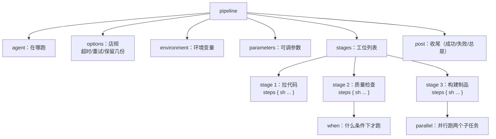

# 第 04 章 Pipeline 语法

> 难度：★★☆　预计耗时：90 分钟（含动手）
> 本章目标：能独立写出 100 行的 Declarative Pipeline，结构清晰、有超时、有重试、失败会通知、不会把 Jenkins 卡死。

---

## 一、为什么需要这一章

第 03 章我们点着界面跑了个 `echo`。真实项目里，流水线要做十几件事：拉代码、装依赖、跑检查、跑测试、构建、打镜像、推仓库、部署、验证、通知。

如果这些全塞在一个 `steps` 里，会变成这样：

```groovy
sh 'npm ci && npm run lint && npm run test && npm run build && docker build -t x . && docker push x && ssh ...'
```

问题立刻出现：

1. **看不出哪一步失败了**——日志几千行，报错藏在中间。
2. **没有超时**——某次 `npm ci` 卡在网络上，这条流水线会挂一整天，占着执行器，后面所有任务排队。
3. **失败后不清理**——工作区留着一堆脏文件，下次构建被污染。
4. **没法重试**——网络抖动导致的失败，只能手动再点一次。

Declarative Pipeline 就是为解决这四件事设计的**结构化语法**。

> **餐厅比喻**：`stages` 是流水线上的工位，`steps` 是每个工位上的动作，`post` 是收工后的大扫除，`options` 是店规（超过 20 分钟没出锅就报警）。

---

## 二、原理图解：一份 Jenkinsfile 的骨架



顺序记住一句话：**先声明在哪跑（agent），再定规矩（options/environment/parameters），然后干活（stages），最后收尾（post）。**

---

## 三、动手步骤

### 步骤 1 认识两种写法，并选定一种

| 维度 | Declarative（声明式） | Scripted（脚本式） |
| --- | --- | --- |
| 开头 | `pipeline { }` | `node { }` |
| 可读性 | 高，结构固定 | 低，全靠自觉 |
| 学习成本 | 低 | 中（要会 Groovy） |
| 灵活度 | 中（复杂逻辑要 `script {}` 包起来） | 极高（任意 Groovy） |
| 报错提示 | 友好（"缺少 stages"） | 晦涩（Groovy 异常栈） |
| 适用 | **99% 的场景** | 动态生成 stage、复杂循环 |

**本书全部用 Declarative**。确实需要写复杂逻辑时，用一个 `script { }` 块包起来即可，不必整份换成 Scripted。

### 步骤 2 `agent`：任务在哪儿跑

五种写法，按需选：

```groovy
// ① 任意可用节点（单机 Jenkins 就是它自己）
agent any

// ② 不在顶层指定，由每个 stage 自己决定（适合多环境混合）
agent none

// ③ 指定标签的节点（第 17 章自建 Agent 用）
agent { label 'linux && docker' }

// ④ 在指定镜像的容器里跑（环境隔离最干净）
agent {
    docker {
        image 'node:20-alpine'
        args '-v /tmp:/tmp'
        reuseNode true
    }
}

// ⑤ 用仓库里的 Dockerfile 构建临时镜像再跑
agent {
    dockerfile {
        filename 'deploy/Dockerfile.backend'
        dir '.'
    }
}
```

**怎么选**：

- 学习和简单项目：`agent any`。
- 需要多个不同环境（前端 Node、后端 Python）：顶层 `agent none`，每个 stage 单独指定 `agent { docker { ... } }`。
- 企业生产：`label` + 专用 Agent，把"能部署生产"的 Agent 单独隔离（第 17 章）。

> **坑**：`agent none` 时，如果某个 stage 没写自己的 agent，会报 `Required context class hudson.FilePath is missing`。顶层用 `agent none`，**每个 stage 都必须显式声明**。

### 步骤 3 `options`：四条能救命的店规

```groovy
options {
    timestamps()                                  // 每行日志加时间戳
    timeout(time: 20, unit: 'MINUTES')            // 整条流水线最多跑 20 分钟
    retry(2)                                      // 整体失败重试 2 次（慎用，见下）
    buildDiscarder(logRotator(numToKeepStr: '20', artifactNumToKeepStr: '5')) // 只留 20 次构建
    disableConcurrentBuilds()                     // 同一条流水线不许并发（部署类必加）
    skipDefaultCheckout(true)                     // 不自动 checkout，由第一步自己做
    ansiColor('xterm')                            // 彩色日志
}
```

四条"救命"的说明：

| 选项 | 不写会怎样 | 建议 |
| --- | --- | --- |
| `timeout` | 卡死的构建永远占着执行器，队列越来越长 | **每条流水线都写**，按正常耗时的 2 倍设 |
| `buildDiscarder` | 半年后 `/var/jenkins_home` 几十 GB，磁盘满、Jenkins 崩 | **都写**，`numToKeepStr: 20` 起步 |
| `disableConcurrentBuilds` | 两次部署同时进行，容器互相覆盖，线上出现"半新半旧" | **部署类流水线必加** |
| `retry` | 偶发网络失败要人工点重试 | 只对"幂等且易抖动"的整条流水线用；**部署步骤不要整体 retry**（会重复发布） |

更精细的重试应该放在**单个 step** 上：

```groovy
retry(3) {
    sh 'npm ci --prefer-offline'
}
```

### 步骤 4 `environment`：环境变量的三个来源

```groovy
environment {
    APP_NAME     = 'cicd-demo'
    BUILD_VERSION = "${env.BUILD_NUMBER}"                        // 引用 Jenkins 内置变量
    GIT_SHA      = sh(returnStdout: true, script: 'git rev-parse --short HEAD').trim()
    NODE_ENV     = 'production'
}
```

三个来源要分清：

| 来源 | 写法 | 安全性 | 用在哪 |
| --- | --- | --- | --- |
| 明文配置 | `APP_NAME = 'cicd-demo'` | 低（日志可见） | 应用名、端口、路径 |
| 凭据 | `withCredentials([...]) { }` | 高（日志打码） | 密码、Token、SSH 私钥 |
| 构建时注入 | `parameters` + `params.XXX` | 中 | 分支名、部署开关 |

**铁律：密钥只能走 `withCredentials`，绝不能写在 `environment` 里**。写在 `environment` 的密钥会出现在 `env` 输出、日志、甚至 Blue Ocean 界面上（第 05 章详细讲）。

`withCredentials` 用法预览（第 05 章配合凭据创建一起练）：

```groovy
withCredentials([sshUserPrivateKey(credentialsId: 'deploy-ssh-key', keyFileVariable: 'SSH_KEY')]) {
    sh 'ssh -i "$SSH_KEY" ubuntu@49.234.202.181 "echo 连上了"'
}
```

### 步骤 5 `parameters`：让流水线可配置

```groovy
parameters {
    string(name: 'BRANCH', defaultValue: 'main', description: '要构建的分支')
    choice(name: 'ENV', choices: ['staging', 'prod'], description: '部署到哪个环境')
    booleanParam(name: 'SKIP_TESTS', defaultValue: false, description: '跳过测试（仅紧急时用）')
    password(name: 'TEMP_TOKEN', defaultValue: '', description: '临时令牌，仅在本次构建有效')
}
```

注意两个坑：

1. **参数只在"下一次构建"生效**：第一次构建时 `params.ENV` 可能为空，代码要写兜底：`def target = params.ENV ?: 'staging'`。
2. `password` 类型参数不会打码到所有位置，敏感信息仍建议用凭据。

### 步骤 6 `when`：什么条件下才跑这个 stage

```groovy
stage('部署生产') {
    when {
        branch 'main'                                  // 只在 main 分支
        environment name: 'DEPLOY_ENV', value: 'prod'  // 环境变量匹配
        expression { params.ENV == 'prod' }            // 任意表达式
        changeset 'demos/backend/**'                   // 只有后端文件变了
        not { branch 'feature/*' }                     // 取反
        allOf { branch 'main'; expression { !params.SKIP_TESTS } }
        anyOf { branch 'main'; branch 'release/*' }
    }
    steps { echo '部署生产' }
}
```

**最常用的组合**：

```groovy
when {
    allOf {
        branch 'main'
        not { changeset 'docs/**' }   // 只改文档就不部署
    }
}
```

### 步骤 7 `post`：收尾比开头更重要

```groovy
post {
    always   { echo '无论成败都执行：清理工作区、归档日志' }
    success  { echo '成功：更新部署记录' }
    failure  { echo '失败：发告警、保留现场' }
    unstable { echo '不稳定：测试有失败但构建没红' }
    aborted  { echo '被手动中止' }
    cleanup  { cleanWs() }   // 所有其他 post 执行完之后
}
```

执行顺序（很多人不知道）：`always` → `success`/`failure`/`unstable`/`aborted`（只执行其中一个）→ `cleanup`。

`cleanup` 和 `always` 的区别：`cleanup` 一定最后跑，且**即使前面的 post 报错也会跑**。所以资源释放（关容器、删临时文件）写 `cleanup`。

### 步骤 8 `parallel`：并行省时间

```groovy
stage('质量门禁') {
    failFast true
    parallel {
        stage('前端检查') {
            agent { docker { image 'node:20-alpine'; reuseNode true } }
            steps {
                dir('demos/frontend') {
                    sh 'npm ci'
                    sh 'npm run lint'
                    sh 'npm run test'
                }
            }
        }
        stage('后端检查') {
            agent { docker { image 'python:3.11-slim'; reuseNode true } }
            steps {
                dir('demos/backend') {
                    sh 'pip install -r requirements.txt'
                    sh 'pytest'
                }
            }
        }
    }
}
```

`failFast true`：一个分支失败，立刻取消其他分支。**不加的话，前端挂了后端还会跑完，白等 3 分钟。**

> 注意：并行分支会抢占执行器。单机 Jenkins 只有 2 个执行器时，3 个并行 stage 会排队。执行器数量在 **Manage Jenkins → Nodes → 内置节点 → 配置 → 执行器数量** 调整（本地机器可以调到 4）。

### 步骤 9 `input`：人工审批（部署生产的守门人）

```groovy
stage('等待审批') {
    when { branch 'main' }
    steps {
        timeout(time: 30, unit: 'MINUTES') {
            input message: "确认把 ${env.BUILD_NUMBER} 号构建部署到生产？",
                  ok: '确认部署',
                  submitter: 'admin,ops-team',
                  submitterParameter: 'APPROVER'
        }
    }
}
```

三个必须写的保护：

1. **外面套 `timeout`**：否则审批单挂在那里，执行器被永久占用。
2. **写 `submitter`**：限定谁能点，否则任何登录用户都能部署生产。
3. **记录 `submitterParameter`**：把审批人记进日志，审计时能查到"谁批的"。

### 步骤 10 错误处理：让流水线"该红就红，该黄就黄"

```groovy
stage('可选检查') {
    steps {
        // 失败了不把整个构建搞红，只把当前 stage 标黄
        catchError(buildResult: 'SUCCESS', stageResult: 'UNSTABLE') {
            sh './scripts/flaky-check.sh'
        }
    }
}

stage('允许失败的步骤') {
    steps {
        // 拿到退出码，自己决定怎么处理
        script {
            def code = sh(script: 'curl -fsS http://127.0.0.1:8000/healthz', returnStatus: true)
            if (code != 0) {
                echo "健康检查失败（code=${code}），但继续"
            }
        }
    }
}

stage('必须失败的步骤') {
    steps {
        script {
            if (!fileExists('dist/index.html')) {
                error '构建产物缺失，终止流水线'   // error 会直接让构建变红并中止
            }
        }
    }
}
```

三个关键字的区别：

| 写法 | 结果 | 用在哪 |
| --- | --- | --- |
| `error '消息'` | 立刻抛异常，构建变红并停止 | 关键校验不通过 |
| `catchError(...)` | 捕获异常，可指定构建/stage 结果 | 非阻塞的可选检查 |
| `sh(returnStatus: true)` | 不抛异常，返回退出码 | 需要自己判断成败的命令 |

---

## 四、完整实例：一份能直接用的三阶段 Jenkinsfile

文件：`pipelines/jenkins/Jenkinsfile-01-minimal`

```groovy
pipeline {
    agent any

    options {
        timestamps()
        timeout(time: 15, unit: 'MINUTES')
        buildDiscarder(logRotator(numToKeepStr: '20'))
        disableConcurrentBuilds()
    }

    environment {
        APP_NAME = 'cicd-demo'
        GIT_SHA  = sh(returnStdout: true, script: 'git rev-parse --short HEAD').trim()
    }

    parameters {
        choice(name: 'TARGET', choices: ['none', 'staging'], description: '部署目标（本章只演示 none）')
    }

    stages {
        stage('① 检出代码') {
            steps {
                checkout scm
                sh 'git log -1 --pretty=format:"%h %an %s"'
            }
        }

        stage('② 质量检查（并行）') {
            failFast true
            parallel {
                stage('前端') {
                    steps {
                        dir('demos/frontend') {
                            sh 'node --version && npm --version'
                            echo '真实项目这里跑 npm ci / lint / test（第 07 章）'
                        }
                    }
                }
                stage('后端') {
                    steps {
                        dir('demos/backend') {
                            sh 'python3 --version'
                            echo '真实项目这里跑 pip install / pytest（第 08 章）'
                        }
                    }
                }
            }
        }

        stage('③ 构建制品') {
            steps {
                sh '''
                    mkdir -p dist
                    echo "build ${GIT_SHA} at $(date -u +%FT%TZ)" > dist/build-info.txt
                    tar -czf dist/${APP_NAME}-${BUILD_NUMBER}.tar.gz dist/build-info.txt
                '''
                archiveArtifacts artifacts: 'dist/*.tar.gz', fingerprint: true
            }
        }

        stage('④ 部署（占位）') {
            when { expression { params.TARGET == 'staging' } }
            steps {
                echo "本章只演示结构；真实部署见第 12、15 章"
            }
        }
    }

    post {
        success {
            echo "构建成功 #${env.BUILD_NUMBER}，耗时 ${currentBuild.durationString}"
        }
        failure {
            echo "构建失败，请查看 ${env.BUILD_URL}console"
        }
        cleanup {
            cleanWs()
        }
    }
}
```

**把它跑起来**：

1. 新建任务 → Pipeline → 在 Pipeline 定义里选 **Pipeline script from SCM**（第 05 章配仓库），或直接把脚本粘贴进界面（先验证语法）。
2. 点"立即构建"，观察：
   - ② 阶段的两个子 stage 是**并行**的（Blue Ocean 里能明显看到两条并行线）
   - 构建结束后 `dist/*.tar.gz` 出现在构建的 **Artifacts** 里
   - 工作区被 `cleanWs()` 清空

**验证成功的标准**：

- 构建绿色，四个 stage 都通过
- Console Output 每行有时间戳
- 构建页面能看到归档的 tar.gz
- 连续点两次构建时，第二次会**等待**第一次完成（`disableConcurrentBuilds` 生效）

---

## 五、坑与排错

| 现象 | 根因 | 解法 |
| --- | --- | --- |
| `No such DSL method 'xxx'` | 插件没装，或拼写错 | 查插件；DSL 方法大小写敏感 |
| 双引号里的 `$` 被 Jenkins 展开 | Groovy 双引号会插值 | 想用 shell 变量：用单引号 `sh 'echo $HOME'`；想用 Groovy 变量：双引号 `sh "echo ${env.BUILD_NUMBER}"` |
| `sh` 步骤卡住不退出 | 命令在等输入，或没有 `-y` | 加 `</dev/null`、`-y`、或 `timeout` |
| `agent none` 后 stage 报 `FilePath is missing` | 该 stage 没有自己的 agent | 每个 stage 显式声明 `agent` |
| 变量在 stage 之间"消失" | 各 stage 的 shell 是独立进程 | 用 `environment` 或写文件传递，别指望 `export` 跨 stage |
| `archiveArtifacts` 找不到文件 | 工作区路径不对 | 用 `dir()` 明确目录；先 `ls -l` 确认 |
| 构建历史把磁盘撑爆 | 没配 `buildDiscarder` | 加上，并用 `cleanup.sh` 定期清理 |
| 部署流水线并发导致事故 | 没配 `disableConcurrentBuilds` | 加上；更严格的做法用锁 `lock('prod-deploy')` |
| `input` 一直挂着，占满执行器 | 没有 timeout | 外面套 `timeout`，并设置 `submitter` |
| Windows 上 Jenkinsfile 里的 `sh` 报换行错误 | CRLF | 仓库 `.gitattributes` 已强制 LF；确认编辑器保存为 LF |

---

## 六、横向对照：Declarative 元素在另外两个平台叫什么

| Jenkins | GitHub Actions | GitLab CI |
| --- | --- | --- |
| `pipeline { }` | 一个 workflow 文件 | `.gitlab-ci.yml` 整个文件 |
| `agent any` | `runs-on: ubuntu-latest` | `image:` / Runner 标签 |
| `stage('x')` | `jobs.<id>` | `job:` + `stage:` |
| `steps { sh ... }` | `steps: - run: ...` | `script:` |
| `environment { }` | `env:` | `variables:` |
| `options { timeout }` | `timeout-minutes:` | `timeout:` |
| `when { branch 'main' }` | `if: github.ref == 'refs/heads/main'` | `rules: - if: $CI_COMMIT_BRANCH == "main"` |
| `parallel { }` | 多个 job 自动并行 | 同 stage 多个 job 自动并行 |
| `post { failure { } }` | `if: failure()` 的 step | `after_script:` / `when: on_failure` |
| `input` 审批 | Environments + Required reviewers | `when: manual` + Protected environments |
| `archiveArtifacts` | `actions/upload-artifact` | `artifacts:paths` |
| `disableConcurrentBuilds` | `concurrency:` 组 | `resource_group:` |

---

## 七、本章检查清单与练习

### 检查清单

- [ ] 能默写 Declarative 的骨架（pipeline → agent → options → stages → post）
- [ ] 知道 `timeout`、`buildDiscarder`、`disableConcurrentBuilds` 各自防的是什么事故
- [ ] 能说清 `sh 'echo $HOME'` 与 `sh "echo ${env.HOME}"` 的区别
- [ ] 会写 `when` 的 `allOf`/`anyOf`/`changeset` 组合
- [ ] 知道 `error`、`catchError`、`returnStatus` 三者的差别
- [ ] 跑通了 `Jenkinsfile-01-minimal`，看到并行 stage 与归档产物

### 练习

**练习 1**：给"部署阶段"加一个保护：只有 `main` 分支、且 `demos/backend/` 有改动时才允许执行，并且需要 admin 审批，审批最多等 15 分钟。
<details><summary>参考要点</summary>

```groovy
when {
    allOf { branch 'main'; changeset 'demos/backend/**' }
}
steps {
    timeout(time: 15, unit: 'MINUTES') {
        input message: '确认部署后端？', ok: '部署', submitter: 'admin'
    }
    sh './scripts/deploy.sh'
}
```
</details>

**练习 2**：流水线里有个"发送通知"的步骤，即使前面失败也要执行，但失败不能影响构建结果。写出这段代码。
<details><summary>参考要点</summary>

放在 `post { always { catchError(buildResult: 'SUCCESS', stageResult: 'UNSTABLE') { sh './notify.sh' } } }`。注意 `post` 里的失败默认会把构建标红，所以要用 `catchError` 包住。
</details>

**练习 3**：为什么 `retry(2)` 加在整条流水线级别，对"部署生产"是危险的？
<details><summary>参考要点</summary>

因为整条流水线重试会**重新执行部署**。第一次部署其实已经成功，只是后续通知步骤失败，重试会再部署一次，造成重复发布或数据重复写入。正确做法：只对幂等步骤（拉依赖、下载）单独 `retry`，部署步骤用"检查-重试-回滚"逻辑。
</details>

---

## 下一章预告

语法会写了，但代码从哪来？第 05 章讲 Jenkins 真正干活的四个配套能力：凭据怎么安全存、多分支流水线怎么自动发现分支、`Jenkinsfile` 为什么要入库、以及 GitHub/GitLab 的 Webhook 到底怎么配（含国内网络下的坑）。
