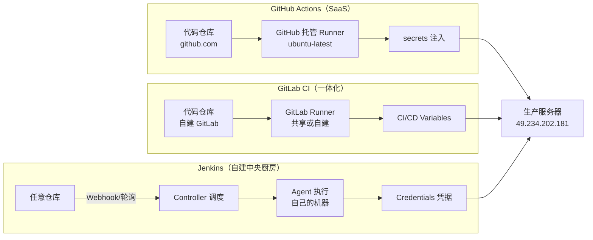
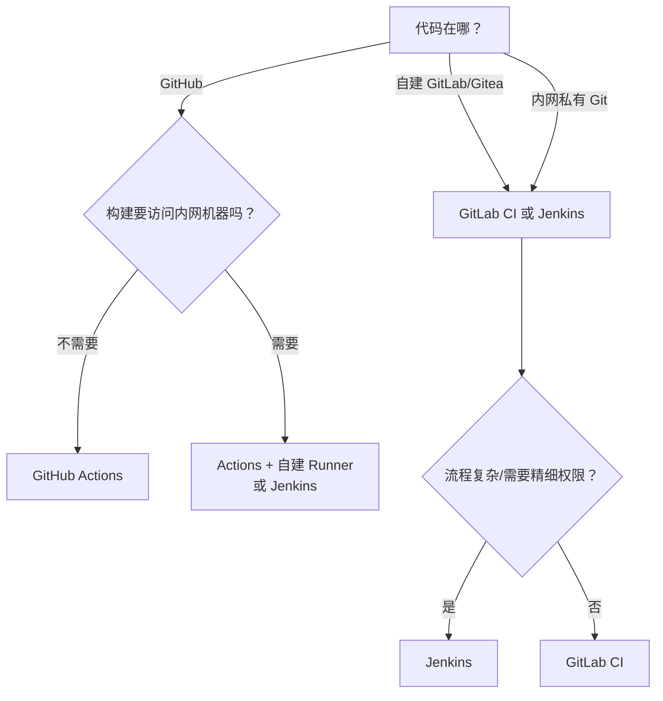

# 第 06 章 一条流水线的三种写法

> 难度：★★☆　预计耗时：60 分钟
> 本章目标：把同一个需求（前端 lint/test/build + 后端 test + main 分支部署）分别用 Jenkins、GitHub Actions、GitLab CI 写出来，看懂它们的映射关系，并带走一张能直接开会用的选型决策表。

---

## 一、为什么需要这一章

面试和真实工作里，最常被问的不是"你会不会 Jenkins"，而是：

> "我们团队现在用 Jenkins，迁移到 GitHub Actions 值不值？"

回答这个问题，你得同时会两种，并且能说清**代价**（迁移成本、维护成本、能力缺口），而不是只会背"Actions 更现代"。

更现实的是：很多公司的代码托管是混着的——开源部分在 GitHub，业务代码在自建 GitLab，部署机器在内网，Jenkins 活着。你写的流水线要能在这三种世界里穿梭。

> **一句话先给结论**：语法是糖，机制是肉。**触发 → 排队 → 分配执行器 → 拉代码 → 注入密钥 → 跑命令 → 收集产物 → 通知**，这八件事三个平台全都一样。换平台，只是换写法。

---

## 二、原理图解：三个平台各自站在哪



三个平台的本质区别只有一句话：

| 平台 | 谁的机器干活 | 谁维护机器 |
| --- | --- | --- |
| GitHub Actions | GitHub 的云机器 | GitHub |
| GitLab CI | GitLab 实例的 Runner | 自建 GitLab 时是你自己 |
| Jenkins | 你的机器 | 你自己（永远） |

**所有取舍都从这一句派生出来。**

---

## 三、同一需求，三份配置

需求固定为：

1. 前端（`demos/frontend`）：`npm ci` → `lint` → 单测（带覆盖率）→ `build`
2. 后端（`demos/backend`）：`pip install` → `pytest`（覆盖率门槛 80%）
3. 仅在 `main` 分支、且前后端都通过时，部署到生产（需要人工确认）
4. 只改文档（`docs/**`）不触发构建
5. 同一分支的新提交取消旧构建

### 3.1 Jenkins 版

文件：`pipelines/jenkins/Jenkinsfile-02-standard`

```groovy
pipeline {
    agent any

    options {
        timestamps()
        timeout(time: 25, unit: 'MINUTES')
        buildDiscarder(logRotator(numToKeepStr: '30'))
        disableConcurrentBuilds(abortPrevious: true)   // 需求 5：新提交取消旧构建
    }

    environment {
        APP_DIR = 'demos'
    }

    stages {
        stage('文档变更检测') {
            steps {
                // 需求 4：只改文档则跳过后续（用 changeset 判断）
                script {
                    def onlyDocs = currentBuild.changeSets.collectMany { it.items }
                        .every { it.path.startsWith('docs/') || it.path.endsWith('.md') }
                    if (onlyDocs) {
                        echo '本次只改文档，跳过构建'
                        currentBuild.result = 'SUCCESS'
                        error('SKIP_BUILD')   // 用异常提前结束，post 仍会执行
                    }
                }
            }
        }

        stage('质量门禁') {
            failFast true
            parallel {
                stage('前端') {
                    steps {
                        dir("${APP_DIR}/frontend") {
                            sh 'npm ci'
                            sh 'npm run lint'
                            sh 'npm run test:cov'
                            sh 'npm run build'
                        }
                    }
                    post {
                        success { archiveArtifacts artifacts: "${APP_DIR}/frontend/dist/**", allowEmptyArchive: true }
                    }
                }
                stage('后端') {
                    steps {
                        dir("${APP_DIR}/backend") {
                            sh 'python3 -m venv .venv'
                            sh '.venv/bin/pip install -r requirements.txt'
                            sh '.venv/bin/pytest'
                        }
                    }
                }
            }
        }

        stage('部署生产') {
            when { branch 'main' }                       // 需求 3
            steps {
                timeout(time: 30, unit: 'MINUTES') {
                    input message: "确认部署 ${env.GIT_SHA ?: env.BUILD_NUMBER} 到生产？",
                          ok: '部署', submitter: 'admin'
                }
                withCredentials([sshUserPrivateKey(credentialsId: 'deploy-ssh-key', keyFileVariable: 'SSH_KEY')]) {
                    sh '''
                        ssh -i "$SSH_KEY" -o StrictHostKeyChecking=accept-new ubuntu@49.234.202.181 \
                          "cd /opt/apps/cicd-demo && sudo ./scripts/deploy.sh $BUILD_NUMBER"
                    '''
                }
            }
        }
    }

    post {
        failure { echo "失败：${env.BUILD_URL}console" }
        cleanup { cleanWs() }
    }
}
```

### 3.2 GitHub Actions 版

文件：`pipelines/github/ci.yml`（放到仓库的 `.github/workflows/ci.yml`）

```yaml
name: CI

on:
  push:
    branches: [main, 'feature/**']
    paths-ignore: ['docs/**', '**/*.md']        # 需求 4
  pull_request:
    branches: [main]
  workflow_dispatch:

concurrency:                                    # 需求 5
  group: ci-${{ github.ref }}
  cancel-in-progress: true

jobs:
  frontend:
    runs-on: ubuntu-latest
    defaults:
      run:
        working-directory: demos/frontend
    steps:
      - uses: actions/checkout@v4
      - uses: actions/setup-node@v4
        with:
          node-version: '20'
          cache: npm
          cache-dependency-path: demos/frontend/package-lock.json
      - run: npm ci
      - run: npm run lint
      - run: npm run test:cov
      - run: npm run build
      - uses: actions/upload-artifact@v4
        with:
          name: frontend-dist
          path: demos/frontend/dist
          retention-days: 7

  backend:
    runs-on: ubuntu-latest
    defaults:
      run:
        working-directory: demos/backend
    steps:
      - uses: actions/checkout@v4
      - uses: actions/setup-python@v5
        with:
          python-version: '3.11'
          cache: pip
          cache-dependency-path: demos/backend/requirements.txt
      - run: pip install -r requirements.txt
      - run: pytest

  deploy:
    needs: [frontend, backend]                  # 需求 3：两边都过才部署
    if: github.ref == 'refs/heads/main'
    runs-on: ubuntu-latest
    environment: production                     # 可在此配置 Required reviewers
    steps:
      - uses: actions/checkout@v4
      - name: 准备 SSH
        run: |
          mkdir -p ~/.ssh
          echo "${{ secrets.DEPLOY_SSH_KEY }}" > ~/.ssh/id_ed25519
          chmod 600 ~/.ssh/id_ed25519
          ssh-keyscan -H ${{ secrets.DEPLOY_HOST }} >> ~/.ssh/known_hosts
      - name: 部署
        run: |
          ssh ${{ secrets.DEPLOY_USER }}@${{ secrets.DEPLOY_HOST }} \
            "cd /opt/apps/cicd-demo && sudo ./scripts/deploy.sh ${{ github.run_number }}"
```

### 3.3 GitLab CI 版

文件：`pipelines/gitlab/.gitlab-ci.yml`

```yaml
stages: [check, deploy]

variables:
  PIP_CACHE_DIR: "$CI_PROJECT_DIR/.cache/pip"

frontend:
  stage: check
  image: node:20-alpine
  rules:
    - changes: ['demos/frontend/**']
  before_script:
    - cd demos/frontend
    - npm ci
  script:
    - npm run lint
    - npm run test:cov
    - npm run build
  cache:
    key: npm-$CI_COMMIT_REF_SLUG
    paths: [demos/frontend/node_modules]
  artifacts:
    paths: [demos/frontend/dist]
    expire_in: 1 week

backend:
  stage: check
  image: python:3.11-slim
  rules:
    - changes: ['demos/backend/**']
  script:
    - cd demos/backend
    - pip install -r requirements.txt
    - pytest
  cache:
    key: pip-$CI_COMMIT_REF_SLUG
    paths: [.cache/pip]

deploy:
  stage: deploy
  image: alpine:3.20
  rules:
    - if: '$CI_COMMIT_BRANCH == "main"'
      when: manual                              # 需求 3：人工确认
  environment:
    name: production
  before_script:
    - apk add --no-cache openssh-client
    - mkdir -p ~/.ssh
    - echo "$DEPLOY_SSH_KEY" > ~/.ssh/id_ed25519
    - chmod 600 ~/.ssh/id_ed25519
    - ssh-keyscan -H "$DEPLOY_HOST" >> ~/.ssh/known_hosts
  script:
    - ssh "$DEPLOY_USER@$DEPLOY_HOST" "cd /opt/apps/cicd-demo && sudo ./scripts/deploy.sh $CI_PIPELINE_IID"
```

---

## 四、逐段对照表（这张表值得收藏）

| 需求 | Jenkins | GitHub Actions | GitLab CI |
| --- | --- | --- | --- |
| 定义文件 | `Jenkinsfile` | `.github/workflows/*.yml` | `.gitlab-ci.yml` |
| 执行环境 | `agent { docker { image } }` | `runs-on: ubuntu-latest` | `image: node:20-alpine` |
| 拉代码 | `checkout scm`（默认） | `actions/checkout@v4` | 自动 |
| 缓存依赖 | `cache` 指令 / 手工 | `actions/setup-node` 的 `cache:` | `cache:paths` |
| 并行 | `parallel { stage ... }` | 多个 job 天然并行 | 同 stage 的 job 并行 |
| 失败即停其他并行分支 | `failFast true` | `strategy.fail-fast` | 默认无，需 `needs` 编排 |
| 分支条件 | `when { branch 'main' }` | `if: github.ref == ...` | `rules: - if: $CI_COMMIT_BRANCH` |
| 路径过滤 | `changeset 'docs/**'` | `paths-ignore:` | `rules: - changes:` |
| 取消旧构建 | `disableConcurrentBuilds(abortPrevious: true)` | `concurrency.cancel-in-progress` | `resource_group` + `interruptible` |
| 人工审批 | `input submitter: 'admin'` | `environment` + Required reviewers | `when: manual` + Protected environments |
| 密钥 | Credentials + `withCredentials` | `secrets.NAME` | CI/CD Variables（勾 Masked） |
| 产物归档 | `archiveArtifacts` | `actions/upload-artifact` | `artifacts:paths` |
| 复用逻辑 | 共享库（`@Library`） | Reusable workflow / Composite Action | `include` + `extends` |
| 自托管执行器 | Agent 节点 | Self-hosted runner | 自建 GitLab Runner |
| 超时 | `options { timeout }` | `timeout-minutes` | `timeout` |

**注意三个"看起来一样其实不一样"的点**：

1. **密钥打码**：Jenkins 与 Actions 自动打码；GitLab 必须手动勾 `Masked`，**忘了就明文出现在日志里**（这是 GitLab 最高频的泄露原因）。
2. **并行的失败传播**：Actions 的 job 之间默认**互不影响**（`needs` 才建立依赖）；Jenkins 的 `parallel` 默认会等其他分支跑完，除非 `failFast`。
3. **缓存**：Actions 的缓存要显式 `cache:` 配置；GitLab 的 cache 是"按 job 声明目录"；Jenkins 需要自己装插件或用 `stash/unstash`。

---

## 五、选型决策表（可以直接拿去开会）

| 评估项 | Jenkins | GitHub Actions | GitLab CI |
| --- | --- | --- | --- |
| 起步成本 | 高（装、配、维护） | 极低 | 低（已有 GitLab 就是零） |
| 长期维护成本 | **高**（插件升级、磁盘、备份、CVE） | 低 | 中 |
| 内网生产机访问 | **强**（就在内网） | 弱（需自建 Runner） | 中（可自建 Runner） |
| 复杂流程表达力 | **极强**（Groovy 任意逻辑） | 中 | 中 |
| 生态/插件 | 1800+ 插件（质量参差） | Marketplace 丰富且质量较齐 | 中等 |
| 免费额度 | 全自费（机器+电+维护人力） | 公开仓库免费；私有 2000 分钟/月 | 自建无限；SaaS 400 分钟/月 |
| 权限精细度 | **高**（角色/文件夹/审批） | 中（environments + reviewers） | 中高 |
| 可审计性 | 中（需插件） | 高（原生日志） | 高 |
| 迁移锁定风险 | 低（自建，随时搬） | **高**（深度绑定 GitHub） | 中 |
| 适合规模 | 10 人以上、内网、复杂流程 | 1~50 人、开源、云上 | 5~200 人、已用 GitLab |

**决策树**：



**混合策略（很多公司的真实答案）**：

- 代码托管在 GitHub/GitLab（享受 PR、Issue、代码搜索）
- CI 用平台原生（Actions/GitLab CI）做测试与构建
- **部署用 Jenkins**（因为只有它能进内网、能做审批、能持有生产凭据）

这种"CI 在云、CD 在内网"的分工，是安全与效率的常见平衡点。

---

## 六、坑与排错

| 现象 | 平台 | 根因 | 解法 |
| --- | --- | --- | --- |
| 密钥明文出现在日志 | GitLab | 变量没勾 Masked | 编辑变量勾选 Masked；值不能含特殊字符 |
| `npm ci` 报 lock 文件不一致 | 三平台通用 | `package-lock.json` 没提交或版本不匹配 | 本地 `npm install` 后提交 lock 文件；CI 用 `npm ci` |
| Actions 缓存永远不命中 | GitHub | `cache-dependency-path` 写错 | 指向实际 lock 文件路径 |
| GitLab job 因 `changes` 规则不执行 | GitLab | 首次 push 或合并请求时 `changes` 行为不同 | 用 `rules: - if: $CI_PIPELINE_SOURCE == "merge_request_event"` 兜底 |
| Jenkins `disableConcurrentBuilds(abortPrevious: true)` 不生效 | Jenkins | 旧版本不支持参数 | 升级 Jenkins；或改用手动 lock |
| Actions 的 deploy 在没有 secrets 的 fork PR 上失败 | GitHub | fork 不继承 secrets | 用 `if: github.event.pull_request.head.repo.full_name == github.repository` |
| Windows 换行导致 Linux 脚本失败 | 三平台通用 | CRLF | `.gitattributes` 强制 LF |
| 时区不一致导致定时任务错 | 三平台通用 | 默认 UTC | Jenkins 设 TZ；Actions 用 `TZ=Asia/Shanghai`；GitLab 在 `variables` 里设 |

---

## 七、本章检查清单与练习

### 检查清单

- [ ] 能对着对照表，把一份 Jenkinsfile 翻译成 Actions workflow
- [ ] 知道三个平台"密钥打码"的差异（谁需要手动勾）
- [ ] 能画出选型决策树，并说出你们团队该选哪个、为什么
- [ ] 三份配置都放在 `pipelines/` 下，路径正确
- [ ] 能解释"CI 在云、CD 在内网"这种混合策略为什么常见

### 练习

**练习 1**：把 Jenkinsfile 里的 `input submitter: 'admin'` 换成 Actions 的等价实现，需要哪两步？
<details><summary>参考要点</summary>

① 仓库 Settings → Environments 建 `production`，添加 Required reviewers；② deploy job 写 `environment: production`。这样该 job 会暂停等待审批。
</details>

**练习 2**：为什么说"GitLab 的变量忘了勾 Masked 就等于泄露"？举一个具体场景。
<details><summary>参考要点</summary>

未 Mask 的变量会被回显到 job 日志（例如 `echo "$TOKEN"` 或命令失败时打印上下文），任何有仓库读权限的人都能看到。Masked 变量在日志中被替换为 `[MASKED]`。
</details>

**练习 3**：团队 3 人，代码在 GitHub 私有仓库，要部署到一台有公网 IP 的腾讯云服务器。给出你的选型和理由（一句话）。
<details><summary>参考要点</summary>

选 GitHub Actions：无需维护 CI 机器，公网服务器可直接 SSH；用 `environment` 做审批。若将来构建需要访问内网，再加 self-hosted runner。
</details>

---

## 下一章预告

平台选定，接下来进入真实项目的流水线细节。第 07 章从零写前端流水线：`npm ci` 为什么比 `npm install` 快、缓存怎么配才真的命中、产物体积怎么卡门禁——每一条都对应一次真实的构建事故。
