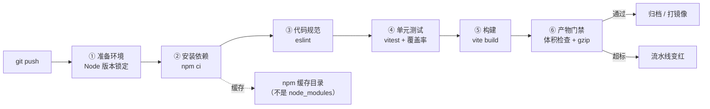

# 第 07 章 前端流水线实战

> 难度：★★☆　预计耗时：75 分钟
> 本章目标：写出一条"快、稳、会拦人"的前端流水线：依赖装得可复现、缓存真的命中、产物体积有门禁、发版产物带版本号。

---

## 一、为什么需要这一章

前端流水线看起来最简单：`npm install && npm run build`，两行就完事。但它是最容易出问题的环节，四个经典事故：

**事故 1：`npm install` 让同一份代码构建出不同结果。**
`npm install` 会按 `package.json` 的 `^` 范围装"当前最新"的版本。今天构建成功，明天依赖发了个小版本，构建就炸了——而你什么都没改。前端团队的经典台词："我本地是好的。"

**事故 2：缓存配了等于没配。**
很多人把 `node_modules` 整个缓存起来，结果命中率极低（lock 文件一变就失效），而且跨平台缓存二进制依赖会直接报错（Windows 缓存的 `esbuild` 二进制拿到 Linux 上无法执行）。

**事故 3：产物悄悄长大。**
某次有人 `import _ from 'lodash'`，包体从 180KB 涨到 620KB。没人发现，直到用户投诉"打开要 8 秒"——尤其在 2M 带宽的服务器上，这个数字会非常难看。

**事故 4：Node 版本漂移。**
本地 Node 20，流水线默认 Node 18，`vite` 新版直接报 `SyntaxError`。或者反过来，CI 用 Node 22，本地 Node 18 跑不起来。

> 这一章逐个解决：**可复现（npm ci + lock）**、**缓存命中（缓存对的东西）**、**体积门禁（挡住悄悄变胖）**、**版本锁定（Node 版本三处对齐）**。

---

## 二、原理图解：前端流水线的六个工位



三个关键决策，先给结论再解释：

| 决策 | 选择 | 为什么 |
| --- | --- | --- |
| 装依赖用什么 | `npm ci` | 严格按 lock 文件装，可复现，且比 `npm install` 快 |
| 缓存什么 | `~/.npm`（npm 缓存目录） | 跨平台安全、命中率高；`node_modules` 不缓存 |
| 门禁卡什么 | JS 总量 + gzip 后总量 | 前者防"悄悄变胖"，后者对应用户真实体验 |

---

## 三、动手步骤

### 步骤 1 锁定 Node 版本（三处必须一致）

**① `package.json` 里声明引擎要求**

```json
{
  "engines": {
    "node": ">=20.19 <21",
    "npm": ">=10"
  }
}
```

**② 仓库根放 `.nvmrc`**（本地开发用 nvm/fnm 时自动切换）

```text
20.19.0
```

**③ CI 与 Docker 里用同一个大版本**

- GitHub Actions：`node-version: '20'`
- GitLab：`image: node:20-alpine`
- Jenkins/Docker：`FROM node:20-alpine`
- 本地：`node -v` 确认

> **为什么不用 `node:latest`**：某天 latest 变成 Node 22，你的 `node-sass`/`esbuild` 可能直接挂掉，而代码一行没改。**基础镜像必须钉版本。**

### 步骤 2 `npm ci` 与 `npm install` 到底差在哪

| 维度 | `npm install` | `npm ci` |
| --- | --- | --- |
| 依据 | `package.json`（可忽略 lock） | **只认 `package-lock.json`** |
| lock 不存在时 | 自动生成 | **直接报错**（这是好事） |
| 已存在 `node_modules` | 增量更新 | **先删掉再重装**（保证干净） |
| 速度 | 较慢（要解析依赖树） | 较快（直接按 lock 装） |
| 可复现性 | 低 | **高** |
| 用在哪 | 本地开发加新依赖 | **流水线与生产构建** |

配套铁律：

1. `package-lock.json` **必须提交到 Git**（`.gitignore` 里不能有它）。
2. 流水线里**只用 `npm ci`**。
3. 加依赖在本地用 `npm install 包名`，然后**把 `package.json` 和 `package-lock.json` 一起提交**。

> **跨平台坑**：lock 文件在 Windows 上生成时，可能缺少 Linux 需要的可选依赖（`esbuild`、`rollup` 的二进制包）。如果 CI 报 `Cannot find module @rollup/rollup-linux-x64-gnu`，原因是 npm 的可选依赖 bug。解法：删掉 `node_modules` 和 lock，在 Linux 容器里重新 `npm install` 生成 lock，或升级 npm 到 10.4+。

### 步骤 3 缓存：缓存对的东西，命中率才高

**缓存 npm 缓存目录（推荐）**：

| 平台 | 写法 |
| --- | --- |
| GitHub Actions | `actions/setup-node@v4` 自带 `cache: npm` + `cache-dependency-path` |
| GitLab CI | `cache: { key: "npm-$CI_COMMIT_REF_SLUG", paths: [.npm] }` + `npm ci --cache .npm` |
| Jenkins | `stash/unstash` 不适合跨构建；用 **Docker 命名卷** 挂 `~/.npm` |

Jenkins 的缓存写法（在 `agent { docker }` 里挂卷）：

```groovy
agent {
    docker {
        image 'node:20-alpine'
        args '-v jenkins-npm-cache:/root/.npm'
        reuseNode true
    }
}
```

> **为什么缓存 `~/.npm` 而不是 `node_modules`**：npm 缓存存的是**压缩包（tarball）**，与平台无关；`node_modules` 里有平台相关的二进制文件，跨平台复用会直接崩。而且 lock 变了以后 `node_modules` 缓存就废了，tarball 缓存还能复用大部分。

**验证缓存是否真的命中**：

```bash
npm ci --prefer-offline --no-audit --no-fund
```

看耗时：第一次 90 秒，第二次应该在 15~30 秒。如果没有变快，说明缓存路径没挂对。

### 步骤 4 代码规范检查（lint）

```bash
npm run lint
```

`eslint.config.js` 已经配好（flat config）。三个实践建议：

1. **lint 失败必须阻断流水线**，否则没人管。
2. 本地配 Git 钩子提前拦（第 09 章的 husky），别等推上去才发现。
3. 不要一次性开启所有规则——老项目会有几千个错误。用 `warn` 过渡，新文件用 `error`。

### 步骤 5 单元测试与覆盖率

```bash
npm run test:cov
```

`vite.config.js` 里已配覆盖率门槛（起步 50%，第 09 章讲怎么提到 80%）。输出示例：

```text
 ✓ src/__tests__/App.spec.js (4 tests) 128ms

 % Coverage report from v8
------------------|---------|----------|---------|---------|
File              | % Stmts | % Branch | % Funcs | % Lines |
------------------|---------|----------|---------|---------|
All files         |   78.26 |    66.67 |   83.33 |   79.31 |
 App.vue          |   78.26 |    66.67 |   83.33 |   79.31 |
------------------|---------|----------|---------|---------|
```

> **注意**：覆盖率是"防止倒退"的工具，不是"追求 100%"的 KPI。一个 80% 覆盖但断言扎实的项目，比 100% 覆盖全是 `expect(true).toBe(true)` 的项目靠谱得多。

### 步骤 6 构建与环境变量注入

```bash
npm run build
```

生产环境的 API 地址在构建时被 **写死进产物**（Vite 是编译时注入，不是运行时读取）。这一点非常重要：

```bash
# 生产构建：前端请求同源 /api，由 Nginx 反代到后端
VITE_API_BASE=/api npm run build
```

> **由此得出结论**：同一份前端产物不能同时服务两个不同 API 地址的环境。要么构建两次（不推荐，违反"同一制品"原则），要么**统一用相对路径 `/api` + Nginx 反代**（本书采用）。这也是为什么前端几乎不需要"环境配置"——让 Nginx 去区分环境。

Docker 构建时传参：

```bash
docker build -f deploy/Dockerfile.frontend \
  --build-arg VITE_API_BASE=/api \
  -t cicd-demo-frontend:${BUILD_NUMBER} demos/frontend
```

### 步骤 7 产物体积门禁（本项目已提供脚本）

```bash
bash scripts/check-bundle-size.sh demos/frontend/dist 200
```

输出示例：

```text
----------------------------------------
产物体积报告：demos/frontend/dist
  总大小      : 96 KB
  JS 总量     : 78 KB（上限 200 KB）
  CSS 总量    : 8 KB
  gzip 后估算 : 31 KB
----------------------------------------
门禁通过
```

三个数字的意义：

| 指标 | 作用 | 参考阈值（小项目） |
| --- | --- | --- |
| JS 总量（未压缩） | 发现"误引入大库" | ≤ 200 KB |
| gzip 后总量 | 对应真实首屏下载量（2M 带宽 ≈ 250KB/s） | ≤ 500 KB |
| 总大小 | 防止图片/字体把包撑爆 | ≤ 2 MB |

> 体积突然翻倍时，最快定位方法是 `npx vite-bundle-visualizer`，一眼看到哪个包最大。

### 步骤 8 产物归档与命名

```groovy
archiveArtifacts artifacts: 'demos/frontend/dist/**', fingerprint: true
```

命名规范（能和镜像、Git 提交对上）：

```text
frontend-<BUILD_NUMBER>-<GIT_SHA前7位>.tar.gz
```

例如 `frontend-42-a1b2c3d.tar.gz`。**不要用 `frontend.tar.gz`**——第 01 章说过，制品必须不可变。

---

## 四、完整实例：一条能拦住事故的前端流水线

**文件：`pipelines/jenkins/Jenkinsfile-03-frontend`**

```groovy
pipeline {
    agent {
        docker {
            image 'node:20-alpine'
            args '-v jenkins-npm-cache:/root/.npm'
            reuseNode true
        }
    }

    options {
        timestamps()
        timeout(time: 20, unit: 'MINUTES')
        buildDiscarder(logRotator(numToKeepStr: '20'))
        disableConcurrentBuilds(abortPrevious: true)
    }

    environment {
        CI = 'true'
        NODE_ENV = 'production'
    }

    stages {
        stage('① 环境自检') {
            steps {
                sh 'node -v && npm -v'
                sh 'test -f package-lock.json || (echo "缺少 package-lock.json，拒绝构建"; exit 1)'
            }
        }

        stage('② 安装依赖') {
            steps {
                sh 'npm ci --prefer-offline --no-audit --no-fund'
            }
        }

        stage('③ 代码规范') {
            steps {
                sh 'npm run lint'
            }
        }

        stage('④ 单元测试') {
            steps {
                sh 'npm run test:cov'
            }
            post {
                always {
                    junit allowEmptyResults: true, testResults: 'coverage/junit.xml'
                }
            }
        }

        stage('⑤ 构建') {
            steps {
                sh 'VITE_API_BASE=/api npm run build'
            }
        }

        stage('⑥ 体积门禁') {
            steps {
                // 脚本在仓库根目录，注意工作目录是 demos/frontend
                sh 'bash ../../scripts/check-bundle-size.sh dist 200'
            }
        }

        stage('⑦ 归档') {
            steps {
                sh '''
                    cd ../..
                    mkdir -p dist-archive
                    tar -czf dist-archive/frontend-${BUILD_NUMBER}-${GIT_COMMIT:0:7}.tar.gz -C demos/frontend/dist .
                    ls -lh dist-archive/
                '''
                archiveArtifacts artifacts: 'dist-archive/*.tar.gz', fingerprint: true
            }
        }
    }

    post {
        failure {
            echo "前端流水线失败：${env.BUILD_URL}console"
            echo '优先看：lint 报错 → 单测失败 → 体积超标'
        }
        cleanup {
            cleanWs()
        }
    }
}
```

**在本地验证同一套流程**（不用 Jenkins 也能测）：

```powershell
cd I:\work-body-dir\cicd-tutorial\demos\frontend
npm ci
npm run lint
npm run test:cov
$env:VITE_API_BASE="/api"; npm run build
cd ../..
bash scripts/check-bundle-size.sh demos/frontend/dist 200
```

**验证成功的标准**：

- 五条命令全绿
- `dist/` 里产物带 hash 文件名
- 体积报告显示 JS ≤ 200KB、gzip ≤ 500KB
- 故意把 `node_modules` 里的 lock 改坏（或删掉 lock），流水线第一步就应该红

---

## 五、坑与排错

| 现象 | 根因 | 解法 |
| --- | --- | --- |
| `npm ci` 报 lock 与 package.json 不一致 | 改了依赖没更新 lock | 本地 `npm install` 后提交 lock |
| `Cannot find module @rollup/rollup-linux-x64-gnu` | lock 在 Windows 生成，缺 Linux 可选依赖 | 删 lock + node_modules，在 Linux 容器里重装并提交 lock |
| 构建 OOM（`JavaScript heap out of memory`） | 大项目默认堆不够 | `NODE_OPTIONS=--max-old-space-size=2048` |
| 缓存命中率 0 | 缓存 key 里带了 commit sha | key 用 lock 文件哈希，或 `npm-$CI_COMMIT_REF_SLUG` |
| 构建产物里出现 `localhost:8000` | 构建时没传 `VITE_API_BASE` | 构建命令显式传环境变量 |
| gzip 没生效 | Nginx 没配 `gzip_types` 或 CDN 覆盖 | 检查响应头 `content-encoding: gzip` |
| 页面刷新 404 | SPA 路由没配回退 | Nginx `try_files $uri $uri/ /index.html` |
| 静态资源更新后用户还是旧版 | `index.html` 被强缓存 | 入口文件设 `no-cache`，带 hash 的资源长缓存 |
| lint 报几千个错误 | 老项目一次开了全部规则 | 分批开启，先 `warn` 后 `error` |

---

## 六、横向对照：三个平台的前端流水线

| 环节 | Jenkins | GitHub Actions | GitLab CI |
| --- | --- | --- | --- |
| Node 环境 | `agent { docker { image 'node:20-alpine' } }` | `actions/setup-node@v4` with `node-version: 20` | `image: node:20-alpine` |
| 依赖缓存 | 卷挂 `/root/.npm` | `cache: npm` + `cache-dependency-path` | `cache:paths: [.npm]` |
| 装依赖 | `sh 'npm ci'` | `run: npm ci` | `npm ci` |
| 覆盖率报告 | `junit` + `publishHTML` | `upload-artifact` + Codecov Action | `artifacts:reports:coverage_report` |
| 体积门禁 | `sh 'bash scripts/check-bundle-size.sh'` | 同左（脚本复用） | 同左 |
| 产物 | `archiveArtifacts` | `upload-artifact` | `artifacts:paths` |

> **一个复用技巧**：把 `check-bundle-size.sh` 这类检查写成**仓库里的脚本**，三个平台都调用它。门禁逻辑只维护一份，换平台不用重写。

---

## 七、本章检查清单与练习

### 检查清单

- [ ] `package-lock.json` 已提交，流水线只用 `npm ci`
- [ ] Node 版本在 `engines`、`.nvmrc`、CI 镜像三处一致
- [ ] 缓存的是 `~/.npm`，不是 `node_modules`
- [ ] `npm run lint`、`npm run test:cov`、`npm run build` 三条全绿
- [ ] 体积门禁脚本能跑通，故意把上限调到 10 时会变红
- [ ] 能把产物打成带版本号的 tar.gz 并归档

### 练习

**练习 1**：为什么"同一份前端产物部署到测试和生产两个环境"在 Vite 项目里很难做到？给出两种解法。
<details><summary>参考要点</summary>

因为 `import.meta.env.VITE_*` 是**构建时**替换成字面量的。解法：① 产物里只用相对路径 `/api`，由各环境 Nginx 反代到不同后端（推荐）；② 运行时从 `/config.json` 读取配置（需要改成运行时加载）。
</details>

**练习 2**：团队把 `node_modules` 缓存到 CI，结果每周有两次构建报 `esbuild: Exec format error`。解释原因和修法。
<details><summary>参考要点</summary>

Windows/macOS 上生成的 `esbuild` 二进制被缓存后拿到 Linux 执行，格式不兼容。修法：缓存 `~/.npm`（平台无关的 tarball），不缓存 `node_modules`；并在 CI 里固定 Linux 镜像。
</details>

**练习 3**：给体积门禁加一条规则：单个 chunk 超过 300KB 就失败，并打印出这个 chunk 的文件名。
<details><summary>参考要点</summary>

`find dist -name '*.js' -size +300k -print | while read f; do echo "超标: $f"; exit 1; done`。注意 `exit` 在管道子 shell 里不会终止主脚本，要用 `-exec` 或先收集再判断。
</details>

---

## 下一章预告

前端搞定，第 08 章轮到后端：Python 依赖怎么装才快、pytest 覆盖率怎么卡、SQLite 数据怎么在容器里持久化、以及"服务起来了但健康检查一直失败"的六种原因。
