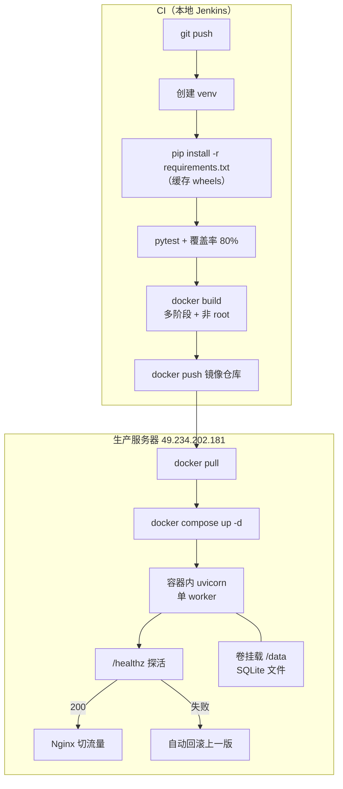

# 第 08 章 后端流水线实战

> 难度：★★☆　预计耗时：75 分钟
> 本章目标：写出后端流水线并打出生产镜像，同时解决四个真实问题：依赖装得慢、测试只是摆设、SQLite 在容器里写不进去、服务重启时请求被硬切。

---

## 一、为什么需要这一章

后端流水线比前端更"危险"，因为它的产物是**别人要访问的服务**。四个高频事故：

**事故 1：`pip install` 装出"薛定谔的环境"。**
`requirements.txt` 里写 `fastapi`，今天装 0.115，下周装 0.120，某个不兼容改动直接让线上 500。而这个镜像你已经推到仓库了。

**事故 2：测试全绿，但服务起不来。**
测试用的是 `TestClient`，不经过真实容器；真正跑起来时缺少系统依赖（`libpq`、时区数据）、或数据目录没权限，容器启动即退出。

**事故 3：数据丢了。**
SQLite 文件写在容器里，`docker compose up -d --force-recreate` 一次，历史数据全部消失。

**事故 4：发布时用户请求被硬切。**
`docker restart` 的瞬间，正在处理的请求直接断开。用户看到 502，投诉到客服。

> 这一章解决：**依赖可复现**、**镜像能真跑**、**数据持久化**、**优雅退出**。

---

## 二、原理图解：后端流水线与运行形态



关键设计只有三条：

1. **构建在 CI，运行在服务器**。服务器上永远不执行 `pip install`。
2. **镜像不可变**。每次构建用 `BUILD_NUMBER` 或 `git sha` 当 tag。
3. **数据在卷里**。容器可随时删，`/data` 目录必须挂到宿主机。

---

## 三、动手步骤

### 步骤 1 锁定 Python 版本

三处对齐（和第 07 章锁 Node 是同一个道理）：

| 位置 | 写法 |
| --- | --- |
| 仓库根 `.python-version` | `3.11` |
| CI 镜像 | `python:3.11-slim` |
| 生产镜像 | `python:3.11-slim` |

> **为什么不用 3.12/3.13**：部分 C 扩展（老版本 `psycopg2`、`numpy`）对最新版支持滞后。生产环境选"次新版"更稳。

### 步骤 2 依赖锁定：精确版本，不用范围

`requirements.txt` 必须写 `==`：

```text
fastapi==0.115.6
uvicorn[standard]==0.34.0
pydantic==2.10.4
pytest==8.3.4
httpx==0.28.1
pytest-cov==6.0.0
```

如果依赖树很深（几十个传递依赖），用 `pip freeze` 生成完整锁定文件：

```bash
pip install -r requirements.in
pip freeze > requirements.lock.txt
```

更现代的做法是用 `uv`（2024 年后非常流行，速度是 pip 的 10~100 倍）：

```bash
uv pip compile requirements.in -o requirements.txt
uv pip install -r requirements.txt
```

> 本书主线用 `pip`（兼容性最好），第 16 章提速部分会给出 `uv` 的对比与迁移方法。

### 步骤 3 CI 里怎么装依赖最快

三种方式对比：

| 方式 | 命令 | 优点 | 缺点 |
| --- | --- | --- | --- |
| 全局装 | `pip install -r requirements.txt` | 简单 | 污染系统环境，CI 容器里无所谓 |
| venv | `python -m venv .venv && .venv/bin/pip install ...` | 隔离干净 | 多一步，路径长 |
| 缓存 wheels | `pip install --cache-dir .pip-cache` | 二次构建快 | 要挂载持久目录 |

**Jenkins 里用 Docker agent + 卷缓存**：

```groovy
agent {
    docker {
        image 'python:3.11-slim'
        args '-v jenkins-pip-cache:/root/.cache/pip'
        reuseNode true
    }
}
```

**GitHub Actions**：

```yaml
- uses: actions/setup-python@v5
  with:
    python-version: '3.11'
    cache: pip
    cache-dependency-path: demos/backend/requirements.txt
```

**GitLab CI**：

```yaml
variables:
  PIP_CACHE_DIR: "$CI_PROJECT_DIR/.cache/pip"
cache:
  key: pip-$CI_COMMIT_REF_SLUG
  paths: [.cache/pip]
```

**验证缓存效果**：第一次 `pip install` 约 40 秒，第二次应在 8~15 秒。

### 步骤 4 测试与覆盖率门禁

`pytest.ini` 里已经配好：

```ini
[pytest]
testpaths = tests
addopts = -q --cov=app --cov-report=term-missing --cov-fail-under=80
```

跑一遍：

```bash
cd demos/backend
python -m venv .venv
.venv/bin/pip install -r requirements.txt
.venv/bin/pytest
```

预期：

```text
......                                                                   [100%]
---------- coverage: platform linux, python 3.11 ----------
Name         Stmts   Miss  Cover   Missing
------------------------------------------
app/db.py       28      3    89%   45-47
app/main.py     46      6    87%   62-64
------------------------------------------
TOTAL           74     11    85%
Required test coverage of 80% reached. Total coverage: 85.14%
6 passed in 0.42s
```

**覆盖率不到 80% 时流水线会红**。这不是刁难，是防止"新代码没测试就上线"。

补测试的优先级：

1. **核心业务分支**（有 if 的地方）
2. **错误处理**（404、422、异常分支）
3. 工具函数

> 不要为了覆盖率写"假断言"。`assert response.status_code == 200` 至少验证了接口活着，比 `assert True` 强一百倍。

### 步骤 5 打生产镜像（多阶段 + 非 root）

文件：`deploy/Dockerfile.backend`

```dockerfile
FROM python:3.11-slim AS base
ENV PYTHONDONTWRITEBYTECODE=1 PYTHONUNBUFFERED=1 TZ=Asia/Shanghai
WORKDIR /app

FROM base AS deps
COPY requirements.txt ./
RUN pip install --no-cache-dir -r requirements.txt

FROM base AS runtime
COPY --from=deps /usr/local/lib/python3.11/site-packages /usr/local/lib/python3.11/site-packages
COPY --from=deps /usr/local/bin /usr/local/bin
COPY app ./app

RUN useradd -m -u 10001 appuser \
    && mkdir -p /data \
    && chown -R appuser:appuser /app /data
USER appuser

ENV SQLITE_PATH=/data/app.db
EXPOSE 8000

HEALTHCHECK --interval=30s --timeout=3s --start-period=15s --retries=3 \
  CMD python -c "import urllib.request,sys; sys.exit(0 if urllib.request.urlopen('http://127.0.0.1:8000/healthz',timeout=2).status==200 else 1)"

CMD ["uvicorn", "app.main:app", "--host", "0.0.0.0", "--port", "8000", \
     "--workers", "1", "--timeout-graceful-shutdown", "20"]
```

四个设计点解释：

| 设计 | 原因 |
| --- | --- |
| 多阶段构建 | 最终镜像不含编译工具与 pip 缓存，体积从 ~1GB 降到 ~180MB |
| 先 COPY requirements.txt | 依赖层可复用：只改代码时不重装依赖，构建从 90 秒降到 8 秒 |
| 非 root（uid 10001） | 容器漏洞被利用时，攻击者拿不到 root；代价是宿主机挂载目录要 `chown 10001` |
| `--workers 1` | 2G 内存开多 worker 会互相抢内存，反而更慢（第 03 章核算过） |

构建并在本地跑：

```powershell
docker build -f deploy/Dockerfile.backend -t cicd-demo-backend:dev demos/backend
docker run --rm -d --name api-dev -p 8000:8000 -v api-data:/data cicd-demo-backend:dev
docker ps
curl.exe http://127.0.0.1:8000/healthz
```

预期：

```json
{"status":"ok","version":"dev"}
```

### 步骤 6 SQLite 持久化：容器删了数据还得在

三种挂载方式，选一种：

| 方式 | 写法 | 适合 |
| --- | --- | --- |
| 命名卷 | `-v api-data:/data` | 单机、简单、Docker 管理 |
| 绑定挂载 | `-v /opt/apps/cicd-demo/shared/data:/data` | 需要备份/迁移方便（**本书生产用这个**） |
| 不挂载 | 无 | 只用于一次性测试 |

绑定挂载必须先授权（非 root 用户 uid 10001 要能写）：

```bash
sudo mkdir -p /opt/apps/cicd-demo/shared/data
sudo chown -R 10001:10001 /opt/apps/cicd-demo/shared/data
```

> **这是最容易踩的坑**：不 chown，容器里 `appuser` 写不了 `/data`，日志报 `sqlite3.OperationalError: unable to open database file`，而 `docker logs` 之外毫无提示。

验证持久化：

```powershell
docker run --rm -d --name api-dev -p 8000:8000 -v api-data:/data cicd-demo-backend:dev
curl.exe -X POST http://127.0.0.1:8000/api/tasks -H "Content-Type: application/json" -d '{\"title\":\"持久化测试\"}'
docker rm -f api-dev
docker run --rm -d --name api-dev -p 8000:8000 -v api-data:/data cicd-demo-backend:dev
curl.exe http://127.0.0.1:8000/api/tasks
```

第二次请求里如果还能看到"持久化测试"，说明数据真的在卷里。

### 步骤 7 优雅退出：别在发布时硬切用户请求

`uvicorn --timeout-graceful-shutdown 20` 的意思是：收到 `SIGTERM` 后，最多等 20 秒让正在处理的请求完成，再退出。

配套要确认两件事：

1. **Docker 的停止超时要大于这个值**，否则 Docker 等 10 秒就 `SIGKILL`：

```yaml
services:
  api:
    stop_grace_period: 30s
```

2. **不要在应用里忽略 `SIGTERM`**。自己写的后台线程要监听信号并退出。

验证：

```bash
docker stop api-dev          # 应该"优雅"退出，日志里有 shutdown 记录
docker inspect -f '{{.State.ExitCode}}' api-dev
```

### 步骤 8 健康检查的六种失败原因（提前排掉）

`/healthz` 一直失败，按这个顺序查：

| 现象 | 根因 | 定位命令 |
| --- | --- | --- |
| 容器立刻退出 | 启动命令报错（导入失败、端口占用） | `docker logs <容器>` |
| 容器在跑但 curl 连不上 | 监听地址是 `127.0.0.1` 而非 `0.0.0.0` | `docker exec <容器> ss -tlnp` |
| 连得上但返回 500 | 数据库/依赖初始化失败 | `docker logs`；`/healthz` 不该查数据库 |
| 健康检查超时 | `start-period` 太短，应用启动慢 | 加长 `--start-period` |
| 偶发失败 | 单 worker 被慢请求占满 | 加 `--timeout-keep-alive`、排查慢接口 |
| 检查命令本身报错 | 镜像里没有 `curl`/`wget` | 用 python 发请求（本镜像已这样写） |

> **`/healthz` 的设计原则**：只回答"进程活着、能接请求"，**不要查数据库**。否则数据库抖一下，所有实例一起被判死，流量全切走，故障被放大。

---

## 四、完整实例：后端流水线（构建 + 测试 + 打镜像）

**文件：`pipelines/jenkins/Jenkinsfile-04-backend`**

```groovy
pipeline {
    agent any

    options {
        timestamps()
        timeout(time: 25, unit: 'MINUTES')
        buildDiscarder(logRotator(numToKeepStr: '20'))
        disableConcurrentBuilds(abortPrevious: true)
    }

    environment {
        IMAGE = "ghcr.io/${env.REGISTRY_NAMESPACE}/cicd-demo-backend:${env.BUILD_NUMBER}"
    }

    stages {
        stage('① 测试（容器内）') {
            agent {
                docker {
                    image 'python:3.11-slim'
                    args '-v jenkins-pip-cache:/root/.cache/pip'
                    reuseNode true
                }
            }
            steps {
                dir('demos/backend') {
                    sh 'python -V'
                    sh 'pip install -r requirements.txt'
                    sh 'pytest'
                }
            }
        }

        stage('② 构建镜像') {
            steps {
                sh "docker build -f deploy/Dockerfile.backend -t ${IMAGE} demos/backend"
                sh "docker image inspect ${IMAGE} --format '镜像大小：{{.Size}}'"
            }
        }

        stage('③ 冒烟测试') {
            steps {
                sh '''
                    docker rm -f smoke-api 2>/dev/null || true
                    docker run -d --name smoke-api -p 18000:8000 cicd-demo-backend:${BUILD_NUMBER}
                    for i in $(seq 1 20); do
                        if curl -fsS http://127.0.0.1:18000/healthz >/dev/null; then
                            echo "健康检查通过（第 ${i} 次尝试）"
                            exit 0
                        fi
                        sleep 2
                    done
                    echo "健康检查失败，输出容器日志："
                    docker logs smoke-api
                    exit 1
                '''
            }
            post {
                always {
                    sh 'docker rm -f smoke-api 2>/dev/null || true'
                }
            }
        }

        stage('④ 推送镜像') {
            when { branch 'main' }
            steps {
                withCredentials([usernamePassword(credentialsId: 'ghcr-registry',
                                                  usernameVariable: 'REG_USER',
                                                  passwordVariable: 'REG_PASS')]) {
                    sh 'echo "$REG_PASS" | docker login -u "$REG_USER" --password-stdin ghcr.io'
                    sh "docker push ${IMAGE}"
                }
            }
        }
    }

    post {
        failure {
            sh 'docker rm -f smoke-api 2>/dev/null || true'
            echo "后端流水线失败：${env.BUILD_URL}console"
        }
        cleanup { cleanWs() }
    }
}
```

**本地等价验证（不依赖 Jenkins）**：

```powershell
cd I:\work-body-dir\cicd-tutorial
docker build -f deploy/Dockerfile.backend -t cicd-demo-backend:dev demos/backend
docker run -d --name smoke-api -p 18000:8000 cicd-demo-backend:dev
Start-Sleep -Seconds 5
curl.exe http://127.0.0.1:18000/healthz
docker rm -f smoke-api
```

**验证成功的标准**：

- `pytest` 覆盖率 ≥ 80%
- 镜像体积 ≤ 250MB（`docker image ls`）
- 冒烟测试脚本 20 次重试内通过（说明启动在 40 秒内）
- 容器以非 root 运行：`docker exec <容器> whoami` 输出 `appuser`

---

## 五、坑与排错

| 现象 | 根因 | 解法 |
| --- | --- | --- |
| `pip install` 卡在 `Collecting` | 网络或源慢 | 换国内源：`pip install -i https://pypi.tuna.tsinghua.edu.cn/simple -r requirements.txt` |
| `SSL: CERTIFICATE_VERIFY_FAILED` | 容器缺 CA 证书 | `apt-get install -y ca-certificates` 或换源镜像 |
| `sqlite3.OperationalError: unable to open database file` | 挂载目录权限不对 | `chown -R 10001:10001` 数据目录 |
| 容器内时间差 8 小时 | 没设 TZ | `ENV TZ=Asia/Shanghai` + 安装 `tzdata` |
| 中文乱码 | locale 未配置 | `ENV LANG=C.UTF-8` |
| 镜像 1GB+ | 单阶段构建，含 pip 缓存与编译工具 | 用多阶段（本 Dockerfile） |
| 健康检查一直 unhealthy | 检查命令用了镜像里没有的 curl | 用 python 发请求 |
| 发布时 502 | 硬重启，无优雅退出 | `stop_grace_period` + `--timeout-graceful-shutdown` |
| `ImportError: cannot import name 'app'` | 构建上下文错了（应在 `demos/backend`） | `docker build -f deploy/Dockerfile.backend demos/backend` |
| 多 worker 下 SQLite 锁争用 | 写了 `--workers 4` | 单 worker；或换 PostgreSQL（第 14 章讨论） |

---

## 六、横向对照

| 环节 | Jenkins | GitHub Actions | GitLab CI |
| --- | --- | --- | --- |
| Python 环境 | `docker { image 'python:3.11-slim' }` | `setup-python@v5` + `python-version` | `image: python:3.11-slim` |
| 依赖缓存 | 卷挂 `/root/.cache/pip` | `cache: pip` | `PIP_CACHE_DIR` + `cache:paths` |
| 测试 | `sh 'pytest'` | `run: pytest` | `pytest` |
| 覆盖率报告 | `junit` / `publishHTML` | `upload-artifact` / Codecov | `artifacts:reports:coverage_report` |
| 镜像构建 | `sh 'docker build'` | `docker/build-push-action@v6` | `docker build` + DinD |
| 冒烟测试 | `docker run` + 轮询 curl | 同左 | 同左 |

---

## 七、本章检查清单与练习

### 检查清单

- [ ] `requirements.txt` 全部用 `==` 锁定
- [ ] `pytest` 通过且覆盖率 ≥ 80%
- [ ] 镜像能 `docker run` 起来，`/healthz` 返回 200
- [ ] `docker exec <容器> whoami` 是 `appuser`（非 root）
- [ ] 数据目录绑定挂载后，删容器重建数据还在
- [ ] `docker stop` 时日志显示优雅退出
- [ ] 镜像体积 ≤ 250MB

### 练习

**练习 1**：为什么 `/healthz` 不应该检查数据库连接？
<details><summary>参考要点</summary>

健康检查决定"是否把流量切给这个实例"。如果数据库短暂抖动，所有实例同时被判死，负载均衡把流量全部摘除，整个服务雪崩。数据库健康应该用独立指标监控，而不是让编排系统杀掉所有实例。
</details>

**练习 2**：容器 `whoami` 是 `appuser`，但写入 `/data` 报权限错误，为什么？两种修法。
<details><summary>参考要点</summary>

宿主机目录属主是 root，容器内 uid 10001 无写权限。修法：① `chown -R 10001:10001 目录`；② compose 里 `user: "10001:10001"` 并确保目录属主匹配；③ 用命名卷（由 Docker 管理权限）。
</details>

**练习 3**：把冒烟测试改成"最多等 60 秒、每 3 秒探一次、失败时打印容器最后 50 行日志"，写出核心脚本。
<details><summary>参考要点</summary>

```bash
for i in $(seq 1 20); do
  curl -fsS http://127.0.0.1:18000/healthz && exit 0
  sleep 3
done
docker logs --tail 50 smoke-api
exit 1
```
</details>

---

## 下一章预告

前后端都能构建了，但"能构建"不等于"能上线"。第 09 章加质量与安全门禁：覆盖率阈值怎么定才合理、依赖漏洞扫描怎么接、镜像里的高危 CVE 怎么拦、以及为什么"提交前钩子"能省下 80% 的返工。
