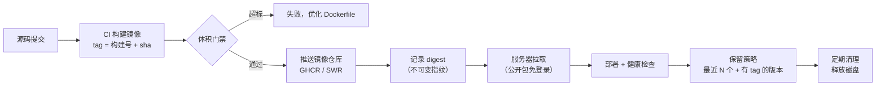

# 第 10 章 镜像与制品管理

> 难度：★★★　预计耗时：80 分钟
> 本章目标：建立一套能追溯、能回滚、不撑爆磁盘、不被 2M 带宽拖死的制品管理规范——镜像怎么命名、tag 怎么打、推到哪、留多久、怎么在服务器上快速拉到。

---

## 一、为什么需要这一章

四个真实事故，全部和"制品管理"有关：

**事故 1：`latest` 惹的祸。**
流水线永远推 `latest`。某天线上出问题要回滚，执行 `docker pull app:latest`——拉到的还是坏的那版。因为 `latest` 不指向"上一个好版本"，它指向"最后一次推送"。**回滚这件事，从打 tag 的那一刻就决定了能不能做。**

**事故 2：tag 被覆盖。**
两个流水线（前端、后端）都用 `BUILD_NUMBER` 当 tag，Jenkins 各自从 1 开始数。结果 `app:42` 先后是四个完全不同的镜像。查问题时 `docker inspect` 出来的创建时间对不上，团队吵了一下午。

**事故 3：磁盘满了。**
每天构建 10 次，每次两个镜像各 200MB，从不清理。40G 的盘，两个月后 `No space left on device`，Docker 起不来，业务全挂。

**事故 4：2M 带宽拉镜像超时。**
服务器在公网拉 180MB 镜像，理论最快 12 分钟，实际经常中断。部署从 1 分钟变成 20 分钟，最后超时失败。

> 这一章逐个解决：**tag 可追溯（不可变 + 唯一）**、**拉取走内网（省带宽）**、**镜像瘦身（少传就快）**、**保留策略（不撑爆磁盘）**。

---

## 二、原理图解：一个镜像的完整生命周期



制品管理只有四个问题，本章按顺序回答：

| 问题 | 答案 |
| --- | --- |
| 叫什么名字 | `registry/namespace/应用名:tag` |
| tag 怎么打 | `构建号-sha` 唯一；语义版本另打；`latest` 只做参考 |
| 放哪里 | GitHub GHCR（公开镜像免费） |
| 留多久 | 最近 10 个 + 所有 `v*` 正式版本 |

---

## 三、动手步骤

### 步骤 1 命名规范：从名字就能看出一切

```text
<registry>/<namespace>/<app>:<tag>
ghcr.io/yxm1989614/cicd-demo-backend:42-a1b2c3d
└────────┬─────────┘ └───┬───┘ └──────┬──────┘ └──┬──┘
      仓库地址          命名空间        应用名       版本标识
```

约定：

| 部分 | 规则 | 示例 |
| --- | --- | --- |
| registry | 仓库域名，不带 `https://` | `ghcr.io` |
| namespace | GitHub 用户名/组织名，小写 | `yxm1989614` |
| app | 应用名，全小写，用 `-` 分隔 | `cicd-demo-backend` |
| tag | 见步骤 2 | `42-a1b2c3d` |

**三个禁止**：

1. 禁止用大写字母（Docker 会报 `invalid reference format`）。
2. 禁止用下划线（部分仓库不接受）。
3. 禁止用 `:` 以外的分隔符表达版本（`app-42` 是名字不是 tag）。

### 步骤 2 Tag 策略：这是整套体系的命门

**三类 tag，用途不同**：

| 类型 | 格式 | 用途 | 可覆盖？ |
| --- | --- | --- | --- |
| **构建 tag（唯一）** | `<BUILD_NUMBER>-<git sha 7 位>` | 每次构建都不同，追溯与回滚的唯一依据 | **绝不** |
| **版本 tag（正式）** | `v1.2.3` | 对外发布版本，与 Git Tag 对应 | **绝不** |
| **流动 tag** | `latest`、`main`、`prod` | 方便人看"当前是什么"，**不能用于回滚** | 可以变 |

Jenkinsfile 里的生成方式：

```groovy
environment {
    GIT_SHA = sh(returnStdout: true, script: 'git rev-parse --short=7 HEAD').trim()
    IMAGE_TAG = "${env.BUILD_NUMBER}-${env.GIT_SHA}"
    IMAGE = "ghcr.io/${env.REGISTRY_NAMESPACE}/cicd-demo-backend:${env.IMAGE_TAG}"
}
```

**结果示例**：`cicd-demo-backend:42-a1b2c3d`

为什么带 sha：只看构建号，你无法知道它对应哪次提交；带上 sha，任何一台机器上 `docker image inspect` 都能反查到代码。

**`latest` 的正确用法**：

```bash
# 只在推送一个"确定可用"的版本时，额外打 latest
docker tag app:42-a1b2c3d app:latest
docker push app:latest
```

`latest` 的作用是"新人拉下来能跑"，**永远不要**在部署脚本里用 `latest`。部署脚本里的 tag 必须是一个具体的、不可变的值（第 12 章的 `deploy.sh` 会强制校验）。

**关于 tag 被覆盖的坑**：如果前端和后端流水线都用 `BUILD_NUMBER`，并且共用一个命名空间，就会出现"两个 42"。解法有两种：

1. 应用名不同（本项目的 `-frontend` / `-backend` 后缀已经解决）。
2. tag 里加入应用标识或流水线标识，如 `backend-42-a1b2c3d`。

### 步骤 3 登录镜像仓库（GitHub GHCR / 华为云 SWR）

**GitHub GHCR（ghcr.io，公开镜像免费）**：

1. GitHub → Settings → Developer settings → Personal access tokens → 生成 PAT，勾选 `write:packages`（推）与 `read:packages`（拉）。
2. 镜像路径的"命名空间"就是你的 **GitHub 用户名或组织名**（必须全小写）：`ghcr.io/yxm1989614/cicd-demo-backend:42-a1b2c3d`，仓库不需要预先创建，首次 push 自动生成。
3. 登录（密码填 PAT，不是 GitHub 登录密码）：

```bash
docker login ghcr.io -u yxm1989614
```

**推送**：

```bash
docker tag cicd-demo-backend:dev ghcr.io/yxm1989614/cicd-demo-backend:42-a1b2c3d
docker push ghcr.io/yxm1989614/cicd-demo-backend:42-a1b2c3d
```

4. **关键一步：把包改成 Public**。GHCR 推上去的包默认是 **Private**，服务器匿名 `docker pull` 会报 `denied`。去 GitHub 网页 → 头像 → Packages → 选中包 → Package settings → Change visibility → **Public**。`cicd-demo-backend` 和 `cicd-demo-frontend` 两个包都要改。

**华为云 SWR（如果换云）**：

```bash
docker login -u cn-north-4@<AK> -p <登录密钥> swr.cn-north-4.myhuaweicloud.com
```

> **关键概念：免费仓库 vs 国内仓库**。
> - GHCR：免费、与 GitHub 账号/PAT 一体；但服务器从 `ghcr.io` 拉镜像走公网跨境链路，受带宽和波动影响，180MB 可能要几分钟。
> - 华为云 SWR：同区域 ECS 访问 `swr.cn-north-4.myhuaweicloud.com` 走内网，速度快，但需要云账号。
>
> **这就是为什么服务器要"只拉镜像不构建"**：构建交给 Jenkins，服务器只负责拉取与启动；镜像越瘦（步骤 6），跨境拉取越快。

**在 Jenkins 里安全登录**（凭据 ID `ghcr-registry`）：

```groovy
withCredentials([usernamePassword(credentialsId: 'ghcr-registry',
                                  usernameVariable: 'REG_USER',
                                  passwordVariable: 'REG_PASS')]) {
    sh 'echo "$REG_PASS" | docker login -u "$REG_USER" --password-stdin ghcr.io'
    sh "docker push ${IMAGE}"
}
```

**不要**在脚本里写 `docker login -p 明文密码`——它会出现在 `ps`、shell 历史、CI 日志里。

### 步骤 4 让构建变快：缓存与分层

**① 用 `.dockerignore` 减少上下文**

`demos/backend/.dockerignore`：

```text
.venv/
__pycache__/
*.pyc
tests/
data/
*.md
.git/
```

`demos/frontend/.dockerignore`：

```text
node_modules/
dist/
coverage/
.git/
*.md
```

> 不加 `.dockerignore`，`docker build` 会把整个 `node_modules`（几百 MB）发给守护进程，光这一项就多花 30 秒。

**② Dockerfile 顺序：变化越少的越靠前**

```dockerfile
COPY requirements.txt ./      # 依赖清单先拷
RUN pip install -r requirements.txt
COPY app ./app                # 代码后拷（天天变）
```

只改代码时，`pip install` 那一层直接复用缓存，构建从 90 秒降到 8 秒。

**③ BuildKit 的 registry 缓存（跨机器复用）**

```bash
docker buildx build \
  --cache-from type=registry,ref=ghcr.io/yxm1989614/cicd-demo-backend:buildcache \
  --cache-to   type=registry,ref=ghcr.io/yxm1989614/cicd-demo-backend:buildcache,mode=max \
  -f deploy/Dockerfile.backend -t "$IMAGE" demos/backend --push
```

> 单机 Jenkins 用本地缓存就够了；如果将来换成多台 Agent，registry 缓存是必备的（第 17 章）。

### 步骤 5 镜像瘦身：小即是快

| 手段 | 效果 | 代价 |
| --- | --- | --- |
| 多阶段构建 | 去掉编译工具链，-70% | 无 |
| 用 `slim` / `alpine` 基础镜像 | -60% | alpine 用 musl，部分 Python 包需要编译 |
| `--no-cache-dir`（pip）/ `npm ci --omit=dev` | 去掉包缓存 | 无 |
| 合并 `RUN` 并清理 apt 缓存 | 少几十 MB | 可读性略降 |
| `.dockerignore` | 减少上下文（不影响最终体积） | 无 |

本项目实测目标（写入门禁）：

| 镜像 | 目标体积 |
| --- | --- |
| `cicd-demo-backend` | ≤ 250 MB |
| `cicd-demo-frontend` | ≤ 60 MB |

体积门禁脚本：

```bash
bash scripts/build-and-push.sh backend 42-a1b2c3d
```

输出：

```text
----------------------------------------
镜像   : ghcr.io/yxm1989614/cicd-demo-backend:42-a1b2c3d
大小   : 187 MB（上限 250 MB）
镜像ID : sha256:9f2c...
----------------------------------------
```

超限时排查：

```bash
docker history cicd-demo-backend:42-a1b2c3d --no-trunc | head -20
```

一眼看到哪一层最胖（通常是忘了 `--no-cache-dir` 或把 `node_modules` 拷进去了）。

### 步骤 6 用 digest 锁定"精确的镜像"

tag 是可变的（理论上能被覆盖），**digest 不会**：

```bash
docker image inspect cicd-demo-backend:42-a1b2c3d --format '{{index .RepoDigests 0}}'
# ghcr.io/yxm1989614/cicd-demo-backend@sha256:9f2c...
```

两个用途：

1. **发布记录**：部署日志里同时记 tag 和 digest，出了问题能证明"当时跑的是哪一个字节"。
2. **最高安全级别的部署**：compose 里直接写 `image: ...@sha256:...`，彻底杜绝"tag 被改"的风险（第 15 章会演示）。

### 步骤 7 保留与清理：40G 磁盘的生存法则

**服务器端清理脚本**（第 15 章会调用）：

```bash
#!/usr/bin/env bash
set -euo pipefail

# 1. 保留每个应用最近 5 个镜像，其余删除
for repo in cicd-demo-backend cicd-demo-frontend; do
  docker images "ghcr.io/yxm1989614/${repo}" --format '{{.Tag}}' \
    | grep -v '^<none>$' | tail -n +6 \
    | while read -r tag; do
        echo "删除旧镜像 ${repo}:${tag}"
        docker rmi "ghcr.io/yxm1989614/${repo}:${tag}" || true
      done
done

# 2. 清理悬空镜像与构建缓存
docker image prune -f
docker builder prune -f --filter until=168h

# 3. 容器日志轮转（compose 里也要配，双保险）
find /var/lib/docker/containers -name '*-json.log' -size +100M -exec truncate -s 0 {} \;

echo "清理完成"
df -h /
```

**两个必须注意的点**：

1. **保留的镜像数量要 ≥ 回滚需要**。至少 5 个，否则回滚到第 3 个版本时就找不到了。
2. **`v*` 正式版本不要清理**。语义版本的镜像是"历史存档"，占不了多少空间（每个 200MB，一年也就几十个）。

**仓库端保留策略**：华为云 SWR 支持"保留最近 N 个 tag"的规则（控制台配置）；GHCR 在 Packages 页面手动删除旧版本，或用 GitHub Actions 定时清理。**服务端和仓库端都要配**，因为仓库容量也是有限的。

### 步骤 8 SBOM（可选，但很加分）

```bash
# 生成软件物料清单：镜像里到底装了什么
syft cicd-demo-backend:42-a1b2c3d -o cyclonedx-json > sbom-backend.json
```

用途：某天爆出 `log4j` 级漏洞，你能在 5 分钟内回答"我们哪个镜像用了它"。没有 SBOM，只能逐个镜像进容器里翻。

---

## 四、完整实例：从构建到可追溯部署

**① 本地构建并推送**

```powershell
cd I:\work-body-dir\cicd-tutorial
$env:REGISTRY_NAMESPACE="yxm1989614"
$env:BUILD_NUMBER="42"
$env:GIT_SHA=(git rev-parse --short=7 HEAD)

docker login ghcr.io -u yxm1989614
$env:PUSH="1"
bash scripts/build-and-push.sh backend "42-$env:GIT_SHA"
bash scripts/build-and-push.sh frontend "42-$env:GIT_SHA"
```

**② 在服务器上验证拉取速度（关键对比）**

```bash
# 【服务器】
time docker pull ghcr.io/yxm1989614/cicd-demo-backend:42-a1b2c3d
```

如果同地域，应该在 10 秒内完成；如果慢到几分钟，说明走了公网（检查是否用了正确的仓库域名、是否配了镜像加速）。

**③ 记录部署指纹**

```bash
docker inspect --format '{{.Config.Image}} {{index .RepoDigests 0}}' <容器名>
```

把它写进部署日志（第 12 章的 `deploy.sh` 会做）。

**验证成功的标准**：

- 两个镜像 tag 都带构建号和 sha，且**互不相同**
- `docker push` 后能在控制台仓库里看到
- 服务器拉取耗时 < 30 秒
- 镜像体积在门禁范围内
- 手动 `docker tag` 覆盖一个旧 tag 时，你清楚地知道自己在违反哪条规矩

---

## 五、坑与排错

| 现象 | 根因 | 解法 |
| --- | --- | --- |
| `unauthorized: authentication required` | 没登录或凭证过期 | `docker login`；PAT 过期后重新生成 |
| `denied: requested access to the resource is denied` | 包不存在/是 Private/无权限 | 服务器匿名拉取需把包设为 Public；登录拉取需 PAT 有 `read:packages` |
| 推送极慢 / 超时 | 镜像太大或跨境链路抖动 | 镜像瘦身；分批推送；换国内有免费额度的仓库 |
| `tag does not exist` | tag 拼错 / 没推送 | `docker images`、控制台核对 |
| 拉下来的镜像不是预期的版本 | 用了 `latest` 或 tag 被覆盖 | 改用不可变 tag 或 digest |
| 构建缓存全部失效 | 每次 `COPY . .` 在依赖安装之前 | 调整 Dockerfile 顺序 |
| 镜像体积暴涨 | 单阶段构建 / 没 `.dockerignore` | 多阶段 + dockerignore |
| 磁盘满导致 Docker 挂 | 没清理旧镜像与日志 | 定时 `cleanup.sh` + 日志轮转 |
| `invalid reference format` | 名字含大写或空格 | 全小写、用 `-` |
| 多平台构建失败（ARM/Mac） | 默认只构建本机架构 | `--platform linux/amd64`（服务器是 x86） |

---

## 六、横向对照

| 能力 | Jenkins | GitHub Actions | GitLab CI |
| --- | --- | --- | --- |
| 构建 | `sh 'docker build'` | `docker/build-push-action@v6` | `docker build`（DinD） |
| 登录 | `withCredentials` + `--password-stdin` | `docker/login-action` + secrets | `docker login` + CI 变量 |
| 缓存 | 本地层缓存 / registry cache | `cache-from/cache-to: type=gha` | `--cache-from` + registry |
| 推送 | `sh 'docker push'` | 由 action 完成 | `docker push` |
| 镜像扫描 | Trivy | `trivy-action` | 模板 |
| 保留策略 | 脚本 + 仓库规则 | GHCR 保留策略 | 仓库清理策略 |

---

## 七、本章检查清单与练习

### 检查清单

- [ ] 镜像 tag 里同时含构建号和 git sha
- [ ] 部署脚本里没有 `latest`
- [ ] `.dockerignore` 已排除 `node_modules`、`.venv`、`dist`
- [ ] 后端镜像 ≤ 250MB，前端 ≤ 60MB
- [ ] 服务器同地域拉取 < 30 秒
- [ ] 有清理脚本，且保留数量 ≥ 5
- [ ] 知道 digest 和 tag 的区别，能说出什么时候必须用 digest

### 练习

**练习 1**：为什么"用 BUILD_NUMBER 当 tag"在多流水线场景下会出问题？给出两种修法。
<details><summary>参考要点</summary>

多个流水线的 BUILD_NUMBER 各自从 1 开始，同一 tag 会对应不同内容。修法：① 应用名区分（`-frontend`/`-backend`）；② tag 加前缀或 sha（`backend-42-a1b2c3d`）。
</details>

**练习 2**：服务器拉镜像要 12 分钟，怎么把时间降到 30 秒以内？列出至少三条措施。
<details><summary>参考要点</summary>

① 用同地域内网仓库域名；② 镜像瘦身（多阶段、slim、no-cache-dir）；③ 只拉变化层（基础层已在本地缓存）；④ 配置镜像加速/专线；⑤ 避免拉 `latest` 导致整层重下。
</details>

**练习 3**：`docker history` 显示某一层 620MB，日志里是 `RUN apt-get update && apt-get install -y build-essential`。怎么优化？
<details><summary>参考要点</summary>

多阶段构建：build-essential 只留在 builder 阶段；运行阶段用 `--from=builder` 只拷产物。同时 `rm -rf /var/lib/apt/lists/*`，并合并 `RUN` 减少层数。
</details>

---

## 下一章预告

制品齐了，终于要上真机。第 11 章在腾讯云服务器上做初始化：先只读探测摸清家底，再按"用户—SSH—安全组—时区—Swap—Docker—Nginx—fail2ban"的顺序逐项配置，每一步都有验证命令和回滚方式。
