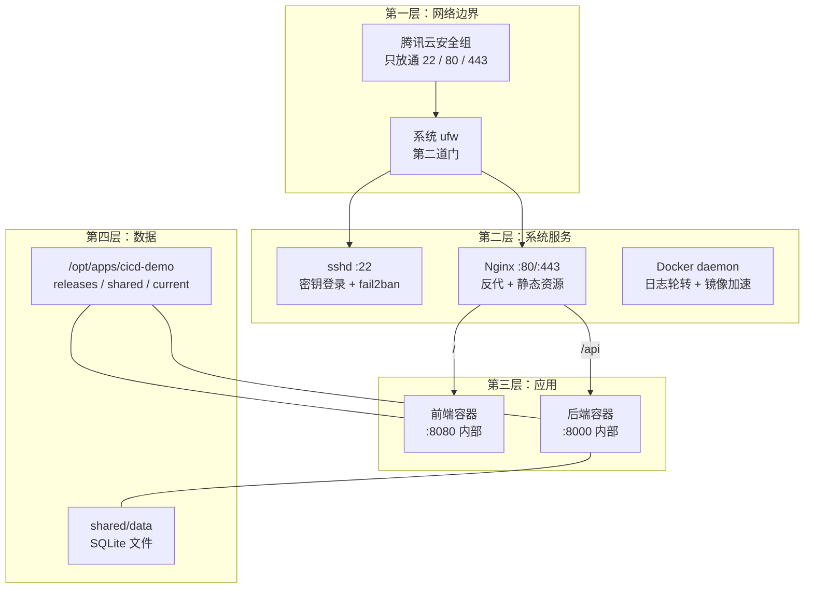

# 第 11 章 服务器初始化

> 难度：★★☆　预计耗时：60 分钟
> 本章目标：把一台刚买的云服务器，变成一台合格的生产机——装好 Docker/Nginx、配好防火墙、定好目录规范、有基本的入侵防护。**每一步都能验证，每一步都可回滚。**

---

## 一、为什么需要这一章

很多人拿到服务器第一件事是 `ssh root@ip`，然后 `apt install` 一通乱装。三个月后这台机器会变成什么样：

- 装了三四个版本的 Node，`node -v` 不知道指向哪个；
- 80 端口被某个已经忘掉的服务占着；
- 磁盘满，因为 Docker 日志从没轮转过；
- 防火墙全开，SSH 密码是 `Abc123456`，每天被爆破 8000 次；
- 换个人接手，完全不知道这台机器上有什么。

**初始化的本质，是把"机器的现状"变成"文档化的、可重复的状态"。** 这一章的脚本 `scripts/init-server.sh` 就是这份"状态说明书"——半年后重装机器，跑一遍就能恢复到同样的状态。

> **餐厅比喻**：新租的店面不能直接开火。要先通水电（装 Docker）、装排烟（Nginx）、贴消防通道标识（防火墙）、把后厨分成备菜区/烹饪区/出餐区（目录规范）。这一章就是装修。

---

## 二、原理图解：一台生产机的四层结构



三层防护的关系要说清：

| 层 | 管什么 | 配在哪 | 能不能被应用影响 |
| --- | --- | --- | --- |
| 安全组 | 云平台级，包进不来 | 腾讯云控制台 | 不能（最外层） |
| ufw | 系统级，端口级 | 服务器内 | 部分 |
| 应用监听地址 | 进程级，绑哪个 IP | 容器/compose | 能 |

**三层都要配，缺一层都不算完整**。只配安全组，机器内部被入侵后横向移动无阻拦；只配 ufw，云平台层面的扫描依然能看到端口。

---

## 三、先探测，再动手（真实数据）

第 00 章写过：**不了解现状就动手，是在赌运气。** 这是本项目生产机的真实探测结果（`scripts/probe-server.sh`，2026-11-11 14:17）：

```text
==================== 1. 系统 ====================
PRETTY_NAME="Ubuntu 26.04 LTS"
VERSION_ID="26.04"
内核: 7.0.0-30-generic
架构: x86_64
主机: VM-0-11-ubuntu

==================== 2. CPU / 内存 ====================
CPU 核数: 4
               total        used        free      shared  buff/cache   available
Mem:           3.6Gi       707Mi       2.0Gi       2.2Mi       1.2Gi       2.9Gi
Swap:          2.0Gi          0B       2.0Gi

==================== 3. 磁盘 ====================
Filesystem      Size  Used Avail Use% Mounted on
/dev/vda3        39G  6.0G   32G  17% /

==================== 4. Swap ====================
NAME      TYPE SIZE USED PRIO
/swap.img file   2G    0B   -1

==================== 5. 时间与时区 ====================
Local time: Wed 2026-11-11 14:17:22 CST
Time zone: Asia/Shanghai (CST, +0800)
System clock synchronized: yes

==================== 6. 已装工具 ====================
docker          NOT INSTALLED
nginx           NOT INSTALLED
git             /usr/bin/git
curl            /usr/bin/curl
python3         /usr/bin/python3      → Python 3.14.4
make            /usr/bin/make
ufw             /usr/sbin/ufw
fail2ban-client NOT INSTALLED
certbot         NOT INSTALLED

==================== 8. 监听端口 ====================
0.0.0.0:22     sshd
127.0.0.54:53  systemd-resolve
```

**从这张表能读出五个决策**：

| 发现 | 决策 |
| --- | --- |
| Ubuntu **26.04 LTS** | 用 `apt`；Docker 官方源可能还没收录该代号，脚本要能自动回退 |
| **4 核 / 3.6 GiB**，available 2.9 GiB | 够跑 Docker + 前后端 + Nginx；**但 Jenkins 仍然放本地**（构建峰值会挤占业务） |
| Python **3.14.4** | 太新，很多库还没有 wheel。**应用一律跑在 `python:3.11-slim` 容器里**，不用系统 Python |
| **Docker / Nginx 未装** | 本章要装，且要配国内镜像加速与日志轮转 |
| **80/443 空闲**，只监听 22 | 可直接用标准端口，HTTPS 走 443；安全组只需放通 22/80/443 |
| Swap 已有 2G | 不再创建，保留作为 OOM 兜底 |
| ufw 未启用 | 与安全组形成两层防护，本章启用 |

> **如果直接照抄网上教程**，大概率会踩两个坑：一是给 Ubuntu 26.04 套用 22.04 的 Docker 源（404）；二是用系统 Python 3.14 跑 FastAPI（依赖装不上）。**这就是"先探测"的价值。**

---

## 四、动手步骤

### 步骤 1 上传初始化脚本并试运行

```powershell
# 【本地】
scp I:/work-body-dir/cicd-tutorial/scripts/init-server.sh yengxun-yun:/tmp/init-server.sh
ssh yengxun-yun "bash -n /tmp/init-server.sh && echo 语法OK"
```

```bash
# 【服务器】先 dry-run，只打印不执行
sudo bash /tmp/init-server.sh --dry-run
```

**dry-run 会打印每一步要做什么**。确认没有意外操作后再正式跑。

### 步骤 2 正式执行（不含 SSH 加固）

```bash
# 【服务器】
sudo bash /tmp/init-server.sh
```

脚本按顺序做九件事：

| 步骤 | 做什么 | 为什么 |
| --- | --- | --- |
| 1 | `apt update` + 装基础工具 | 后面全靠 curl/gnupg |
| 2 | 装 Docker（官方源，失败回退 `docker.io`） | 新系统官方源可能没收录 |
| 3 | 配 daemon.json：日志轮转 + 镜像加速 | **40G 盘的头号杀手是容器日志** |
| 4 | 装 Nginx 并 `enable --now` | 开机自启 |
| 5 | 建 `/opt/apps/cicd-demo/{releases,shared,current}` | 支撑第 12 章的秒级回滚 |
| 6 | ufw：**先 allow 22，再 enable** | 顺序错了就失联 |
| 7 | fail2ban 保护 SSH | 阻止密码爆破 |
| 8 | （可选）SSH 加固 | 默认不做，见步骤 5 |
| 9 | 打印验证结果 | 眼见为实 |

### 步骤 3 逐项验证（不要只看脚本说"完成"）

```bash
# 【服务器】
docker --version && docker compose version
systemctl is-active docker nginx fail2ban
nginx -t
sudo ufw status verbose
ls -la /opt/apps/cicd-demo/
cat /etc/docker/daemon.json
```

预期输出要点：

```text
Docker version 29.x.x, build ...
Docker Compose version v5.x.x
active
active
active
nginx: configuration file /etc/nginx/nginx.conf test is successful
Status: active
22/tcp   ALLOW   Anywhere
80/tcp   ALLOW   Anywhere
443/tcp  ALLOW   Anywhere
drwxr-xr-x releases
drwxr-xr-x shared
lrwxrwxrwx current -> /opt/apps/cicd-demo/releases
```

**一个容易忽略的验证**：`docker compose version` 必须能输出。只有 `docker` 没有 compose 的机器，后面所有部署都会失败。

### 步骤 4 配置安全组（控制台操作，无法用命令行替代）

腾讯云控制台 → 云服务器 → 实例 → 安全组 → 修改规则 → 入站规则：

| 协议端口 | 来源 | 用途 | 是否必须 |
| --- | --- | --- | --- |
| TCP:22 | 你的固定公网 IP（**不要用 0.0.0.0/0**） | SSH | 必须 |
| TCP:80 | 0.0.0.0/0 | HTTP（跳转 HTTPS） | 必须 |
| TCP:443 | 0.0.0.0/0 | HTTPS | 必须 |
| ICMP | 0.0.0.0/0 | ping 排障 | 可选 |

**两个安全建议**：

1. **22 端口限定来源 IP**。你的家庭宽带 IP 会变，但至少别全网开放。临时出差可以用控制台的 VNC 登录。
2. **数据库端口绝不放通**（3306/5432/6379）。这些服务只应该被同一内网的容器访问。

### 步骤 5 SSH 加固（危险操作，按顺序来）

先看当前状态：

```bash
# 【服务器】
sudo sshd -T | grep -Ei 'passwordauthentication|permitrootlogin|pubkeyauthentication'
```

典型输出：

```text
passwordauthentication yes
permitrootlogin without-password
pubkeyauthentication yes
```

**加固的目标**：`PasswordAuthentication no`，`PermitRootLogin no`。

**执行前必须做的三件事**（顺序不能改）：

1. **另开一个终端**，确认 `ssh -o BatchMode=yes yengxun-yun "echo ok"` 能成功（证明密钥登录可用）。
2. **保持当前 SSH 会话不要关**（万一改坏了，还能在这个会话里改回来）。
3. **确认你能进腾讯云控制台的 VNC/救援登录**（最后一道保险）。

确认后再执行：

```bash
# 【服务器】
sudo bash /tmp/init-server.sh --harden-ssh
# 只做这一步也行：
sudo sed -ri 's/^#?PasswordAuthentication .*/PasswordAuthentication no/' /etc/ssh/sshd_config
sudo sed -ri 's/^#?PermitRootLogin .*/PermitRootLogin no/' /etc/ssh/sshd_config
sudo sshd -t && sudo systemctl reload ssh
```

验证：

```powershell
# 【本地】新开一个窗口
ssh -o BatchMode=yes yengxun-yun "echo 仍然可以登录"
ssh -o PreferredAuthentications=password -o PubkeyAuthentication=no ubuntu@49.234.202.181 "echo 应该失败"
```

第二条应该返回 `Permission denied (publickey)`——**这说明密码登录真的被禁了**。

### 步骤 6 目录规范：为"秒级回滚"打地基

脚本创建的结构：

```text
/opt/apps/cicd-demo/
├── releases/              每个版本一个目录：20261111-141700-42/
│   └── 20261111-141700-42/
│       ├── docker-compose.yml
│       └── .env
├── shared/                跨版本共享，回滚时不动
│   ├── data/              SQLite 文件
│   └── logs/              Nginx 之外的日志
└── current -> releases/20261111-141700-42    ← 软链接，切版本就是换它
```

为什么这么设计：

| 设计 | 好处 |
| --- | --- |
| 版本目录带时间戳 | 天然排序，一眼看出新旧 |
| `shared` 独立 | 回滚不会丢数据 |
| `current` 软链接 | 切版本是原子操作（`ln -sfn`），毫秒级 |
| 每个版本自带 compose 与 env | 版本可独立运行，回滚不需要"配套改配置" |

### 步骤 7 日志与磁盘的保命配置

`/etc/docker/daemon.json`（脚本已写入）：

```json
{
  "log-driver": "json-file",
  "log-opts": { "max-size": "10m", "max-file": "3" },
  "registry-mirrors": ["https://mirror.ccs.tencentyun.com"]
}
```

- `max-size: 10m` + `max-file: 3`：每个容器最多占 30MB 日志。不配的话，一个刷日志的应用一天能写几十 GB。
- `registry-mirrors`：腾讯云 CVM 内网镜像加速，拉公共镜像快很多。

改完必须重启：

```bash
sudo systemctl restart docker
docker info | grep -A2 "Registry Mirrors"
```

Nginx 日志也要轮转（Ubuntu 默认已配 `/etc/logrotate.d/nginx`，确认一下）：

```bash
cat /etc/logrotate.d/nginx
```

---

## 五、完整实例：一次完整的初始化（含验证）

```powershell
# 【本地】1. 上传脚本
scp I:/work-body-dir/cicd-tutorial/scripts/init-server.sh yengxun-yun:/tmp/init-server.sh

# 2. 语法检查
ssh yengxun-yun "bash -n /tmp/init-server.sh && echo 语法OK"

# 3. dry-run
ssh yengxun-yun "sudo bash /tmp/init-server.sh --dry-run"

# 4. 正式执行（约 3~6 分钟，取决于网络）
ssh yengxun-yun "sudo bash /tmp/init-server.sh"
```

```bash
# 【服务器】5. 逐项验证
echo "--- Docker ---"; docker --version; docker compose version
echo "--- Nginx ---"; nginx -v; systemctl is-active nginx
echo "--- 防火墙 ---"; sudo ufw status
echo "--- 目录 ---"; ls -la /opt/apps/cicd-demo/
echo "--- 资源 ---"; free -h | head -2; df -h / | tail -1
```

**验证成功的标准（六条全中）**：

1. `docker` 与 `docker compose` 都有版本输出
2. `systemctl is-active docker nginx fail2ban` 三行都是 `active`
3. `ufw status` 显示 22/80/443 放通，且状态为 `active`
4. `/opt/apps/cicd-demo/current` 是指向 `releases` 的软链接
5. `docker info` 里能看到 `Registry Mirrors: https://mirror.ccs.tencentyun.com`
6. 重新 `ssh` 一次仍能免密登录（说明没把自己锁在门外）

---

## 六、坑与排错

| 现象 | 根因 | 解法 |
| --- | --- | --- |
| 执行脚本后 SSH 断了，连不上 | ufw 在 allow 22 之前就 enable 了 | 控制台 VNC 登录 → `sudo ufw disable` → 修正顺序 |
| 改完 SSH 配置彻底失联 | 密钥没验证就禁了密码 | VNC 登录 → `sudo sed -i 's/^PasswordAuthentication no/PasswordAuthentication yes/' /etc/ssh/sshd_config` → reload |
| `apt update` 报 404 找不到 Docker 源 | 26.04 代号未被官方源收录 | 脚本已自动回退 `docker.io`；也可稍后重试官方源 |
| `docker: permission denied` | 用户不在 docker 组 | `sudo usermod -aG docker ubuntu`，然后**重新登录**（组权限不会即时生效） |
| `docker compose` 命令不存在 | 只装了 compose v1 或没装插件 | `apt install docker-compose-v2` 或用官方 `docker-compose-plugin` |
| Nginx 起不来，80 被占 | 有残留进程 | `sudo ss -tlnp \| grep :80` 找进程处理 |
| 拉镜像极慢 | 没配镜像加速 / 走了公网 | 检查 `daemon.json` 的 registry-mirrors；重启 docker |
| 容器日志把磁盘吃满 | 没配 log-opts | 加 `max-size`；已产生的日志用 `truncate -s 0` 清理 |
| fail2ban 把自己封了 | 多次输错密码 | 控制台登录 → `sudo fail2ban-client unbanip <你的IP>` |
| 系统时间不对导致 TLS 报错 | NTP 没同步 | `sudo timedatectl set-ntp true`，确认 `System clock synchronized: yes` |

---

## 七、横向对照：三种"运行环境"的初始化

| 项 | 自建云服务器（本章） | GitHub Actions | GitLab SaaS Runner |
| --- | --- | --- | --- |
| 系统 | 你自己选、自己装 | 平台预装 `ubuntu-latest` | 镜像由 `.gitlab-ci.yml` 的 `image` 决定 |
| Docker | 手动装 + 配加速 | 预装，直接可用 | 预装，DinD 需配置 |
| 防火墙 | 安全组 + ufw 两层 | 无需关心 | 无需关心 |
| 时区 | 需手动确认 | 默认 UTC | 默认 UTC |
| 持久化 | 你自己规划目录 | 无状态，每次全新 | 无状态 |
| 成本 | 机器 + 你的时间 | 免费额度 | 免费额度 |

> 一句话：**托管 Runner 帮你省掉了这一整章**，代价是"你对运行环境失去控制权"。这也是为什么内网部署最终还得回到自建。

---

## 八、本章检查清单与练习

### 检查清单

- [ ] 探测脚本的真实输出已存档（`docs/probe/`）
- [ ] Docker 与 Compose 都能输出版本
- [ ] `docker info` 里有 Registry Mirrors
- [ ] Nginx、docker、fail2ban 三个服务都是 `active`
- [ ] ufw 已启用，且只放通 22/80/443
- [ ] 安全组只放通 22/80/443，22 最好限定来源 IP
- [ ] `/opt/apps/cicd-demo/{releases,shared,current}` 存在且归属正确
- [ ] 另开终端验证过：免密登录仍可用；密码登录已被拒绝

### 练习

**练习 1**：为什么脚本里 `ufw allow OpenSSH` 必须在 `ufw --force enable` 之前？如果顺序反了会怎样？
<details><summary>参考要点</summary>

ufw 启用后默认拒绝所有入站，22 端口没放通会导致新建 SSH 连接全部被拒。已经建立的会话通常还能用，但一旦断开就再也连不上，只能控制台救援。
</details>

**练习 2**：`docker` 命令报 `permission denied while trying to connect to the Docker daemon socket`，为什么加了 docker 组还是不行？
<details><summary>参考要点</summary>

Linux 的附加组权限在登录时确定，`usermod -aG` 后当前会话不会刷新。需要退出重新登录（或 `newgrp docker`）。
</details>

**练习 3**：为什么本书坚持"生产机不装 JDK/Node/Python 依赖"？用这台机器的 Python 3.14 举例说明。
<details><summary>参考要点</summary>

① 系统 Python 3.14 太新，`pydantic` 等库可能没有对应 wheel，装不上或需要现场编译；② 编译会吃内存和 CPU，和业务抢资源；③ 多版本共存会造成"到底跑的是哪个 Python"的混乱；④ 容器化后运行环境随镜像走，服务器保持干净。
</details>

---

## 下一章预告

机器装好了，但"怎么把新版本放上去"才是 CI/CD 的核心。第 12 章把部署方式从最土到最稳演进一遍：手动 scp → systemd → Docker Compose → 蓝绿/滚动 → `releases` + `current` 秒级回滚，每一级都告诉你"为什么必须进化到下一级"。
