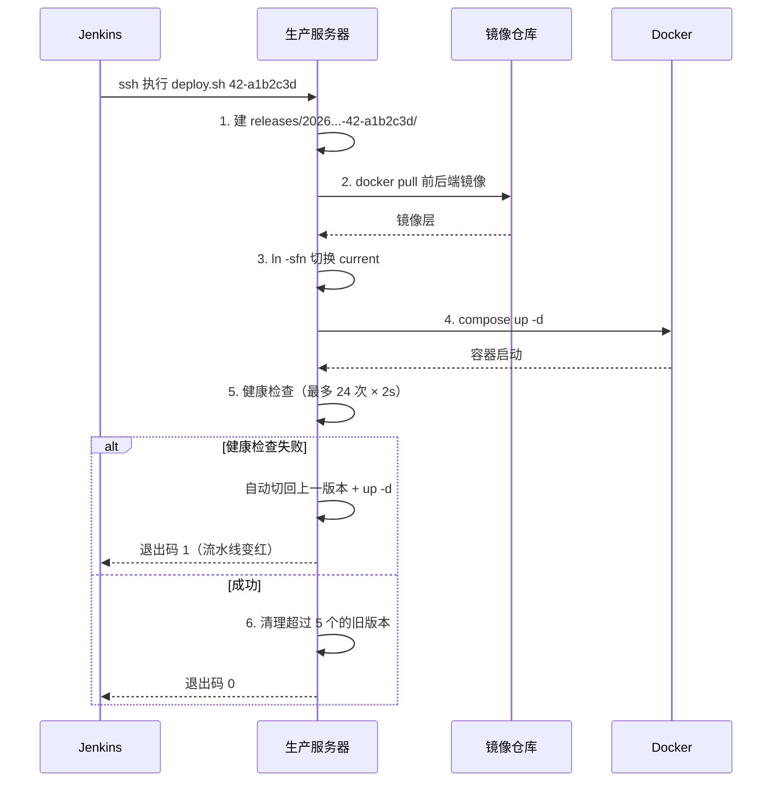

# 第 12 章 部署方式演进

> 难度：★★★　预计耗时：90 分钟
> 本章目标：理解部署方式的五个阶段，知道每一级为什么必须升级；能独立完成"发布新版本"和"30 秒回滚"两个动作。

---

## 一、为什么需要这一章

"部署"两个字，在不同团队手里是完全不同的东西：

- A 团队：`scp` 上传，覆盖原文件，重启服务。出问题就再传一次。
- B 团队：Jenkins 点一下按钮，2 分钟后线上是新版本。
- C 团队：部署失败自动回滚，用户完全无感。

差别不在工具，而在**是否想清楚了"版本"这件事**。

再看一次第 01 章那个回滚失败的场景：小张每次部署都 `scp app.jar` 覆盖服务器上的同一个文件。出问题时，**上一版已经不存在了**——不是他不会回滚，是结构上不支持。

> 这一章把部署从"覆盖文件"进化到"版本化 + 软链接切换"。做完之后，回滚就是换一个软链接，**秒级**。
>
> **餐厅比喻**：不是把新菜倒进旧盘子（覆盖），而是**每道菜都单独装盒、贴上批次号、摆进冷柜**（releases），传菜口永远指向"当前要上的那盒"（current）。客人投诉，把传菜口的标签换回上一盒即可。

---

## 二、原理图解：五个阶段的演进


| 阶段 | 怎么做的 | 解决什么 | 致命缺陷 | 何时升级 |
| --- | --- | --- | --- | --- |
| ① 手动 scp | 传文件 + 重启 | 能上线 | 无版本、无回滚、依赖靠运气 | 第一次线上事故 |
| ② systemd | 写 unit 文件托管进程 | 进程挂了能自启 | 环境不一致（本地能跑服务器不能） | 第二次"依赖缺失" |
| ③ Compose | 一个 yml 起全套 | 环境一致、依赖打包 | 发布要停服务、多实例困难 | 有用户投诉发布期间 502 |
| ④ 蓝绿/滚动 | 双实例 + 切流量 | 发布不断服 | 版本目录仍然混乱、回滚靠手工 | 版本超过 3 个 |
| ⑤ 版本目录 + 软链 | 每版一个目录，软链指向当前 | 秒级回滚、可追溯 | 需要额外脚本维护 | ——（本书终点） |

**关键认知：每一级不是"更高级的工具"，而是"解决上一级留下的具体问题"。** 没有经历过 ① 的痛，很难理解 ⑤ 为什么要这么设计。

---

## 三、动手步骤：五级各来一遍

> 以下每级都给"能跑的最小实现"，你可以在一台测试机上逐级体验。**跳过体验直接看第 5 级也可以，但第 5 级的每个设计点你都会似懂非懂。**

### 第 1 级：手动 scp（最土，但很多人真的这么干）

```bash
# 本地打包
npm run build
tar -czf dist.tar.gz -C dist .

# 上传并覆盖
scp dist.tar.gz yengxun-yun:/tmp/
ssh yengxun-yun "sudo rm -rf /var/www/html/* && sudo tar xzf /tmp/dist.tar.gz -C /var/www/html"
```

**问题清单**：

- 旧文件被 `rm -rf` 删了，回滚不可能；
- 传到一半断网，站点变成半新半旧；
- 每次都要人肉执行，忘了就忘发。

### 第 2 级：systemd 托管（解决"进程挂了没人管"）

`/etc/systemd/system/cicd-demo.service`：

```ini
[Unit]
Description=CI/CD Demo API
After=network.target

[Service]
Type=simple
User=ubuntu
WorkingDirectory=/opt/apps/cicd-demo/current
Environment="SQLITE_PATH=/opt/apps/cicd-demo/shared/data/app.db"
ExecStart=/opt/apps/cicd-demo/current/.venv/bin/uvicorn app.main:app --host 127.0.0.1 --port 8000
Restart=always
RestartSec=3
TimeoutStopSec=30

[Install]
WantedBy=multi-user.target
```

```bash
sudo systemctl daemon-reload
sudo systemctl enable --now cicd-demo
sudo systemctl status cicd-demo
journalctl -u cicd-demo -f
```

**解决了**：进程崩溃自动重启、开机自启、日志进 journald。

**没解决**：服务器上要有 Python 3.11 + 全部依赖（本机是 3.14，装不上 pydantic 的 wheel），"本地能跑、服务器报 `ModuleNotFoundError`"依然存在。

### 第 3 级：Docker Compose（解决"环境不一致"）

`docker-compose.yml`：

```yaml
services:
  api:
    image: ccr.ccs.tencentyun.com/cicd-demo/cicd-demo-backend:42-a1b2c3d
    ports: ["127.0.0.1:8000:8000"]
    volumes:
      - /opt/apps/cicd-demo/shared/data:/data
```

```bash
docker compose up -d
docker compose ps
docker compose logs -f api
```

**解决了**：依赖打包进镜像，服务器不需要装 Python/Node；环境与本地一致。

**没解决**：`up -d` 会先停旧容器再起新的，中间有 5~20 秒 502；而且**如果新镜像起不来，旧容器已经被停了**。

### 第 4 级：蓝绿发布（解决"发布期间中断"）

思路：同时跑两套，Nginx 只把流量给其中一套，新版本验证通过后再切。

```bash
# 绿色（新版本）起在 8001，蓝色（旧版本）还在 8000
docker run -d --name api-green -p 127.0.0.1:8001:8000 cicd-demo-backend:43-abcdef0

# 验证绿色健康
curl -fsS http://127.0.0.1:8001/healthz || { echo "绿色失败，不切流量"; exit 1; }

# 切 Nginx upstream
sudo sed -i 's/127.0.0.1:8000/127.0.0.1:8001/' /etc/nginx/conf.d/upstream.conf
sudo nginx -t && sudo systemctl reload nginx

# 观察 5 分钟，没问题再停蓝色
docker rm -f api-blue
```

**解决了**：零停机；新版本不健康时**流量根本不切过去**。

**代价**：资源翻倍（这台 4C3.6G 能承受，2G 机器不行）；Nginx 配置要改；版本目录依旧混乱。

> 单机也可以用滚动：一个实例一个实例替换。但只有一个后端实例时，滚动就退化成"先停后起"。所以单机真正实用的是**蓝绿思想**：新版本先起在备用端口，健康后切流量。

### 第 5 级：版本目录 + 软链接（本书方案）

```text
/opt/apps/cicd-demo/
├── releases/
│   ├── 20261111-141700-43-abcdef0/     ← 本次发布
│   │   ├── docker-compose.yml
│   │   ├── .env                        ← IMAGE_TAG=43-abcdef0
│   │   ├── VERSION
│   │   └── DIGEST
│   └── 20261111-120300-42-a1b2c3d/     ← 上一版（回滚目标）
├── shared/                              ← 跨版本共享，回滚不受影响
│   ├── data/                            ← SQLite
│   ├── nginx/site.conf
│   └── certs/
└── current -> releases/20261111-141700-43-abcdef0
```

发布与回滚的核心只有两行：

```bash
ln -sfn /opt/apps/cicd-demo/releases/<新版本> /opt/apps/cicd-demo/current   # 发布
ln -sfn /opt/apps/cicd-demo/releases/<旧版本> /opt/apps/cicd-demo/current   # 回滚
```

`ln -sfn` 是**原子操作**，切换瞬间完成；配合 `docker compose up -d`，整体回滚在 30 秒内。

---

## 四、完整实例：本书的发布脚本

脚本位置：`scripts/deploy.sh`（服务器上放在 `/opt/apps/cicd-demo/scripts/`）。

### 4.1 它做的六件事



### 4.2 关键代码逐段解释

```bash
# ① 版本号由外部传入，脚本自己不猜
TAG="${1:?用法: deploy.sh <镜像tag>}"

# ② 版本目录名 = 时间 + tag：既能排序，又能追溯
RELEASE_ID="$(date +%Y%m%d-%H%M%S)-${TAG}"

# ③ 记住上一版本，用于失败回滚
[ -L "$CURRENT_LINK" ] && PREVIOUS="$(readlink -f "$CURRENT_LINK")"

# ④ 中断也要回滚（Ctrl+C、SSH 断开）
trap 'echo "部署被中断"; rollback; exit 130' INT TERM
```

```bash
# ⑤ 每个版本目录自带 compose 与 env：回滚时不需要"配套改配置"
cp "$COMPOSE_SRC" "${RELEASE_DIR}/docker-compose.yml"
cat > "${RELEASE_DIR}/.env" <<EOF
REGISTRY=${REGISTRY}
NAMESPACE=${NAMESPACE}
IMAGE_TAG=${TAG}
EOF
```

```bash
# ⑥ 先拉镜像再切软链：拉取失败不会污染 current
docker pull "${REGISTRY}/${NAMESPACE}/cicd-demo-backend:${TAG}"
docker pull "${REGISTRY}/${NAMESPACE}/cicd-demo-frontend:${TAG}"
ln -sfn "$RELEASE_DIR" "$CURRENT_LINK"
```

```bash
# ⑦ 健康检查失败 → 回滚 → 非 0 退出（让流水线变红）
if ! bash "$(dirname "$0")/healthcheck.sh" "$HEALTH_URL" 24 2; then
  compose "$RELEASE_DIR" logs --tail 60
  rollback
  exit 1
fi
```

### 4.3 首次部署前的准备（在服务器上做一次）

```bash
# 【服务器】
cd /opt/apps/cicd-demo

# 1. 放脚本
sudo mkdir -p scripts
# 把 deploy.sh / rollback.sh / healthcheck.sh 上传到这里
sudo chmod +x scripts/*.sh

# 2. 放 compose 模板
sudo mkdir -p shared/nginx shared/certs
# 把 deploy/docker-compose.prod.yml 上传为 shared/docker-compose.prod.yml

# 3. 放 Nginx 站点配置（第 13 章详解内容）
# shared/nginx/site.conf

# 4. 数据目录授权：容器内是 uid 10001，宿主机必须对得上
sudo mkdir -p shared/data
sudo chown -R 10001:10001 shared/data

# 5. 验证目录
tree -L 2 /opt/apps/cicd-demo 2>/dev/null || ls -R /opt/apps/cicd-demo | head -30
```

> **为什么数据目录要 `chown 10001`**：镜像里用 `useradd -u 10001 appuser` 运行应用。宿主机目录属主是 root 时，容器里的 appuser 写不进去，日志只会报一句 `unable to open database file`。

### 4.4 发布一次（真实流程）

```bash
# 【服务器】首次发布
sudo REGISTRY=ccr.ccs.tencentyun.com \
     REGISTRY_NAMESPACE=cicd-demo \
     bash /opt/apps/cicd-demo/scripts/deploy.sh 42-a1b2c3d
```

预期输出：

```text
[14:30:01] 1/6 准备发布目录：/opt/apps/cicd-demo/releases/20261111-143001-42-a1b2c3d
[14:30:02] 2/6 拉取镜像
42-a1b2c3d: Pulling from cicd-demo/cicd-demo-backend
...
[14:30:10] 3/6 切换 current 并启动
 Container cicd-demo-api-1  Started
 Container cicd-demo-web-1  Started
[14:30:12] 4/6 健康检查：http://127.0.0.1:8000/healthz
健康检查：http://127.0.0.1:8000/healthz（最多 24 次，每次间隔 2s）
通过：第 2 次尝试（约 4 秒）
[14:30:16] 5/6 记录部署指纹
backend digest: ccr.ccs.tencentyun.com/...@sha256:9f2c...
[14:30:17] 6/6 清理旧版本（保留最近 5 个）
[14:30:17] 部署完成：42-a1b2c3d
当前版本目录：/opt/apps/cicd-demo/releases/20261111-143001-42-a1b2c3d
```

### 4.5 回滚（这才是重点）

```bash
# 查看有哪些版本
sudo bash /opt/apps/cicd-demo/scripts/rollback.sh --list
```

```text
当前版本：/opt/apps/cicd-demo/releases/20261111-143001-42-a1b2c3d
可用版本（新→旧）：
  20261111-143001-42-a1b2c3d ← 当前
  20261111-120300-41-9e8d7c6
  20261110-180200-40-1a2b3c4
```

```bash
# 回到上一个版本（一条命令）
sudo bash /opt/apps/cicd-demo/scripts/rollback.sh
```

```text
[15:02:11] 回滚到：20261111-120300-41-9e8d7c6
 Container cicd-demo-api-1  Started
[15:02:14] 健康检查
通过：第 1 次尝试（约 2 秒）
[15:02:15] 回滚完成，当前版本：20261111-120300-41-9e8d7c6
```

**全过程 4 秒。** 这就是"版本目录 + 软链"的威力。

---

## 五、坑与排错

| 现象 | 根因 | 解法 |
| --- | --- | --- |
| `current: No such file or directory` | 软链用了相对路径 | 用 `ln -sfn` 指向**绝对路径** |
| 回滚后容器还是新版本 | `compose` 用了缓存或 env 文件没换 | 回滚要同时切软链 **和** 用对应目录的 `.env` |
| `compose up` 报端口占用 | 上一个 release 的容器没停 | 加 `--remove-orphans`；确认 `name:` 一致，避免不同 project 名并存 |
| 新版本起不来，旧版本也没了 | `up -d` 先停旧再起新 | 用"先拉镜像 + 健康检查 + 失败回滚"；或蓝绿两个端口并存 |
| `unable to open database file` | 数据目录 uid 不匹配 | `chown -R 10001:10001 shared/data` |
| 部署脚本被 Ctrl+C 中断，状态混乱 | 没写 trap | 加 `trap ... INT TERM` 自动回滚 |
| `releases` 目录越积越多 | 没有清理逻辑 | 保留最近 N 个（脚本已实现） |
| `ln -sfn` 后目录没变 | 目标是目录且已存在时行为不同 | 用 `ln -sfnT`（Linux）或先 `rm -f` 再 `ln -s` |
| 发布成功但页面还是旧的 | Nginx 或浏览器缓存 | `index.html` 设 no-cache；确认 Nginx reload |
| 首次发布时 `PREVIOUS` 为空 | 没有上一版本 | 脚本已判断：无可回滚时保持现状并报错 |

---

## 六、横向对照

| 能力 | 本书方案（单机） | Kubernetes | 云平台"发布"功能 |
| --- | --- | --- | --- |
| 版本管理 | releases 目录 | Deployment revision | 平台自动保留 |
| 切流量 | 软链 + compose up | Service selector / Ingress | 平台控制 |
| 回滚 | `rollback.sh`（4 秒） | `kubectl rollout undo` | 控制台点按钮 |
| 零停机 | 蓝绿（双端口） | 滚动/金丝雀 | 视平台 |
| 成本 | 一台机器 | 集群 | 按量计费 |
| 复杂度 | 低 | 高 | 中 |

> 别急着上 K8s：单机 + 版本目录 + 健康检查，已经能覆盖 90% 的中小项目需求。第 20 章会讲什么时候真的需要 K8s。

---

## 七、本章检查清单与练习

### 检查清单

- [ ] 能说出五级部署各自的致命缺陷
- [ ] 服务器上有 `/opt/apps/cicd-demo/{releases,shared,current}`
- [ ] `deploy.sh` 能跑通一次发布（健康检查通过、current 指向新版本）
- [ ] `rollback.sh --list` 能看到版本列表
- [ ] 手动回滚过一次，耗时 < 30 秒
- [ ] 数据目录 `chown 10001` 过，SQLite 可写
- [ ] 知道为什么 `docker pull` 要放在切软链之前

### 练习

**练习 1**：为什么"每个版本目录自带一份 `docker-compose.yml` 和 `.env`"，而不是共用一份？
<details><summary>参考要点</summary>

回滚时需要"连配置一起回滚"。共用 compose 时，新版本改了环境变量，回滚旧镜像却用新配置，容易出现"镜像旧、配置新"的诡异错误。版本目录自包含，才能保证"回滚 = 回到当时完整的状态"。
</details>

**练习 2**：`deploy.sh` 里为什么先 `docker pull` 再 `ln -sfn`？如果顺序反了会怎样？
<details><summary>参考要点</summary>

拉取可能失败（网络/权限/镜像不存在）。先切软链后拉取，会让 `current` 指向一个镜像还没拉下来的版本，`up -d` 失败且旧容器已被移除，服务直接不可用。
</details>

**练习 3**：单机怎么近似实现"零停机发布"？写出关键步骤。
<details><summary>参考要点</summary>

① 新版本容器起在备用端口（如 8001）；② `curl` 健康检查通过；③ 改 Nginx upstream 指向 8001 并 `reload`（reload 不会断开已有连接）；④ 观察一段时间后停旧容器。失败则不切流量，直接删新容器。
</details>

---

## 下一章预告

站点已经能跑，但用户访问的是 `http://49.234.202.181`——没有 HTTPS，密码明文传输，浏览器还会提示"不安全"。第 13 章解决 Nginx 反代与 HTTPS：在没有域名的情况下，怎么签出一张能用的证书，以及配错一个 `location` 会引发什么样的线上事故。
