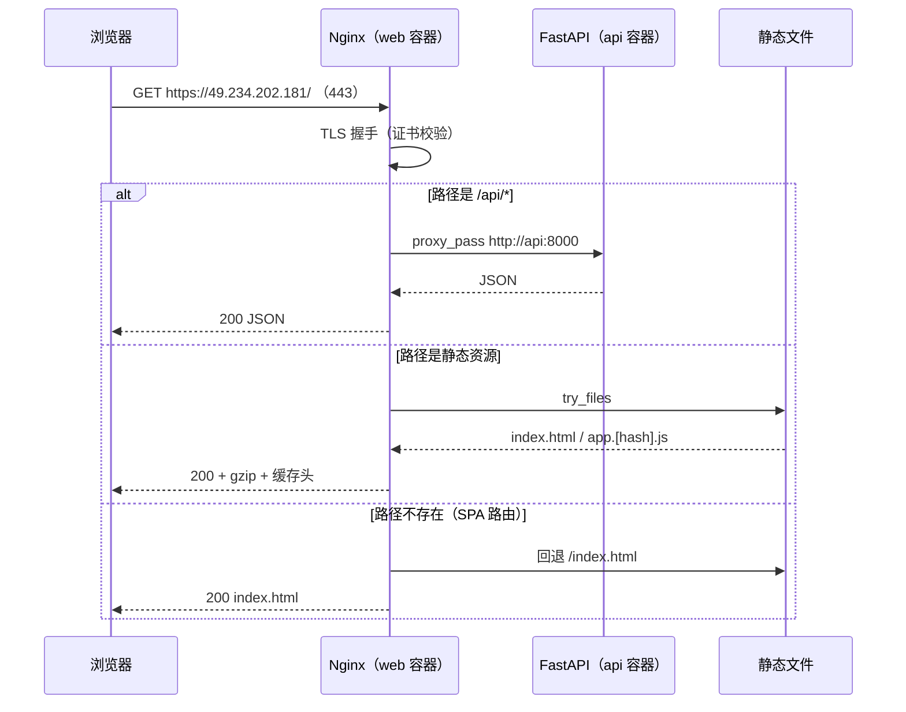

# 第 13 章 Nginx 与 HTTPS

> 难度：★★★　预计耗时：90 分钟
> 本章目标：让站点通过 `https://` 正常访问（没有域名也能做到），并搞清楚 Nginx 的 `location` 匹配、反代请求头、缓存策略这三个最容易出事故的地方。

---

## 一、为什么需要这一章

先看三个真实故障：

**故障 1：全站白屏，控制台一片红。**

```
Mixed Content: The page at 'https://xxx' was loaded over HTTPS,
but requested an insecure resource 'http://49.234.202.181:8000/api/tasks'.
```

前端硬编码了 `http://IP:8000`，页面本身是 HTTPS，浏览器直接拦掉所有请求。**HTTPS 页面里不允许请求 HTTP 资源**，这叫混合内容。

**故障 2：刷新页面就 404。**

首页能打开，点进 `/tasks` 再刷新就 404。因为 Nginx 在磁盘上找不到 `/tasks` 这个文件，也没有配 SPA 回退。

**故障 3：接口偶发 502，但后端明明是好的。**

Nginx 里写了 `proxy_pass http://127.0.0.1:8000`，但后端跑在 Docker 容器里，`127.0.0.1` 指的是**前端容器自己**，当然连不上。容器之间要用服务名。

> 这一章的三个目标：**上 HTTPS（没有域名也行）**、**搞清楚请求是怎么被路由的**、**把最容易出错的三个配置点写对**。

---

## 二、原理图解：一个请求的完整旅程



三个角色要说清：

| 角色 | 在哪 | 职责 |
| --- | --- | --- |
| Nginx | `web` 容器内，监听 80/443 | TLS 终止、静态文件、反代 API、压缩、缓存头 |
| 静态文件 | 前端镜像里的 `/usr/share/nginx/html` | 构建产物，带 hash 文件名 |
| FastAPI | `api` 容器内，监听 8000（仅 127.0.0.1 暴露） | 业务接口与 `/healthz` |

> **为什么后端只绑 `127.0.0.1:8000`**：公网只能通过 Nginx 进来。这样即使后端有漏洞，也无法被直接扫描到（少一层暴露面）。

---

## 三、动手步骤

### 步骤 1 理解 Nginx 的四个目录（容器内外不一样）

宿主机上的位置（本项目）：

```text
/opt/apps/cicd-demo/shared/nginx/site.conf    ← 我们写的站点配置
/opt/apps/cicd-demo/shared/certs/server.crt   ← 证书
/opt/apps/cicd-demo/shared/certs/server.key   ← 私钥
```

容器内的映射（`docker-compose.prod.yml` 已配好）：

```text
site.conf → /etc/nginx/conf.d/default.conf   （覆盖镜像自带的默认站点）
certs/    → /etc/nginx/certs                  （只读）
```

**为什么不在镜像里改配置**：配置随环境变（证书、上游地址），镜像要"一次构建、处处运行"。所以配置用挂载注入。

### 步骤 2 生成自签证书（没有域名的解法）

先走一遍"自签 CA"的完整流程，理解证书是怎么回事。

```bash
# 【服务器】
cd /opt/apps/cicd-demo/shared/certs
sudo bash /opt/apps/cicd-demo/scripts/gen-selfsigned-cert.sh 49.234.202.181
```

脚本做了五件事：

| 步骤 | 命令 | 作用 |
| --- | --- | --- |
| 1 | `openssl req -x509 -newkey rsa:4096 ...` | 生成根 CA（自己当发证机构） |
| 2 | `openssl req -newkey rsa:2048 -nodes ...` | 生成服务器私钥与 CSR（证书请求） |
| 3 | 写 `san.cnf` | 声明这张证书适用于 `IP:49.234.202.181` |
| 4 | `openssl x509 -req -CA ... -extfile san.cnf` | 用 CA 签发服务器证书 |
| 5 | `openssl x509 -in server.crt -noout -dates` | 自检有效期 |

输出示例：

```text
subject=CN = 49.234.202.181, O = CICD Tutorial
issuer=CN = CICD Demo Root CA, O = CICD Tutorial
notBefore=Nov 11 06:30:00 2026 GMT
notAfter=Feb 14 06:30:00 2029 GMT
X509v3 Subject Alternative Name:
    IP Address:49.234.202.181, IP Address:127.0.0.1, DNS:localhost
```

**必须理解的三个点**：

1. **SAN（Subject Alternative Name）是现代浏览器唯一认的字段**。只写 `CN=IP` 的证书，Chrome 会直接报 `NET::ERR_CERT_COMMON_NAME_INVALID`。
2. **自签证书在别人电脑上一定"不安全"**——因为对方的浏览器不认识你的 CA。这就是为什么需要"把 `ca.crt` 导入信任"。
3. **私钥权限必须是 600**。权限过宽 Nginx 启动会警告，也是安全隐患。

**导入信任（Windows，只在你自己的电脑上做）**：

```powershell
# 【本地】把 ca.crt 拉到本地
scp yengxun-yun:/opt/apps/cicd-demo/shared/certs/ca.crt .

# 打开"管理计算机证书"：Win+R → certlm.msc
# 受信任的根证书颁发机构 → 证书 → 右键"所有任务" → 导入 → 选择 ca.crt
```

> 只在自己的开发机上导入，**不要让用户去导入**。生产环境还是需要真证书（见步骤 6）。

### 步骤 3 写站点配置（本项目的 `deploy/nginx/site.conf`）

完整配置见 `deploy/nginx/site.conf`，这里拆解四个关键段落。

**① 80 端口只做跳转，不服务内容**

```nginx
server {
    listen 80;
    server_name _;
    location = /healthz { proxy_pass http://api:8000/healthz; }
    location / { return 301 https://$host$request_uri; }
}
```

为什么 `/healthz` 要单独放行：有些监控/负载均衡只用 HTTP 探活，跟着跳转会被判为异常。

**② 443 端口：TLS + 静态 + 反代**

```nginx
server {
    listen 443 ssl;
    http2 on;
    ssl_certificate     /etc/nginx/certs/server.crt;
    ssl_certificate_key /etc/nginx/certs/server.key;
    ssl_protocols       TLSv1.2 TLSv1.3;

    root  /usr/share/nginx/html;
    index index.html;
    client_max_body_size 20m;

    location /api/ {
        proxy_pass         http://api:8000;
        proxy_set_header   Host              $host;
        proxy_set_header   X-Real-IP         $remote_addr;
        proxy_set_header   X-Forwarded-For   $proxy_add_x_forwarded_for;
        proxy_set_header   X-Forwarded-Proto $scheme;
    }

    location / {
        try_files $uri $uri/ /index.html;
    }
}
```

四个必须写的反代头，各自解决一个问题：

| 头 | 不写会怎样 |
| --- | --- |
| `Host` | 后端生成的绝对链接、重定向地址会变成容器 IP |
| `X-Real-IP` | 后端日志里所有客户端 IP 都是 `172.x.x.x`（Nginx 的地址） |
| `X-Forwarded-For` | 多级代理时拿不到真实来源，风控/限流失效 |
| `X-Forwarded-Proto` | 后端以为自己被 HTTP 访问，生成 `http://` 链接 → 混合内容 |

**③ 缓存：入口不缓存，资源长缓存**

```nginx
location ~* \.(js|css|png|jpg|svg|woff2?)$ {
    expires 30d;
    add_header Cache-Control "public, immutable";
}

location = /index.html {
    add_header Cache-Control "no-cache, no-store, must-revalidate";
}
```

原理：Vite 构建出的文件名带内容 hash（`index-a1b2c3.js`），内容变了文件名就变，所以可以放心缓存一年。但 `index.html` 是"资源清单"，必须每次拿最新的，否则用户永远加载旧版本。

**④ SPA 回退**

```nginx
location / {
    try_files $uri $uri/ /index.html;
}
```

含义：先找同名文件，再找同名目录，都没有就返回 `index.html`（由前端路由处理）。**不写这一行，刷新任何非首页都会 404。**

### 步骤 4 `location` 匹配优先级（背下来，能省一天）

```text
① = /exact          精确匹配，最高优先级
② ^~ /prefix        前缀匹配，命中后不再检查正则
③ ~  \.php$         正则匹配（区分大小写），按出现顺序
④ ~* \.(jpg|png)$   正则匹配（不区分大小写）
⑤ /prefix           普通前缀匹配，最长者优先
```

记忆口诀：**等号 > 尖号 > 正则 > 普通前缀**。

三个常见误配：

| 写法 | 问题 |
| --- | --- |
| `location /api { proxy_pass http://api:8000; }` | `/apixxx` 也会被匹配，误伤其他路径 |
| `location /api/ { proxy_pass http://api:8000/api/; }` | 路径被二次拼接，变成 `/api/api/tasks` |
| `location ~ \.js$` 写在 `/api/` 之前 | 正则优先级高于普通前缀，`/api/xxx.js` 会被当静态文件 |

> 建议：API 用 `location /api/`，静态资源用正则，SPA 回退放最后。

### 步骤 5 部署并验证 HTTPS

```bash
# 【服务器】1. 放配置与证书
sudo ls -l /opt/apps/cicd-demo/shared/nginx/site.conf
sudo ls -l /opt/apps/cicd-demo/shared/certs/

# 2. 重启前端容器让配置生效（改配置才 restart；改证书 reload 即可）
cd /opt/apps/cicd-demo/current
sudo docker compose restart web

# 3. 检查容器内配置语法
sudo docker compose exec web nginx -t
```

验证四连：

```bash
# ① HTTP 是否跳转
curl -I http://49.234.202.181/
# 期望：301，Location: https://...

# ② HTTPS 是否可用（自签要加 -k 跳过校验）
curl -kI https://49.234.202.181/
# 期望：200，且 content-type: text/html

# ③ 证书内容是否正确（SAN 含 IP）
openssl s_client -connect 49.234.202.181:443 -servername 49.234.202.181 </dev/null 2>/dev/null \
  | openssl x509 -noout -subject -dates -ext subjectAltName

# ④ 用 CA 校验（证明证书链是通的）
curl --cacert /opt/apps/cicd-demo/shared/certs/ca.crt \
     https://49.234.202.181/healthz
# 期望：{"status":"ok","version":"..."}
```

四条全过，HTTPS 就算配好了。

### 步骤 6 进阶：用 sslip.io 拿到真证书（可选）

自签证书的问题是"每个客户端都要导入信任"。如果你能接受用一个"临时域名"，可以走这条路：

1. `49.234.202.181.sslip.io` 会自动解析到 `49.234.202.181`（无需你配置 DNS）。
2. 安装 certbot，用 HTTP-01 验证签发：

```bash
sudo apt install -y certbot
sudo certbot certonly --webroot -w /var/www/html \
  -d 49.234.202.181.sslip.io \
  --email you@example.com --agree-tos --non-interactive
```

> 但我们的站点跑在容器里，`--webroot` 需要可达的静态目录。更简单的方式是 `--standalone`（临时占用 80 端口），或把 certbot 也放进容器。**这是"可选进阶"，主线仍用自签证书。**

**风险提示**：`sslip.io` 依赖境外 DNS，国内解析可能不稳定；正式业务请购买域名（几十元一年），不要依赖临时方案。

**买了域名之后要改哪里（只有三处）**：

1. `shared/certs/` 换成真证书（或配 certbot 自动续期）
2. `site.conf` 的 `server_name _;` 改成你的域名
3. 前端 `VITE_API_BASE` 保持 `/api`（不需要改，同源反代）

### 步骤 7 证书到期与监控

自签证书 825 天，Let's Encrypt 90 天。到期那天站点会直接打不开（浏览器拦截），比 502 更严重。

```bash
# 查看剩余天数
openssl x509 -in /opt/apps/cicd-demo/shared/certs/server.crt -noout -enddate

# 一条命令算剩余天数（<30 天该处理了）
openssl x509 -in /opt/apps/cicd-demo/shared/certs/server.crt -noout -checkend 2592000 \
  && echo "30 天内不会过期" || echo "警告：30 天内过期"
```

把这条命令加进监控（第 18 章），或者写进 `healthcheck.sh` 的扩展项。

---

## 四、完整实例：从 HTTP 到 HTTPS 的完整变更

假设站点现在只能 `http://49.234.202.181` 访问。

```bash
# 【服务器】1. 生成证书
cd /opt/apps/cicd-demo/shared/certs
sudo bash /opt/apps/cicd-demo/scripts/gen-selfsigned-cert.sh 49.234.202.181

# 2. 上传 site.conf（本地执行）
#    scp deploy/nginx/site.conf yengxun-yun:/tmp/site.conf
#    ssh yengxun-yun "sudo mv /tmp/site.conf /opt/apps/cicd-demo/shared/nginx/site.conf"

# 3. 重启 web 容器
cd /opt/apps/cicd-demo/current
sudo docker compose restart web
sudo docker compose logs --tail 30 web

# 4. 四项验证
curl -I http://49.234.202.181/
curl -kI https://49.234.202.181/
curl --cacert /opt/apps/cicd-demo/shared/certs/ca.crt https://49.234.202.181/healthz
sudo docker compose exec web nginx -t
```

**验证成功的标准**：

- `curl -I http://...` 返回 `301` 且 `Location` 是 https
- `curl -kI https://...` 返回 `200`
- 用 `--cacert` 校验通过（说明证书链完整、SAN 正确）
- 浏览器打开 `https://49.234.202.181`（导入 CA 后）显示锁形图标，无混合内容警告
- 刷新任意前端路由不 404

---

## 五、坑与排错

| 现象 | 根因 | 解法 |
| --- | --- | --- |
| `NET::ERR_CERT_COMMON_NAME_INVALID` | 证书没写 SAN，或 SAN 里没有你访问的地址 | 重新签发，`san.cnf` 加 `IP:公网IP` |
| `NET::ERR_CERT_AUTHORITY_INVALID` | 自签 CA 未被信任 | 导入 `ca.crt`；或换真证书 |
| 页面白屏 + 控制台 Mixed Content | 前端请求了 `http://` 接口 | 前端用相对路径 `/api`，由 Nginx 反代 |
| 刷新 404 | 缺 `try_files ... /index.html` | 补上 |
| `502 Bad Gateway` | `proxy_pass` 指向 `127.0.0.1:8000`（容器内是自己） | 改成 `http://api:8000` |
| `413 Request Entity Too Large` | 默认 `client_max_body_size 1m` | 调到 20m |
| 改了配置没生效 | 没 reload/restart，或挂载路径错 | `nginx -t` 后 `restart`；检查容器内文件 |
| `nginx: [emerg] cannot load certificate` | 路径错或权限不对 | 确认 `/etc/nginx/certs/server.crt` 存在；私钥 600 |
| 接口路径变成 `/api/api/...` | `proxy_pass` 末尾多了 `/api/` | 用 `proxy_pass http://api:8000;`（不带路径） |
| 图片/JS 走了 API 反代 | `location` 优先级错 | 正则 location 放前面，或 API 用 `^~ /api/` |
| 上线后用户仍是旧页面 | `index.html` 被缓存 | 入口文件加 `no-cache` |
| 开 HSTS 后 HTTP 彻底不能访问 | HSTS 被浏览器记住 | 自签阶段不要开；测试用无痕窗口 |

---

## 六、横向对照

| 能力 | 自建 Nginx | 云厂商负载均衡 | K8s Ingress |
| --- | --- | --- | --- |
| TLS 终止 | 自己配证书 | 控制台上传证书 | Ingress Controller + Secret |
| 反代到应用 | `proxy_pass` | 后端服务器组 | Service |
| 证书续期 | certbot / 手动 | 平台托管 | cert-manager |
| 配置方式 | 文本文件 | 控制台/API | YAML |
| 适合 | 单机、完全可控 | 多机、免运维 | 集群 |

---

## 七、本章检查清单与练习

### 检查清单

- [ ] `http://` 自动跳 `https://`
- [ ] 证书 SAN 包含公网 IP
- [ ] `curl --cacert ca.crt https://IP/healthz` 通过
- [ ] 反代四个头都写了
- [ ] `index.html` 不缓存、带 hash 的资源长缓存
- [ ] 刷新任意前端路由不 404
- [ ] 知道买了域名后只需改三处

### 练习

**练习 1**：为什么 `proxy_pass http://api:8000;` 不能写成 `http://127.0.0.1:8000`？
<details><summary>参考要点</summary>

`127.0.0.1` 在 Nginx 容器内指向容器自身，而后端跑在另一个容器里。Docker Compose 会为服务创建 DNS，用服务名 `api` 才能解析到后端容器 IP。
</details>

**练习 2**：`location /api/ { proxy_pass http://api:8000/api/; }` 会导致什么？怎么改？
<details><summary>参考要点</summary>

请求 `/api/tasks` 会被转发成 `/api/api/tasks`（前缀被替换拼接）。改成 `proxy_pass http://api:8000;`（不带 URI 部分）即可保持原路径。
</details>

**练习 3**：为什么自签证书必须包含 SAN，而不能只写 CN？
<details><summary>参考要点</summary>

现代浏览器（Chrome 58+）已完全忽略 CN，只校验 SAN。缺 SAN 或 SAN 不含访问地址，一律报 `COMMON_NAME_INVALID`。
</details>

---

## 下一章预告

HTTPS 通了，但"配置"本身还散落在各处：数据库路径、密钥、端口、镜像 tag。第 14 章把配置收拢成一套可审计的体系：环境变量分层、Secrets 不入库、SQLite 数据卷与备份、以及"回滚时数据库怎么办"这个最容易被忽略的坑。
