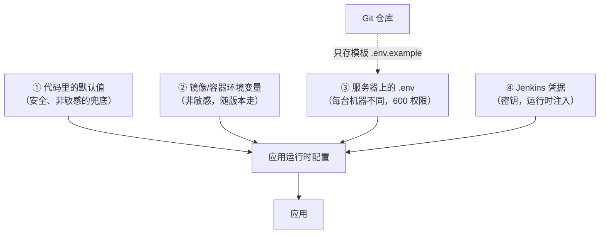
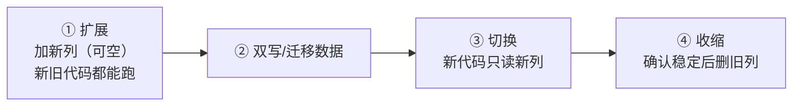

# 第 14 章 配置管理与数据持久化

> 难度：★★☆　预计耗时：70 分钟
> 本章目标：把配置从"散落在代码各处的字符串"变成"可审计、可回滚、不泄露"的一套体系；同时把数据从"容器里的临时文件"变成"删了容器也不丢"的持久化卷，并具备备份与恢复能力。

---

## 一、为什么需要这一章

四个真实事故：

**事故 1：密钥进了 Git。**
开发图方便，把数据库密码写在 `config.py` 里推了上去。三个月后仓库开源，密码泄露。改密码只需要 5 分钟，但**Git 历史里那条记录删不掉**（除非重写历史），任何克隆过仓库的人都还留着。

**事故 2：配置漂移。**
测试环境 `DB_HOST=test-db`，生产环境忘了改，应用连到测试库跑了半天，把测试数据写进了测试库，生产用户看到的是别人的数据。

**事故 3：数据丢了。**
SQLite 文件写在容器可写层，`docker compose down -v` 一次，一年的数据清零。而"备份"是这样一个状态：**从来没人做过，也没人验证过**。

**事故 4：回滚把数据搞坏了。**
新版本加了一个字段，发布后回滚到旧版本——旧代码不认识新字段，直接报错。**代码能回滚，数据库回滚不了。**

> 这一章的四个产出：**配置分层**、**密钥不出现在代码里**、**数据持久化 + 可验证的备份**、**迁移与回滚的兼容原则**。

---

## 二、原理图解：配置的四层来源



四层各管什么：

| 层 | 存什么 | 存哪 | 能不能进 Git |
| --- | --- | --- | --- |
| 代码默认值 | 端口、时区、日志级别 | 代码 | 能 |
| 容器环境变量 | 应用名、内部地址 | compose | 能 |
| 服务器 `.env` | 每台机器不同的值（端口、路径） | 服务器 `shared/` | **不能** |
| 凭据 | 密码、Token、私钥 | Jenkins Credentials | **绝对不能** |

> **12-Factor 原则一句话**：配置与代码分离，同一份制品通过不同配置适配不同环境。

---

## 三、动手步骤

### 步骤 1 建立 `.env` 规范

**仓库里只放模板** `env.example`（本项目已提供），真实 `.env` 只在服务器上：

```bash
# 【服务器】
sudo install -m 600 -o ubuntu -g ubuntu /dev/null /opt/apps/cicd-demo/shared/.env
sudo nano /opt/apps/cicd-demo/shared/.env
```

模板内容（按实际改）：

```dotenv
APP_ENV=production
APP_PORT=8000
SQLITE_PATH=/data/app.db
LOG_LEVEL=info
```

三条规矩：

1. **权限 600**：`-rw-------`，只有属主能读。`chmod 644` 等于把配置广播给机器上所有用户。
2. **不进 Git**：`.gitignore` 里必须有 `.env` 和 `.env.*`（本项目已配）。
3. **有模板**：新人看 `.env.example` 就知道要配哪些项，不用猜。

> 注意：`.env` 在 compose 里是**给 compose 变量替换用**的；要传给容器内部，还得在 `environment:` 或 `env_file:` 里声明。两者不要混。

### 步骤 2 密钥怎么放：三种方式对照

| 方式 | 安全性 | 适合 | 缺点 |
| --- | --- | --- | --- |
| 写在 `.env`（服务器） | 中 | 单机、密钥少 | 谁能登服务器谁就能看 |
| Jenkins 凭据 + 运行时注入 | 高 | CI 触发的部署、多环境 | 需要 CI 参与，本地调试麻烦 |
| 云 KMS / Vault | 最高 | 合规要求高、多服务 | 复杂、要额外服务 |

**本项目的分工**：

- **镜像仓库密码** → Jenkins 凭据 `tcr-registry`（只在 CI 里用）
- **SSH 私钥** → Jenkins 凭据 `deploy-ssh-key`（只在 CI 里用）
- **应用 Secret（如会话密钥）** → 服务器 `shared/.env`，权限 600
- **数据库文件** → 不含密钥，纯数据

**检查有没有泄露**（第 09 章的 gitleaks 已覆盖，这里手动再来一次）：

```bash
# 【本地】确认 .env 没被追踪
git ls-files | grep -E '\.env' || echo "没有 .env 入库，很好"
```

如果已经入库了：

```bash
git rm --cached .env
git commit -m "chore: 移除误提交的环境文件"
# 然后立刻更换泄露的密钥（历史里还在！）
```

### 步骤 3 SQLite 持久化：路径、权限、并发

**路径设计**：

```text
宿主机：/opt/apps/cicd-demo/shared/data/app.db
容器内：/data/app.db   （SQLITE_PATH 指向这里）
```

compose 已配：

```yaml
volumes:
  - ${APP_BASE_DIR}/shared/data:/data
```

**权限（最容易踩）**：

```bash
# 容器内 appuser 的 uid 是 10001
sudo mkdir -p /opt/apps/cicd-demo/shared/data
sudo chown -R 10001:10001 /opt/apps/cicd-demo/shared/data
ls -ldn /opt/apps/cicd-demo/shared/data
# 应该看到 10001 10001
```

**WAL 模式**：`db.py` 里已开 `PRAGMA journal_mode=WAL`，好处是读写并发更友好。代价是目录里会多出 `-wal` 和 `-shm` 文件，备份时**不能只拷 `.db`**（见步骤 4）。

**SQLite 的边界**：单机、低频写、单实例完全够用。不适合：多实例同时写、写并发很高。到了那一步就该换 PostgreSQL（第 20 章讲演进信号）。

### 步骤 4 备份：cp 是错的

**为什么不能 `cp app.db`**：WAL 模式下，数据可能还在 `app.db-wal` 里没合并进主文件。cp 出来的库可能是旧的，甚至损坏。

正确做法：用 SQLite 的在线备份 API（`.backup` 命令或 Python `backup()`），它会拿到一致性快照。

本项目脚本 `scripts/backup-data.sh`：

```bash
# 【服务器】
sudo bash /opt/apps/cicd-demo/scripts/backup-data.sh
```

四步：

| 步骤 | 做什么 | 为什么要做 |
| --- | --- | --- |
| 1 | `sqlite3 .backup` 或 Python backup API | 在线热备，不加锁、不损坏 |
| 2 | gzip 压缩 | 省空间（SQLite 压缩比通常 3~5 倍） |
| 3 | **解压并打开校验** | 备份不验证 = 没有备份 |
| 4 | 删除 14 天前的 | 防止备份把磁盘吃满 |

输出示例：

```text
[15:20:01] 1/4 在线备份 /opt/apps/cicd-demo/shared/data/app.db
[15:20:01] 备份完成：/opt/apps/cicd-demo/shared/backups/app-20261111-152001.db（32K）
[15:20:02] 2/4 压缩
[15:20:02] 3/4 校验压缩包完整性与可读性
校验通过：表 ['tasks']，tasks 行数 3
[15:20:02] 4/4 清理超过 14 天的备份
[15:20:02] 完成。当前备份：
```

**加定时任务**：

```bash
# 【服务器】每天 03:10 备份
echo "10 3 * * * root bash /opt/apps/cicd-demo/scripts/backup-data.sh >> /var/log/cicd-backup.log 2>&1" \
  | sudo tee /etc/cron.d/cicd-backup
sudo chmod 644 /etc/cron.d/cicd-backup
```

### 步骤 5 恢复演练（没演练过就等于没备份）

```bash
# 【服务器】1. 停应用，避免写入
cd /opt/apps/cicd-demo/current
sudo docker compose stop api

# 2. 解压备份到临时位置
cd /opt/apps/cicd-demo/shared/backups
gunzip -c app-20261111-152001.db.gz > /tmp/restore.db

# 3. 校验内容
python3 -c "import sqlite3;print(sqlite3.connect('/tmp/restore.db').execute('select count(*) from tasks').fetchone())"

# 4. 覆盖（先备份当前损坏的库！）
sudo cp /opt/apps/cicd-demo/shared/data/app.db /tmp/app.db.broken
sudo install -m 600 -o 10001 -g 10001 /tmp/restore.db /opt/apps/cicd-demo/shared/data/app.db

# 5. 起应用并验证
sudo docker compose start api
sleep 3
curl -s http://127.0.0.1:8000/api/tasks | head -c 200
```

**关键点**：第 4 步一定要**先把当前文件挪走**，而不是直接覆盖。恢复错了还能再回去。

### 步骤 6 数据迁移与"回滚兼容"原则

SQLite 也能做迁移，最轻量的是 Alembic（本项目暂未引入，到需要时再加）：

```bash
pip install alembic
alembic init migrations
alembic revision --autogenerate -m "add column priority"
alembic upgrade head
```

**但真正重要的是原则，而不是工具**：代码可以回滚，数据不能。所以数据库变更必须**向前兼容**，用"扩展-收缩"两步走：



| 错误做法 | 后果 |
| --- | --- |
| 新版本 `DROP COLUMN` 旧字段 | 回滚后旧代码报"列不存在"，服务起不来 |
| 新版本 `ALTER COLUMN` 改类型 | 回滚后旧代码解析失败 |
| 新版本启动时 `DROP TABLE` 重建 | 回滚 = 数据永久丢失 |

**本书的最低要求**：任何一次发版，**上一个版本的代码必须能在新数据库上启动**。做不到，就别发。

### 步骤 7 环境一致性检查（发布前 30 秒自查）

```bash
# 【服务器】
cd /opt/apps/cicd-demo/current
echo "--- 版本 ---"; cat VERSION
echo "--- 镜像 ---"; sudo docker compose config | grep image
echo "--- 环境变量键（不打印值）---"; sudo docker compose config | grep -A20 environment | grep -oE '^[ ]+[A-Z_]+' | sort -u
echo "--- 数据目录 ---"; ls -ldn /opt/apps/cicd-demo/shared/data
echo "--- 磁盘 ---"; df -h / | tail -1
```

---

## 四、完整实例：一次配置变更 + 备份 + 恢复

**场景**：把日志级别从 `info` 改成 `debug`，验证配置生效，再演练一次恢复。

```bash
# 【服务器】1. 改配置
sudo sed -i 's/^LOG_LEVEL=.*/LOG_LEVEL=debug/' /opt/apps/cicd-demo/shared/.env
grep LOG_LEVEL /opt/apps/cicd-demo/shared/.env

# 2. 让配置生效（当前版本目录的 .env 是发布时复制的，需要同步）
#    本项目设计：应用的 key 写在 shared/.env，compose 通过 --env-file 读取
#    若你改的是 release 目录下的 .env，直接 restart 即可
cd /opt/apps/cicd-demo/current
sudo docker compose restart api

# 3. 验证
sudo docker compose logs --tail 20 api | grep -i debug || echo "日志级别已生效（无 debug 输出说明当前无 debug 事件）"

# 4. 备份
sudo bash /opt/apps/cicd-demo/scripts/backup-data.sh

# 5. 模拟误删数据（危险，仅在演练时做）
sudo docker compose stop api
sudo rm -f /opt/apps/cicd-demo/shared/data/app.db*

# 6. 恢复
gunzip -c /opt/apps/cicd-demo/shared/backups/app-*.db.gz | sudo tee /tmp/restore.db >/dev/null
sudo install -m 600 -o 10001 -g 10001 /tmp/restore.db /opt/apps/cicd-demo/shared/data/app.db
sudo docker compose start api
sleep 3
curl -s http://127.0.0.1:8000/api/tasks
```

**验证成功的标准**：

- 备份文件存在且能通过 `gzip -t`
- 校验脚本能读出 `tasks` 表与行数
- 删库后能恢复出相同数据
- 恢复后容器属主仍是 10001（`ls -ln`）
- 改配置后重启，行为确实变化

---

## 五、坑与排错

| 现象 | 根因 | 解法 |
| --- | --- | --- |
| `.env` 改完不生效 | compose 用 `--env-file` 指定了别的文件，或没 restart | 确认 `--env-file` 路径；`docker compose config` 看最终值 |
| `unable to open database file` | 目录权限/属主不对 | `chown -R 10001:10001` |
| 备份文件比库小很多，恢复后数据缺失 | 直接 `cp` 了 WAL 模式下的库 | 用 `.backup` 或 Python backup API |
| `database is locked` | 多进程写，或长事务 | 单 worker；缩短事务；WAL 已开 |
| 恢复后应用报"表不存在" | 恢复的是空库或错误文件 | 校验行数；确认备份时间点 |
| `.env` 里写了密码，又被 compose 打进日志 | `docker compose config` 会展开变量 | 线上不要 `config` 到日志；密钥走凭据 |
| 回滚后应用起不来 | 数据库结构不兼容旧代码 | 遵守"扩展-收缩"；回滚前先确认兼容 |
| 备份把磁盘占满 | 没有保留策略 | `KEEP_DAYS` + 监控磁盘 |
| 时区导致 `created_at` 差 8 小时 | 容器 TZ 与 SQLite `localtime` 不一致 | 统一 `TZ=Asia/Shanghai`；或存 UTC |
| 定时任务不执行 | cron 文件权限/换行 | `/etc/cron.d/` 下文件需 644 且结尾换行 |

---

## 六、横向对照

| 能力 | 本书（单机） | Docker Compose 官方建议 | K8s |
| --- | --- | --- | --- |
| 配置 | `.env` + compose `env_file` | 同 | ConfigMap |
| 密钥 | Jenkins 凭据 + 600 权限文件 | Docker secrets | Secret |
| 数据 | 绑定挂载 `shared/data` | 命名卷 | PVC |
| 备份 | 脚本 + cron | 外部工具 | VolumeSnapshot |
| 迁移 | Alembic（按需） | 启动时执行 | Job / initContainer |

---

## 七、本章检查清单与练习

### 检查清单

- [ ] `.env` 权限是 600，且不在 Git 里
- [ ] 仓库里只有 `env.example`
- [ ] 数据目录属主是 10001
- [ ] `backup-data.sh` 能跑通并输出"校验通过"
- [ ] 做过一次完整恢复演练（删库 → 恢复 → 数据回来）
- [ ] 定时备份已配置
- [ ] 能说出"为什么数据库变更必须向前兼容"

### 练习

**练习 1**：为什么 `cp app.db backup.db` 在 WAL 模式下可能得到错误数据？正确做法是什么？
<details><summary>参考要点</summary>

WAL 模式下，最新提交可能还在 `-wal` 文件里未合并；直接 cp 主文件会丢掉这部分。正确做法是用 SQLite 的在线备份 API（`.backup` / Python `backup()`），它会保证一致性快照。
</details>

**练习 2**：新版本要加一个 `priority` 列，如何设计才能保证回滚后旧代码仍能启动？
<details><summary>参考要点</summary>

加列时设为 `NULL` 或有默认值，且旧代码不感知该列（SELECT 显式字段，不用 `SELECT *`）。旧代码写入时不带新列，靠默认值兜底。等新版本稳定数个版本后，再考虑加约束或清理旧列。
</details>

**练习 3**：备份脚本为什么要做"解压后打开数据库并查询行数"这一步？
<details><summary>参考要点</summary>

因为"生成文件成功"不等于"文件可用"：可能磁盘满导致截断、gzip 损坏、备份时库已损坏。只有真正打开并查询，才能证明这份备份在需要时救得了命。
</details>

---

## 下一章预告

配置、数据、证书、部署脚本都齐了。第 15 章把它们串成一条完整的发布链路：从 `git push` 到线上可访问，包含 Jenkins 触发、镜像推送、SSH 部署、健康检查、回滚演示，以及两个"肉眼可见"的场景实验。
