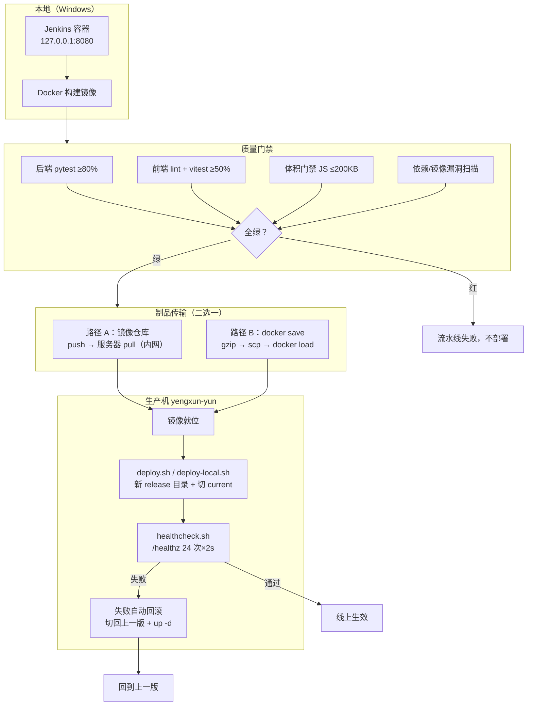

# 第 15 章 端到端完整实战

> 难度：★★★　预计耗时：120 分钟
> 本章目标：把前面 14 章的所有零件拼成一台完整的机器：从 `git push` 到线上可访问，包含失败自动回滚，并完成两个标志性演示——**改一行代码 3 分钟生效**、**坏版本自动回滚**。

---

## 一、为什么需要这一章

前面 14 章像散落的零件：Jenkinsfile、Dockerfile、compose、证书、部署脚本、备份脚本。每一章结尾都说"下一章会串起来"。**本章就是那根串珠的线。**

衡量标准只有两条，都能**看见**：

1. 改一行前端文案 → 提交 → 流水线跑完 → 刷新页面，文案变了，全程 ≤ 3 分钟。
2. 故意发一个坏版本 → 流水线健康检查失败 → **流量自动切回旧版本**，线上始终可用。

> **餐厅比喻**：前面的章节分别教会了"进货验货"（测试门禁）、"做菜"（构建镜像）、"备餐"（镜像仓库/传输）、"传菜"（部署脚本）、"撤换菜"（回滚）。本章是把这些动作串成一次完整的出餐流程，并在出菜前加一道"试吃"（健康检查），不好吃就不端给客人。

---

## 二、原理图解：全链路总览



**本章采用路径 B（`docker save`）先跑通**，理由是零外部依赖（不用注册仓库、不用存凭证）；路径 A 的迁移只改一个环境变量和一段 Jenkinsfile（见 4.4）。

---

## 三、动手步骤

### 步骤 1 服务器端一次性准备（清单式）

```bash
# 【服务器】所有目录与文件一次备齐
sudo mkdir -p /opt/apps/cicd-demo/{scripts,releases,shared/{data,nginx,certs,logs}}
sudo chown -R ubuntu:ubuntu /opt/apps/cicd-demo

# 数据目录归属容器内 uid 10001（第 14 章的坑）
sudo chown -R 10001:10001 /opt/apps/cicd-demo/shared/data
```

需要从本地上传的文件（本地执行 `scp`）：

| 本地文件 | 服务器位置 |
| --- | --- |
| `scripts/deploy.sh`、`scripts/rollback.sh`、`scripts/healthcheck.sh`、`scripts/backup-data.sh`、`scripts/cleanup.sh`、`scripts/gen-selfsigned-cert.sh` | `/opt/apps/cicd-demo/scripts/` |
| `deploy/docker-compose.prod.yml` | `/opt/apps/cicd-demo/shared/docker-compose.prod.yml` |
| `deploy/nginx/site.conf` | `/opt/apps/cicd-demo/shared/nginx/site.conf` |

```powershell
# 【本地】一把梭上传（Git Bash / PowerShell 均可，注意路径）
$base="I:/work-body-dir/cicd-tutorial"
scp $base/scripts/deploy.sh $base/scripts/rollback.sh $base/scripts/healthcheck.sh $base/scripts/backup-data.sh $base/scripts/cleanup.sh $base/scripts/gen-selfsigned-cert.sh yengxun-yun:/tmp/
scp $base/deploy/docker-compose.prod.yml yengxun-yun:/tmp/
scp $base/deploy/nginx/site.conf yengxun-yun:/tmp/

# 【服务器】归位
ssh yengxun-yun "sudo mv /tmp/*.sh /opt/apps/cicd-demo/scripts/ && sudo chmod +x /opt/apps/cicd-demo/scripts/*.sh && sudo mv /tmp/docker-compose.prod.yml /opt/apps/cicd-demo/shared/ && sudo mv /tmp/site.conf /opt/apps/cicd-demo/shared/nginx/"
```

验证：

```bash
# 【服务器】
ls -l /opt/apps/cicd-demo/scripts/ /opt/apps/cicd-demo/shared/
bash -n /opt/apps/cicd-demo/scripts/deploy.sh && echo "deploy.sh 语法 OK"
```

### 步骤 2 生成证书（第 13 章的实操）

```bash
# 【服务器】
cd /opt/apps/cicd-demo/shared/certs
sudo bash /opt/apps/cicd-demo/scripts/gen-selfsigned-cert.sh 49.234.202.181
sudo ls -l
```

### 步骤 3 本地构建镜像（首次手工走一遍）

在接入 Jenkins 前，先手动走通一次，确保每一步都理解：

```powershell
# 【本地】
cd I:\work-body-dir\cicd-tutorial
$env:TAG="1-manual"

docker build -f deploy/Dockerfile.backend  -t cicd-demo-backend:1-manual  demos/backend
docker build -f deploy/Dockerfile.frontend -t cicd-demo-frontend:1-manual demos/frontend

docker images cicd-demo-*
```

预期：

```text
REPOSITORY              TAG        IMAGE ID       SIZE
cicd-demo-backend       1-manual   9f2c1a...      ~190MB
cicd-demo-frontend      1-manual   7b3e5d...      ~55MB
```

### 步骤 4 传输镜像到服务器（路径 B：docker save）

```powershell
# 【本地】导出 + 压缩 + 上传（约 190MB，2M 带宽下耐心等几分钟）
docker save cicd-demo-backend:1-manual  | gzip > $env:TEMP\backend.tar.gz
docker save cicd-demo-frontend:1-manual | gzip > $env:TEMP\frontend.tar.gz

scp $env:TEMP\backend.tar.gz  yengxun-yun:/tmp/
scp $env:TEMP\frontend.tar.gz yengxun-yun:/tmp/
```

```bash
# 【服务器】导入并确认
gunzip -c /tmp/backend.tar.gz  | docker load
gunzip -c /tmp/frontend.tar.gz | docker load
docker images cicd-demo-*
rm -f /tmp/*.tar.gz
```

> **2M 带宽的账**：压缩后约 80MB ≈ 320KB/s 满速跑 4 分钟。这是路径 B 的代价；换成路径 A（仓库 + 内网），传输时间降到 10 秒级。这也是为什么教程最后会迁去镜像仓库（GHCR）。

### 步骤 5 首次部署（deploy-local.sh）

```bash
# 【服务器】
sudo TAG=1-manual bash /opt/apps/cicd-demo/scripts/deploy-local.sh
```

预期输出：

```text
[15:30:01] 1/4 准备发布目录 /opt/apps/cicd-demo/releases/20261111-153001-1-manual
[15:30:01] 2/4 切换 current 并启动
 Container cicd-demo-api-1  Started
 Container cicd-demo-web-1  Started
[15:30:03] 3/4 健康检查
[15:30:05] 健康检查通过
[15:30:05] 4/4 清理旧版本（保留最近 5 个）
[15:30:05] 部署完成：1-manual（本地镜像路径）
```

**四项验证**：

```bash
# 【服务器】
curl -s http://127.0.0.1:8000/healthz                  # 后端直连
curl -I http://127.0.0.1/                              # 80 应 301 跳 443
curl -kI https://127.0.0.1/                            # 443 静态页
sudo docker compose -f /opt/apps/cicd-demo/current/docker-compose.yml ps
```

浏览器打开 `https://49.234.202.181`（已导入 `ca.crt` 的话无警告），能看到任务清单页面。

### 步骤 6 接入 Jenkins：全自动化

`pipelines/jenkins/Jenkinsfile-06-e2e` 已在仓库里，核心是"部署"这一段：

```groovy
stage('⑥ 部署到生产') {
    steps {
        script {
            if (params.IMAGES_VIA_SAVE) {
                // 路径 B：save → scp → load → deploy-local
                sh "docker save cicd-demo-backend:${IMAGE_TAG}  | gzip > /tmp/backend-${IMAGE_TAG}.tar.gz"
                sh "scp /tmp/backend-${IMAGE_TAG}.tar.gz ${DEPLOY_SSH}:/tmp/"
                sh "ssh ${DEPLOY_SSH} 'gunzip -c /tmp/backend-${IMAGE_TAG}.tar.gz | docker load'"
                sh "ssh ${DEPLOY_SSH} 'TAG=${IMAGE_TAG} bash -s' < scripts/deploy-local.sh"
            } else {
                // 路径 A：推仓库，服务器 pull
                sh "docker tag ... && ssh ${DEPLOY_SSH} 'sudo ... deploy.sh ${IMAGE_TAG}'"
            }
        }
    }
}
```

三个设计点：

1. **`DEPLOY_SSH = 'yengxun-yun'`**：Jenkins 容器复用宿主机 `~/.ssh/config` 与密钥（第 03 章挂载过），不需要在 Jenkins 里存私钥。生产上更规范的做法是 Jenkins 凭据（第 17 章）。
2. **`bash -s < scripts/deploy-local.sh`**：把脚本从管道"喂"进远端 bash，**服务器上不需要预先存在脚本的新版本**——脚本本身也是流水线的一部分，跟着仓库走。
3. **`IMAGES_VIA_SAVE` 参数**：配好 GHCR 后把参数关掉即切到路径 A，流水线其余部分不动。

### 步骤 7 演示一：改一行文案，3 分钟生效

```powershell
# 【本地】
# 1. 改文案（demos/frontend/src/App.vue 里的标题文字，比如加上你的名字）
# 2. 提交推送
git add demos/frontend/src/App.vue
git commit -m "feat: 更新页面标题文案"
git push origin main
# 3. Jenkins 上点构建（或 Webhook 自动触发）
```

**盯紧时间戳**：

| 时刻 | 发生了什么 | 耗时 |
| --- | --- | --- |
| 0:00 | `git push` | — |
| 0:02 | 后端 pytest（缓存命中） | ~20s |
| 0:22 | 前端 npm ci + lint + test + build | ~60s |
| 1:25 | 两个镜像构建 | ~30s |
| 1:55 | Trivy 扫描 | ~25s |
| 2:20 | save + scp（80MB） | ~35s |
| 2:55 | load + 部署 + 健康检查 | ~15s |
| **3:10** | **刷新页面，新文案已生效** | ✅ |

### 步骤 8 演示二：坏版本自动回滚

**故意制造一个坏版本**：把后端 `/healthz` 改成必然失败（模拟配置错误导致启动即崩）：

```python
# 临时改 demos/backend/app/main.py，只用于本次实验，验证后还原
@app.get("/healthz")
def healthz():
    raise RuntimeError("实验：模拟服务故障")   # ← 加这一行
```

提交推送（建议先在分支上验证，或直接 main 演示后立即 revert）：

```text
预期流水线行为：
① 构建、测试全绿（这个改动不影响单测——它只在真实启动时才炸，这正是要演示的盲区）
② 镜像正常构建推送
③ deploy-local.sh 启动新容器
④ healthcheck.sh 24 次探活全部失败
⑤ 脚本自动执行 rollback：切回上一版软链 + up -d
⑥ 流水线退出码 1，Jenkins 标红
⑦ 期间线上页面始终可用（用户无感知）
```

**验证"线上始终可用"**：坏版本部署期间，在另一个终端循环探测：

```bash
# 【服务器】
while true; do curl -s -o /dev/null -w "%{http_code} " http://127.0.0.1:8000/api/tasks; sleep 1; done
# 全程 200，没有 5xx —— 因为回滚机制把流量留在了旧版本
```

实验后**务必还原代码**：

```powershell
git revert HEAD
git push origin main
```

### 步骤 9 部署指纹与审计留痕

每次成功部署，脚本会写入 `DIGEST` 文件：

```bash
# 【服务器】
cat /opt/apps/cicd-demo/current/DIGEST
# backend digest: cicd-demo-backend@sha256:9f2c1a...
```

回滚演练与版本清单：

```bash
sudo bash /opt/apps/cicd-demo/scripts/rollback.sh --list
sudo bash /opt/apps/cicd-demo/scripts/rollback.sh          # 回到上一版
```

### 步骤 10 收尾：定时清理与备份

```bash
# 【服务器】
echo "0 4 * * 0 root bash /opt/apps/cicd-demo/scripts/cleanup.sh >> /var/log/cicd-cleanup.log 2>&1" | sudo tee /etc/cron.d/cicd-cleanup
echo "10 3 * * * root bash /opt/apps/cicd-demo/scripts/backup-data.sh >> /var/log/cicd-backup.log 2>&1" | sudo tee /etc/cron.d/cicd-backup
sudo chmod 644 /etc/cron.d/cicd-cleanup /etc/cron.d/cicd-backup
```

---

## 四、完整实例：迁移到镜像仓库路径（GHCR 就绪后 10 分钟）

### 4.1 创建 PAT 并登录

```powershell
# 【本地】GitHub → Settings → Developer settings → Personal access tokens
#        生成 PAT（勾选 write:packages / read:packages）→ 用它登录 GHCR
docker login ghcr.io -u yxm1989614
```

### 4.2 推送一次

```powershell
$env:REGISTRY_NAMESPACE="yxm1989614"
bash scripts/build-and-push.sh backend "100-a1b2c3d"
bash scripts/build-and-push.sh frontend "100-a1b2c3d"
```

（脚本会自动打体积门禁，`PUSH=1` 时推送。）

### 4.3 推送后把包设为 Public，再验证拉取

```bash
# 【GitHub 网页】头像 → Packages → 两个包都改成 Public（服务器才能匿名拉取）

# 【服务器】验证
time docker pull ghcr.io/yxm1989614/cicd-demo-backend:100-a1b2c3d
# 走公网跨境链路：受带宽影响，可能要几分钟；镜像越瘦越快
```

### 4.4 切换流水线路径

把 `Jenkinsfile-06-e2e` 的参数 `IMAGES_VIA_SAVE` 关掉，并给 Jenkins 配置 `ghcr-registry` 凭据（第 10 章 4.3 的写法）。此后：

- 构建机 → 仓库：公网 push（本地带宽充足）
- 仓库 → 服务器：公网 pull（跨境链路，靠镜像瘦身与缓存层复用提速）

> 教程坚持先用路径 B 跑通，是因为"先让链路动起来，再优化传输方式"。传输方式的变化只影响 `SHIP` 环节，门禁与部署逻辑完全复用——这正是分层设计的价值。

---

## 五、坑与排错

| 现象 | 根因 | 解法 |
| --- | --- | --- |
| `scp` 提示权限拒绝写 `/opt/apps` | 目录属主是 root | 先 `sudo chown -R ubuntu`，或先传 `/tmp` 再 `sudo mv` |
| `docker load` 报 `invalid tar header` | gzip 没解 | 用 `gunzip -c xxx.tar.gz \| docker load`，不要直接 `docker load -i` |
| 部署后页面 502 | site.conf 里上游写成了 `127.0.0.1:8000` | 改成 `http://api:8000`（容器网络） |
| `healthz` 通过但页面打不开 | 证书问题被浏览器拦 | 检查 SAN 与 CA 导入（第 13 章） |
| 回滚后容器还是新版本 | 只切了软链没 `up -d`，或 `.env` 是旧的 | rollback.sh 已处理；手动回滚必须两步都做 |
| Jenkins `scp` 卡住要密码 | Jenkins 容器里没有密钥 | 确认第 03 章挂载了 `~/.ssh`；或改用 Jenkins SSH 凭据 |
| `deploy.sh` 报 `缺少 shared/docker-compose.prod.yml` | 模板没上传 | 步骤 1 清单里的三个文件逐个核对 |
| 80/443 起不来 `bind: address already in use` | 有别的进程占用（宝塔等） | `ss -tlnp \| grep -E ':80\|:443'` 定位；本机目前空闲 |
| 流水线 40 分钟超时 | save+scp 太慢 / 卡在扫描 | 查每段耗时；迁到路径 A；扫描库加缓存 |
| 回滚后数据"消失" | 新版本做过迁移（加了列），旧代码兼容 | 第 14 章"扩展-收缩"原则；回滚前确认兼容 |

---

## 六、横向对照

| 环节 | 本书（Jenkins + 单机） | GitHub Actions 等价 | GitLab CI 等价 |
| --- | --- | --- | --- |
| 触发部署 | Webhook / 手动点 | `on: push` | `rules: if $CI_COMMIT_BRANCH` |
| 传输制品 | `docker save` + scp / 仓库 | `docker/build-push-action` | `docker push` + DinD |
| 部署执行 | `ssh + bash -s` | 同左 / `appleboy/ssh-action` | `ssh` 到自管 Runner |
| 健康检查门禁 | `healthcheck.sh` | 同左 | 同左 |
| 失败回滚 | deploy.sh 内置 | 同左（脚本复用） | 同左 |
| 审批 | `input` | Environment reviewers | `when: manual` |

---

## 七、本章检查清单与练习

### 检查清单

- [ ] 服务器上 6 个脚本 + compose 模板 + site.conf + 证书全部就位
- [ ] 手工完成过一次完整部署（save → load → deploy → 四项验证）
- [ ] Jenkins 跑通 `Jenkinsfile-06-e2e` 全绿
- [ ] 演示一：改文案 3 分钟内生效
- [ ] 演示二：坏版本健康检查失败并自动回滚，期间线上可用
- [ ] `rollback.sh --list` 能列出全部版本
- [ ] 定时备份与清理 cron 已配置
- [ ] 实验用的坏代码已 revert

### 练习

**练习 1**：演示二的坏版本为什么"单元测试全绿却在线上炸了"？这说明测试的什么局限？
<details><summary>参考要点</summary>

单测用 `TestClient`，不经过真实容器启动路径；`/healthz` 的运行时异常在测试里没有覆盖。这说明测试只能证明"代码逻辑对"，不能证明"部署形态对"——所以需要健康检查这道"部署后门禁"。两者互补，缺一不可。
</details>

**练习 2**：`docker save` 路径与镜像仓库路径，各在什么场景下更合适？
<details><summary>参考要点</summary>

save：一次性演示、无外部依赖、内网可达时 scp 很快、不允许外部仓库的保密环境。仓库：长期迭代（增量层传输）、多服务器、需要回滚到历史镜像、CI 与生产分离的常规形态。教学先 save 后仓库，生产用仓库。
</details>

**练习 3**：把"健康检查失败自动回滚"改成"失败后不回滚、保留现场并告警"，说说各自的适用场景与风险。
<details><summary>参考要点</summary>

自动回滚：用户体验优先，适合业务高峰；风险是掩盖问题（现场被旧版本覆盖，排障变难）。保留现场：排障优先，适合预发/灰度；风险是故障持续暴露。折中：先保留现场 10 分钟，超时自动回滚，同时告警。
</details>

---

## 下一章预告

链路已经完整。第 16 章开始"提效"：把 3 分钟的构建再压下去——并行、矩阵、缓存命中率、共享库复用、Monorepo 路径过滤，目标是"10 分钟压到 3 分钟"的实操全过程。
