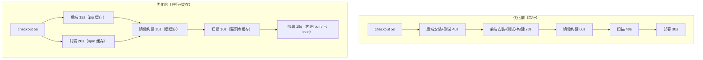

# 第 16 章 流水线工程化与提速

> 难度：★★★　预计耗时：80 分钟
> 本章目标：把第 15 章那条约 3 分钟的流水线继续压短——并行、缓存、复用、按路径触发，最终目标：**任何一次提交，从 push 到上线 ≤ 3 分钟**，且在大项目里也有明确的优化路径。

---

## 一、为什么需要这一章

流水线慢的代价不只是"等得烦"：

- **合并前的等待决定了提交粒度**。流水线要 30 分钟，开发者就攒一天代码一次推——每次变更巨大，出错时定位极难。流水线 3 分钟，大家就高频小步提交。
- **慢的流水线会被绕过**。"这次改动很小，跳过 CI 直接发吧"——所有绕过 CI 的发布，都是未来事故的预付款。
- **CI 资源是钱**。本地 Docker 还好，云上 Runner 按分钟计费，缓存命中率从 0 到 90%，月账单能差一倍。

一个真实规律：**流水线时间的大头，几乎永远是"重复下载"和"串行等待"**。这章就治这两个病。

> **餐厅比喻**：后厨出餐慢，不是让厨师更快颠勺，而是：① 备菜区提前把常用食材切好放冰箱（缓存）；② 凉菜和热菜**两个灶同时开火**（并行）；③ 常见菜配方的步骤写进 SOP，新人不用每次问（共享库）；④ 客人只点了凉菜，就不必烧热菜灶（按路径触发）。

---

## 二、原理图解：提速四板斧



| 板斧 | 手段 | 典型收益 |
| --- | --- | --- |
| 并行 | 无依赖 stage 同时跑 | 总时长 = 最慢分支 |
| 缓存 | npm/pip/Trivy/镜像层 | 安装类步骤 40s → 10s |
| 复用 | 共享库 `vars/` | 多流水线一套逻辑 |
| 裁剪 | changeset 路径过滤 | 只构建受影响的部分 |

---

## 三、动手步骤

### 步骤 1 先测量，再优化（没有数据就没有优化）

Jenkins 构建页面右侧 **"Stage View / Pipeline Steps"** 已经给出每个 stage 的耗时；蓝海（Blue Ocean）的瀑布图更直观。也可以在关键步骤加时间戳：

```groovy
stage('② 前端测试与构建') {
    steps {
        sh 'echo "[$(date +%T)] npm ci 开始"'
        sh 'npm ci --no-audit --no-fund'
        sh 'echo "[$(date +%T)] npm ci 结束"'
    }
}
```

本项目的实测基线（首次构建、无缓存）：

| Stage | 耗时 |
| --- | --- |
| 后端 venv + pip install | ~40s |
| 前端 npm ci | ~50s |
| lint + test + build | ~35s |
| 镜像 ×2 | ~60s |
| Trivy 扫描 ×2 | ~60s |
| save + scp + load | ~90s |
| 部署 + 健康检查 | ~15s |
| **合计** | **~5.5 分钟** |

### 步骤 2 并行：把前后端拆成两条线

前后端测试互不依赖，天然可并行：

```groovy
stage('测试（前后端并行）') {
    parallel {
        stage('后端') {
            steps {
                dir('demos/backend') {
                    sh 'python -m venv .venv'
                    sh '.venv/bin/pip install -r requirements.txt'
                    sh '.venv/bin/pytest'
                }
            }
        }
        stage('前端') {
            steps {
                dir('demos/frontend') {
                    sh 'npm ci --no-audit --no-fund'
                    sh 'npm run lint'
                    sh 'npm run test:cov'
                    sh 'VITE_API_BASE=/api npm run build'
                    sh 'bash ../../scripts/check-bundle-size.sh dist 200'
                }
            }
        }
    }
}
```

**收益**：两段测试 40+50s 变成 max(40,50)=50s。注意两个 `agent any` 时要确认资源够（本地 Docker 一台机器并行两个容器，3.6G 内存没问题；云 Runner 注意配额）。

### 步骤 3 缓存：缓存命中率是工程出来的，不是祈祷出来的

**三条铁律**：

1. **缓存 key 绑 lock 文件**，不绑 commit/时间。lock 没变 → 缓存必命中。
2. **缓存内容（下载产物），不缓存安装结果**（`node_modules` 跨平台会崩，第 07 章讲过）。
3. **命中与否要能观测**：日志里打印命中情况。

Jenkins（Docker agent + 命名卷）：

```groovy
agent {
    docker {
        image 'node:20-alpine'
        args '-v jenkins-npm-cache:/root/.npm'
        reuseNode true
    }
}
```

验证：

```bash
npm ci --prefer-offline --no-audit --no-fund
# 首次 ~50s；lock 不变时二次 ~10s（日志出现 "added 214 packages in 9s" 即命中）
```

pip 同理（第 08 章已配 `jenkins-pip-cache:/root/.cache/pip`）。

**Trivy 漏洞库缓存**（扫描的大头是下载漏洞库）：

```bash
# 在 Jenkins 容器/宿主机固定缓存目录
-v jenkins-trivy-cache:/root/.cache/trivy
```

### 步骤 4 镜像层缓存：从 60s 到 15s

Docker 构建缓存的关键在**层顺序**（第 10 章讲过），这里补 Jenkins 侧的两个动作：

1. **确认 Docker agent 不每次清缓存**：不要在流水线里跑 `docker system prune -a`；清理交给定时 `cleanup.sh`（每周、非构建时段）。
2. **跨 Agent/机器用 registry 缓存**（迁到 TCR 后）：

```bash
docker buildx build \
  --cache-from type=registry,ref=ccr.ccs.tencentyun.com/cicd-demo/cicd-demo-backend:buildcache \
  --cache-to   type=registry,ref=ccr.ccs.tencentyun.com/cicd-demo/cicd-demo-backend:buildcache,mode=max \
  -f deploy/Dockerfile.backend -t "$IMAGE" demos/backend --push
```

验证：第二次构建日志里大量 `CACHED`，构建 60s → 15s。

### 步骤 5 复用：共享库抽取重复逻辑

三处流水线都在写"构建镜像"，抽成 `vars/buildImage.groovy`（第 05 章已建）：

```groovy
// pipelines/jenkins/shared-library/vars/buildImage.groovy
def call(String app, String tag) {
    sh "docker build -f deploy/Dockerfile.${app} -t cicd-demo-${app}:${tag} demos/${app}"
}
```

Jenkinsfile 里就一行：

```groovy
buildImage('backend', IMAGE_TAG)
buildImage('frontend', IMAGE_TAG)
```

**什么时候值得抽**：同一段逻辑出现在 ≥2 条流水线，或者它需要集中改（比如以后统一加 SBOM）。**过早抽象比重复更糟**——两处相似代码先容忍，第三处出现再抽。

### 步骤 6 裁剪：按路径触发（changeset）

改了后端不必跑前端测试（反之亦然）。Declarative 用 `when { changeset }`：

```groovy
stage('前端测试') {
    when {
        anyOf {
            changeset "demos/frontend/**"
            changeset "deploy/Dockerfile.frontend"
            changeset "pipelines/**"        // 流水线本身变动时全跑
        }
    }
    steps { dir('demos/frontend') { ... } }
}
```

**收益**：只改后端的提交，前端 70s 直接跳过。

**风险与边界**：

- `deploy/**`、`scripts/deploy*.sh` 变动时**必须全量跑**（部署逻辑变了）。
- `docs/**` 变动可以只跑 lint 不跑测试。
- changeset 判断基于上次成功构建，rebase/force-push 时可能误判——主干分支保持全量跑更稳。

### 步骤 7 终局：优化后的耗时对照

| Stage | 优化前 | 优化后 | 手段 |
| --- | --- | --- | --- |
| checkout | 5s | 5s | — |
| 后端测试 | 40s | 12s | pip 缓存 |
| 前端测试+构建 | 50s+35s | 25s | npm 缓存 + changeset 跳过 |
| 镜像 ×2 | 60s | 15s | 层缓存 |
| 扫描 | 60s | 10s | Trivy 库缓存 |
| 传输 | 90s | 15s | **迁 TCR 内网 pull** |
| 部署+健康检查 | 15s | 15s | — |
| **合计（串行）** | ~5.5min | **~1.6min** | |

即使不做 changeset，也稳在 3 分钟内。

---

## 四、完整实例：优化版 Jenkinsfile

**文件：`pipelines/jenkins/Jenkinsfile-07-optimized`**

```groovy
pipeline {
    agent any

    options {
        timestamps()
        timeout(time: 15, unit: 'MINUTES')          // 收紧到 15 分钟，超时即失败
        buildDiscarder(logRotator(numToKeepStr: '30'))
        disableConcurrentBuilds(abortPrevious: true) // 新提交来了，取消旧的构建
        quietPeriod(5)                               // 5 秒防抖：连续 push 只构建最后一次
    }

    environment {
        DEPLOY_SSH   = 'yengxun-yun'
        GIT_SHA      = sh(returnStdout: true, script: 'git rev-parse --short=7 HEAD').trim()
        IMAGE_TAG    = "${env.BUILD_NUMBER}-${env.GIT_SHA}"
    }

    stages {
        stage('测试（并行）') {
            parallel {
                stage('后端') {
                    when { changeset "demos/backend/**" }
                    steps {
                        dir('demos/backend') {
                            sh 'python -m venv .venv'
                            sh '.venv/bin/pip install -r requirements.txt'
                            sh '.venv/bin/pytest'
                        }
                    }
                }
                stage('前端') {
                    when {
                        anyOf { changeset "demos/frontend/**"; changeset "pipelines/**" }
                    }
                    steps {
                        dir('demos/frontend') {
                            sh 'npm ci --prefer-offline --no-audit --no-fund'
                            sh 'npm run lint && npm run test:cov'
                            sh 'VITE_API_BASE=/api npm run build'
                            sh 'bash ../../scripts/check-bundle-size.sh dist 200'
                        }
                    }
                }
            }
        }

        stage('构建镜像') {
            steps {
                buildImage('backend',  env.IMAGE_TAG)   // 共享库
                buildImage('frontend', env.IMAGE_TAG)
            }
        }

        stage('扫描') {
            steps {
                sh "trivy image --severity HIGH,CRITICAL --ignore-unfixed --exit-code 1 --no-progress cicd-demo-backend:${env.IMAGE_TAG}"
                sh "trivy image --severity HIGH,CRITICAL --ignore-unfixed --exit-code 1 --no-progress cicd-demo-frontend:${env.IMAGE_TAG}"
            }
        }

        stage('部署') {
            steps {
                sh "docker save cicd-demo-backend:${env.IMAGE_TAG}  | gzip > /tmp/b.tar.gz"
                sh "docker save cicd-demo-frontend:${env.IMAGE_TAG} | gzip > /tmp/f.tar.gz"
                sh "scp /tmp/b.tar.gz /tmp/f.tar.gz ${DEPLOY_SSH}:/tmp/"
                sh "ssh ${DEPLOY_SSH} 'gunzip -c /tmp/b.tar.gz | docker load && gunzip -c /tmp/f.tar.gz | docker load && rm -f /tmp/b.tar.gz /tmp/f.tar.gz'"
                sh "ssh ${DEPLOY_SSH} 'TAG=${env.IMAGE_TAG} bash -s' < scripts/deploy-local.sh"
            }
        }
    }
}
```

**验证成功的标准**：

- 全绿构建总耗时 ≤ 3 分钟（Stage View 截图留档）
- 只改后端的提交：前端 stage 显示 skipped
- 连续推三次提交：只构建最后一次（quietPeriod）
- 构建日志里 `npm ci`/`pip install` 时间 < 首次一半

---

## 五、坑与排错

| 现象 | 根因 | 解法 |
| --- | --- | --- |
| 缓存命中率忽高忽低 | key 里带了 commit sha 或时间 | key 绑 lock 文件哈希 |
| 并行后更慢 | 两个 stage 抢同一 agent 资源 / Docker 磁盘 IO 打满 | 加 agent；或限制并行度 `parallel { stages { ... } }` 拆分 |
| `changeset` 没生效 | 分支首次构建（无基线） | 首次构建全量是正常行为 |
| BuildKit 缓存全部失效 | Dockerfile 顺序变了 / 换了机器 | 层顺序固定；跨机器用 registry cache |
| Trivy 每次都下 100MB+ 库 | 缓存目录没挂载 | 挂 `/root/.cache/trivy` |
| `abortPrevious: true` 误杀 | 排队系统把老构建还在跑的容器停了 | 这是预期行为；不确定就改 `false` |
| 共享库方法找不到 | Jenkins 全局配置没加库，或 `@Library` 写错 | 第 05 章 5.5；先在 Manage Jenkins → System Log 看加载日志 |
| quietPeriod 后构建还是触发多次 | 多个 webhook 源重复触发 | 检查 webhook 配置，只留一个源 |

---

## 六、横向对照

| 能力 | Jenkins | GitHub Actions | GitLab CI |
| --- | --- | --- | --- |
| 并行 | `parallel` stage | `strategy: matrix` / 独立 job | `parallel:matrix` / 多 job |
| 缓存 | 卷挂载 / stash | `actions/cache`（key 绑 lock） | `cache:key[files]` |
| 路径过滤 | `changeset` | `paths:` filter | `rules:changes` |
| 复用 | Shared Library | Reusable workflows / Composite | `include:` + templates |
| 取消旧构建 | `disableConcurrentBuilds(abortPrevious)` | `concurrency: { cancel-in-progress }` | `interruptible: true` |
| 防抖 | `quietPeriod` | 无（用 `concurrency` 近似） | 无（多 runner 排队自然合并） |

---

## 七、本章检查清单与练习

### 检查清单

- [ ] 能在 Jenkins 上指出每个 stage 的耗时（有截图）
- [ ] 前后端测试已并行
- [ ] npm/pip/Trivy 三类缓存都有挂载，且二次构建时间减半以上
- [ ] 镜像构建二次 `CACHED`
- [ ] changeset 生效：改后端不跑前端
- [ ] 构建总时长 ≤ 3 分钟

### 练习

**练习 1**：为什么缓存 key 要绑 lock 文件而不是分支名？绑分支名会怎样？
<details><summary>参考要点</summary>

分支名不变但依赖升级后，缓存会永远命中旧包（新依赖装不上）；lock 变化即失效，既保证新鲜又最大化复用。绑 commit sha 则几乎永不命中。
</details>

**练习 2**：`quietPeriod(5)` 解决什么问题？连续推 5 个 commit 会触发几次构建？
<details><summary>参考要点</summary>

合并连续 push 的重复触发：5 个 commit 在 5 秒窗口内只触发 1 次构建（构建最后一次提交）；配合 `abortPrevious: true`，即使窗口外多触发，旧的也会被取消。
</details>

**练习 3**：changeset 过滤有一条铁律："部署相关文件变动必须全量跑"。为什么？
<details><summary>参考要点</summary>

部署脚本/compose/Dockerfile 变动影响所有应用的发布行为；如果只按应用目录过滤，可能改了 `deploy.sh` 的回滚逻辑却没有在任何"只改后端"的提交上验证过，上线时才发现坏了。
</details>

---

## 下一章预告

流水线快了，但 Jenkins 本身还是个"裸奔"的单容器：谁能登录？密钥怎么存？插件坏了怎么办？数据丢了怎么恢复？第 17 章做生产级治理——把 Jenkins 从"开发玩具"变成"团队基础设施"。
