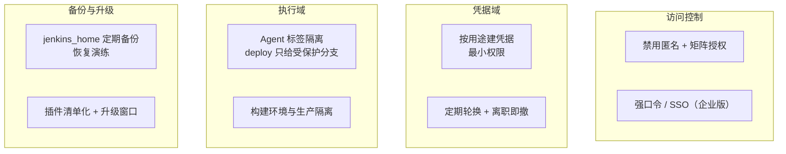

# 第 17 章 Jenkins 生产级治理

> 难度：★★★　预计耗时：70 分钟
> 本章目标：把 Jenkins 从"单容器玩具"治理成"团队基础设施"：凭据最小权限、Agent 隔离、备份可恢复、插件可控、安全基线。**治理的判断标准：Jenkins 坏了/丢了，团队能在 1 小时内恢复，且期间没人能干坏事。**

---

## 一、为什么需要这一章

Jenkins 出事的方式很特别——它平时太稳定了，以至于没人管它，直到某天：

**事故 1：离职员工的密钥还在。**
三年前的构建凭据里躺着某个已离职运维的 SSH 私钥，他仍能登上生产机。没人清过凭据，因为"能跑就别动"。

**事故 2：升级插件，全员歇菜。**
周五下午有人点了"升级全部插件"，一个插件不兼容导致构建全挂，周一恢复。**插件升级没有"灰度"概念，只有"备份"概念。**

**事故 3：Jenkins 所在机器重装，所有 Job 凭据全丢。**
`jenkins_home` 没有备份，几十条 Job 配置、凭据、构建历史清零。团队花两天重建——这两天里所有发布都手工。

> **餐厅比喻**：中央厨房平时无人管，刀具随便拿（凭据）、食谱没有备份（配置丢失）、新来的帮工什么灶都能碰（无权限隔离）。这一章给厨房装门禁、上保险、定规矩。

---

## 二、原理图解：治理的四个域



一句话总纲：**凭据越少越好、权限越小越好、备份越近越好、变更越慢越好。**

---

## 三、动手步骤

### 步骤 1 访问控制：把匿名关掉

Manage Jenkins → Security：

| 配置项 | 值 | 原因 |
| --- | --- | --- |
| Security Realm | Jenkins' own user database（或 LDAP/SSO） | 不允许"无账号访问" |
| Authorization | Matrix-based security | 按人/组授权，不用 "LoggedIn users can do anything" 裸奔 |
| anonymous 权限 | 全部取消（只留 `Overall/Read` 都不给） | 匿名连构建列表都不该看 |
| CSRF Protection | 默认开启（新版本强制） | 防 CSRF 攻击 |
| Markup Formatter | Safe HTML | 防 Job 描述里藏 XSS |

**最小可用授权矩阵（小团队）**：

| 权限 | admin | dev | ci-bot |
| --- | --- | --- | --- |
| Overall/Administer | ✅ | — | — |
| Job/Build + Job/Read | ✅ | ✅ | ✅ |
| Job/Configure | ✅ | — | — |
| Credentials/Create/Update | ✅ | — | — |
| Run/Replay | ✅ | ✅ | ✅ |

### 步骤 2 凭据治理：从"一锅端"到"按用途拆分"

**反模式**：一个万能凭据（既能上生产又能拉仓库），所有 Job 共用。

**正确姿势**：按用途建凭据，最小权限：

| 凭据 ID | 类型 | 用途 | 权限范围 |
| --- | --- | --- | --- |
| `deploy-ssh-key` | SSH Username with private key | 部署到生产机 | 生产机 `ubuntu` 用户，**仅限执行 `/opt/apps/cicd-demo/scripts/` 下的脚本** |
| `ghcr-registry` | Username with password | 拉推镜像仓库 | GitHub PAT，仅 packages 读写 |
| `git-webhook-token` | Secret text | Webhook 校验 | 仅触发构建 |

**让 SSH 凭据"只许跑脚本"**（生产机上，给部署动作上笼子）：

```bash
# 【服务器】authorized_keys 里限定命令来源（部署密钥专用行）
# command="..." 表示：这把私钥连上来只能执行括号里的命令
echo 'command="/opt/apps/cicd-demo/scripts/deploy-wrapper.sh",no-port-forwarding,no-agent-forwarding ssh-ed25519 AAAA... jenkins-deploy' \
  >> ~/.ssh/authorized_keys
```

```bash
# 【服务器】deploy-wrapper.sh：只透传白名单脚本
#!/usr/bin/env bash
case "$SSH_ORIGINAL_COMMAND" in
  "deploy"*)   exec /opt/apps/cicd-demo/scripts/deploy.sh "${SSH_ORIGINAL_COMMAND#deploy }" ;;
  "rollback"*) exec /opt/apps/cicd-demo/scripts/rollback.sh "${SSH_ORIGINAL_COMMAND#rollback }" ;;
  *) echo "拒绝：只允许 deploy/rollback"; exit 1 ;;
esac
```

> 这是"即使 Jenkins 被入侵，攻击者拿到的也只是'能部署，不能登录 shell'的钥匙"。**配置前先在另一个会话测试**，防止把自己锁出去。

**轮换与清理**：

- 每季度过一遍凭据列表：没 Job 引用的、对应人员已离职的，直接删。
- 凭据 ID 命名带用途与年份：`ghcr-registry-2026`，轮换时新建再切换，出问题可秒回退。

### 步骤 3 Agent 与执行隔离

当前形态：Jenkins 单机 + `agent any` + Docker agent 起子容器。规模上来后的隔离要点：

| 需求 | 做法 |
| --- | --- |
| 部署 Job 只在指定节点跑 | `agent { label 'deploy' }`，该节点只有部署 Agent |
| 部署只允许受保护分支触发 | stage 级 `when { branch 'main' }` + Job 级分支过滤；再配 Git 分支保护，PR 里没有"部署到生产"按钮 |
| 构建环境与生产网络隔离 | 构建 Agent 不在 `authorized_keys` 的白名单里，物理上摸不到生产机 |
| 并发控制 | `disableConcurrentBuilds()`（Job 级）+ Agent 执行器数（节点级） |

单机阶段的近似做法（已采用）：`agent any` 全跑在一台机器，但**用 `when { branch 'main' }` 把"推送镜像/部署"两个 stage 锁在 main**，PR 构建只测不部署——这是隔离的最小可行版本。

### 步骤 4 备份与恢复演练（必做，不做等于没备份）

**要备份什么**：`jenkins_home` 卷里真正有价值的部分：

```text
jobs/*/config.xml      Job 定义（最重要）
credentials.xml        凭据加密文件（要连同 secrets/ 一起备）
users/                 用户账号
plugins/*.jpi          可不备（重装即可），但记录插件清单
```

**备份脚本**（本地 Windows，Jenkins 数据在卷里）：

```powershell
# 【本地】每周导出一次 jenkins_home
docker run --rm `
  -v cicd-tutorial_jenkins_home:/data:ro `
  -v ${PWD}\backups:/backup `
  alpine tar czf /backup/jenkins-$(Get-Date -Format yyyyMMdd).tar.gz -C /data jobs credentials.xml users
```

（卷名以 `docker volume ls` 实际为准；compose 定义的卷默认叫 `cicd-tutorial_jenkins_home`。）

**恢复演练**（半年至少一次）：

```powershell
# 1. 起一个全新 Jenkins 容器（不同端口）
docker run -d --name jenkins-restore-test -p 18080:8080 `
  -v ${PWD}\backups\jenkins-<某日期>.tar.gz:/backup.tar.gz `
  -v jenkins-restore-home:/var/jenkins_home alpine sh -c "tar xzf /backup.tar.gz -C /var/jenkins_home && sleep 3600"

# 2. 打开 http://localhost:18080
#    能登录、Job 都在、凭据可用 → 恢复能力确认 ✅
# 3. 删除测试容器与卷
docker rm -f jenkins-restore-test && docker volume rm jenkins-restore-home
```

**插件清单**（升级前快照，坏了能精确回退）：

```bash
# 【本地】
docker exec cicd-tutorial-jenkins-1 bash -c \
  'ls /var/jenkins_home/plugins/*.jpi | xargs -n1 basename' > plugins-$(date +%Y%m%d).txt
```

### 步骤 5 插件风险控制

三条纪律：

1. **清单化**：维护一份必需插件列表（本项目仅 7 个左右：`workflow-aggregator`、`git`、`docker-workflow`、`pipeline-stage-view`、`blueocean`、`ssh-agent`、`matrix-auth`）。新插件必须说明用途再装。
2. **升级走窗口**：只在"没人发版的时间窗"（如周五上午而非下午）升级，且**一次只升一个插件**，升级后跑一条最小流水线验证。
3. **不装"可能有用"的插件**：每个插件都是攻击面与故障面。Jenkins 插件生态的安全事故（反序列化 RCE）大多来自冷门插件。

### 步骤 6 Windows 宿主的特殊坑（本项目主线环境）

| 坑 | 现象 | 解法 |
| --- | --- | --- |
| CRLF | 仓库里的 `deploy.sh` 拉进 Jenkins 容器执行报 `$'\r': command not found` | `.gitattributes` 强制 `*.sh text eol=lf`（本项目已配）；`.gitconfig` 设 `core.autocrlf=input` |
| 卷路径 | `-v C:\Users\...:/var/jenkins_home` 在 PowerShell 里反斜杠转义出错 | 用正斜杠 + 引号：`-v "I:/work-body-dir/...:/var/jenkins_home"` |
| 文件监听 | 容器内改动宿主挂载文件，事件不触发（性能差） | Jenkins 场景影响不大；避免依赖 fsnotify 的工具 |
| 行尾被编辑器改掉 | VS Code 保存 `.sh` 变 CRLF | 编辑器设置 `files.eol: "\n"`；仓库 `.gitattributes` 兜底 |

**验证 CRLF 已根治**：

```powershell
# 【本地】
git ls-files --eol | grep eol=crlf
# 期望：*.sh / *.groovy / *.yml 全部显示 i/lf（index 里是 LF）
bash -n scripts/deploy.sh   # Git Bash 里跑，$'\r' 报错即 CRLF 未清
```

---

## 四、完整实例：30 分钟完成一次治理体检

```powershell
# 【本地】按顺序执行并记录结果
# 1. 匿名访问是否被拒
curl.exe -s -o NUL -w "%{http_code}`n" http://127.0.0.1:8080/api/json
# 期望 403（未带凭据不可读）

# 2. 凭据盘点（Manage Jenkins → Credentials 手工过一遍）：
#    - 有没有超过 90 天未使用的？
#    - 有没有权限过大的一把钥匙？

# 3. 备份是否在跑
Get-ChildItem .\backups\jenkins-*.tar.gz | Sort-Object LastWriteTime -Descending | Select-Object -First 3

# 4. 插件清单与警告
docker exec cicd-tutorial-jenkins-1 bash -c "ls /var/jenkins_home/plugins/*.jpi | wc -l"
# 与 plugins-*.txt 对比，多出来的插件要能说清用途

# 5. 磁盘与内存（Jenkins 容器）
docker stats --no-stream cicd-tutorial-jenkins-1

# 6. 恢复演练（每半年）
# 按步骤 4 的流程，用最近一次备份起临时实例验证登录与 Job
```

**验证成功的标准（治理体检六项全过）**：

1. 匿名 `403`
2. 凭据列表里没有"无用/超大权限"项
3. 备份最近 7 天内有产物，且半年内做过恢复演练
4. 插件数量 = 清单数量
5. Jenkins 容器内存 < 1.2GB、无 OOM 重启记录
6. `git ls-files --eol` 无 CRLF 残留

---

## 五、坑与排错

| 现象 | 根因 | 解法 |
| --- | --- | --- |
| Jenkins 升级后插件集体报错 | 版本跨度太大 / 核心与插件不兼容 | 回退镜像 tag + 恢复备份的 `plugins/`；以后小步升级 |
| 凭据在构建日志里被打印 | `sh 'echo $PASSWORD'` 或 `withCredentials` 用错变量名 | 用 `--password-stdin`；日志敏感值用 Jenkins 的掩码（`WRAPPED` 对象不能直接插值） |
| 备份恢复后凭据解不开 | 只备了 `credentials.xml` 没备 `secrets/` | `credentials.xml + secrets/ + master.key` 三件套一起备 |
| `authorized_keys` command 限制后部署失败 | wrapper 里没透传参数 | 按步骤 2 的 `$SSH_ORIGINAL_COMMAND` 拆参写法 |
| 构建机磁盘满 | 历史构建日志与工作区堆积 | `buildDiscarder` + 定时 `cleanWs()` + 定期清 Docker |
| 匿名被禁后 webhook 也 403 | Webhook 走的是匿名回调 | Webhook token 放 URL 或用 API Token 认证（第 05 章写法） |
| Windows 挂载卷里 Jenkins 极慢 | NTFS + gRPC-FUSE 文件性能 | 数据卷用 named volume（本项目做法），不用 bind mount |

---

## 六、横向对照

| 治理项 | Jenkins 自管 | GitHub Actions | GitLab SaaS |
| --- | --- | --- | --- |
| 访问控制 | 矩阵授权自己配 | 组织级 RBAC + SSO | 角色继承 |
| 凭据 | Credentials 自管 | Org/Repo Secrets | 项目/组变量 |
| 备份 | **自己负责**（jenkins_home） | 平台托管 | 平台托管 |
| 插件风险 | **自己承担** | 无插件（市场 Action 要审计） | 无 |
| 执行隔离 | Agent 标签 | Runner 大池 + self-hosted | Shared/Specific Runner |

> 自管 Jenkins 的本质代价：**平台托管替你做了的"备份/升级/隔离"，现在都是你的活**。这正是第 06 章选型表里"维护成本"一列的真实含义。

---

## 七、本章检查清单与练习

### 检查清单

- [ ] 匿名访问返回 403
- [ ] 凭据按用途拆分，有命名规范，近 90 天无用项已清理
- [ ] 部署 stage 已锁 `main` 分支
- [ ] 备份脚本在跑，最近 7 天有产物
- [ ] 半年内做过（或刚做完）一次恢复演练
- [ ] 插件清单存在且与实际一致
- [ ] `git ls-files --eol` 无 CRLF 残留

### 练习

**练习 1**：为什么备份 `credentials.xml` 必须连 `secrets/` 和 `master.key` 一起备？
<details><summary>参考要点</summary>

Jenkins 凭据文件里的内容是用实例密钥加密的；`secrets/` 里的加密密钥又由 `master.key` 保护。缺任何一个，恢复出来的凭据都无法解密，备份等于白做。
</details>

**练习 2**：`authorized_keys` 的 `command="..."` 限制有什么局限？
<details><summary>参考要点</summary>

只限制了"这把钥匙能执行的命令"，但 wrapper 里如果用 `bash -c "$SSH_ORIGINAL_COMMAND"` 透传，攻击者可以注入任意 shell。所以 wrapper 必须白名单匹配整条命令，不拼接执行。另外它挡不住"拿同一台机器上其他凭据"的横向移动，隔离是分层防御的一环而非全部。
</details>

**练习 3**：一次"升级全部插件"导致全挂的事故，怎么用流程预防？写出升级 SOP。
<details><summary>参考要点</summary>

① 升级前导出插件清单与 `jenkins_home` 备份；② 一次只升一个；③ 在非发布窗口；④ 升级后跑最小流水线验证；⑤ 失败立即回退镜像 + 恢复备份；⑥ 记录变更（谁、何时、升了什么、结果）。
</details>

---

## 下一章预告

流水线能跑了、Jenkins 治理好了，接下来回答管理层最爱问的问题：**这套 CI/CD 到底做得好不好？** 第 18 章用 DORA 四项指标量化，加上审批、审计、告警与最小监控，让"感觉挺好"变成"数据说话"。
