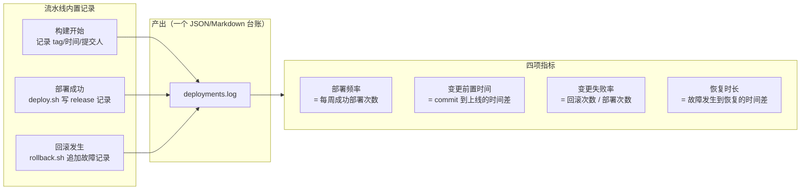

# 第 18 章 发布治理与可观测

> 难度：★★☆　预计耗时：60 分钟
> 本章目标：回答三个问题——**做得好不好**（DORA 指标量化）、**谁批准的发布**（审批与审计）、**坏了谁先知道**（告警与最小监控）。全部在现有单机流水线上实现，不引入新平台。

---

## 一、为什么需要这一章

上线这套流水线一个月后，老板/团队大概率会问：

- "你们现在多久发一次？"——答不上来，因为没有记录。
- "上周那个故障，发布是谁点的？"——答不上来，因为没审计。
- "服务器半夜挂了，你们多久发现的？"——答不上来，因为没有监控，是用户先发现的。

这三个问题对应可观测的三层：**度量（DORA）、审计（谁干的）、监控（坏了知道）**。这一章全部用"现有工具 + 少量脚本"解决，不给 2G 机器加任何新常驻服务。

> **餐厅比喻**：餐厅经营不能只凭老板娘的直觉——要记台账（每天卖了几单、退了几单），要留小票存根（谁批准退的菜），要装烟雾报警器（厨房着火第一时间响）。台账=指标，小票=审计，报警器=监控告警。

---

## 二、原理图解：DORA 四项指标怎么从流水线里"长"出来



| 指标 | 数据来源（本项目） | 采集成本 |
| --- | --- | --- |
| 部署频率 | `releases/` 目录数 | 零（目录即数据） |
| 变更前置时间 | commit 时间（Jenkins 构建记录）与 release 目录时间差 | 一行脚本 |
| 变更失败率 | `rollback` 记录数 / 部署数 | 脚本里加一行 |
| 恢复时长 | 故障记录里的时间差 | 故障时手动补记 |

> DORA 的价值不在"数字多大"，而在**趋势**：前置时间从 3 天缩到 3 小时，失败率从 30% 降到 10%，这些曲线说明流程在变好。

---

## 三、动手步骤

### 步骤 1 给 deploy.sh / rollback.sh 加台账（两行改动）

```bash
# 【服务器】deploy.sh 成功分支末尾追加：
echo "{\"ts\":\"$(date -Is)\",\"event\":\"deploy\",\"tag\":\"${TAG}\",\"release\":\"${RELEASE_ID}\"}" \
  >> "${APP_BASE_DIR}/shared/deployments.log"

# rollback.sh 成功分支末尾追加：
echo "{\"ts\":\"$(date -Is)\",\"event\":\"rollback\",\"to\":\"$(basename "$TARGET")\"}" \
  >> "${APP_BASE_DIR}/shared/deployments.log"
```

台账长这样：

```text
{"ts":"2026-11-11T15:30:05+08:00","event":"deploy","tag":"42-a1b2c3d","release":"20261111-143001-42-a1b2c3d"}
{"ts":"2026-11-12T10:12:33+08:00","event":"rollback","to":"20261111-143001-42-a1b2c3d"}
```

### 步骤 2 周报脚本：四项指标一键算

```bash
# 【服务器】scripts/dora-report.sh
#!/usr/bin/env bash
set -euo pipefail
LOG="${APP_BASE_DIR:-/opt/apps/cicd-demo}/shared/deployments.log"
[ -f "$LOG" ] || { echo "暂无台账"; exit 0; }

DEPLOYS=$(grep -c '"event":"deploy"' "$LOG" || true)
ROLLBACKS=$(grep -c '"event":"rollback"' "$LOG" || true)
FAIL_RATE=$(( DEPLOYS > 0 ? ROLLBACKS * 100 / DEPLOYS : 0 ))
echo "最近全部记录："
echo "  部署次数：${DEPLOYS}"
echo "  回滚次数：${ROLLBACKS}"
echo "  变更失败率：${FAIL_RATE}%"
echo "  最近 5 条："
tail -5 "$LOG" | sed 's/^/    /'
```

**变更前置时间**的细算要 join Jenkins 构建数据（构建号 ↔ tag），第一版先靠 Jenkins 构建页面人工核对；要自动化时把 commit 时间也写进 deploy 日志即可。

### 步骤 3 生产审批：让"能发布"需要两个人

Jenkins 的 `input` 步骤（第 04 章讲过语法），生产版本加上提交者限制：

```groovy
stage('生产审批') {
    when { branch 'main' }
    steps {
        timeout(time: 30, unit: 'MINUTES') {
            input message: "即将部署 ${env.IMAGE_TAG} 到生产，是否继续？",
                  ok: '批准发布',
                  submitter: 'release-approvers'   // Jenkins 用户组
        }
    }
}
```

配置要点：

1. **建组**：Manage Jenkins → Users/Groups → 建 `release-approvers` 组，把有发布权的人加进去。
2. **超时自动拒绝**：30 分钟没人批就失败，避免"挂着的构建占用并发"。
3. **审批记录**：`input` 的批准人与时间自动进构建日志——这就是最简审计。

### 步骤 4 审计：三处留痕拼出完整链条

| 留痕点 | 位置 | 回答的问题 |
| --- | --- | --- |
| Jenkins 构建日志 | `http://localhost:8080/job/.../build#` | 谁触发的、哪次提交、每步输出 |
| 部署台账 | `shared/deployments.log` | 部署了什么 tag、何时、回滚过几次 |
| 发布目录 | `releases/<id>/{VERSION,DIGEST}` | 具体跑了哪个镜像（digest 级） |

复盘一条发布只需 3 条命令：

```bash
# 【服务器】
cat /opt/apps/cicd-demo/current/VERSION
cat /opt/apps/cicd-demo/current/DIGEST
tail -20 /opt/apps/cicd-demo/shared/deployments.log
```

### 步骤 5 告警：不引入新服务的三条路

**① 企业微信 / 钉钉群机器人（推荐，5 分钟搞定）**

群设置里添加机器人拿到 Webhook URL，存成服务器上的凭据文件（600 权限），然后：

```bash
# 【服务器】scripts/notify.sh
#!/usr/bin/env bash
# 用法：notify.sh "标题" "内容"
HOOK_FILE="/opt/apps/cicd-demo/shared/.webhook_url"
[ -f "$HOOK_FILE" ] || { echo "未配置 Webhook"; exit 0; }
URL=$(cat "$HOOK_FILE")
curl -fsS -H 'Content-Type: application/json' -d "{
  \"msgtype\": \"text\",
  \"text\": {\"content\": \"[cicd-demo] $1\n$2\"}
}" "$URL" >/dev/null || echo "告警发送失败（检查 Webhook URL）"
```

在 deploy.sh 的失败分支、rollback.sh、backup-data.sh 里各加一行调用。**部署成功也可以发**——团队对"发版节奏"有实感，比只有坏消息好。

**② Jenkins 邮件**：Manage Jenkins → System → E-mail Notification，`post { failure { emailext ... } }`。适合个人，不适合群协作。

**③ UptimeRobot 等外部拨测（免费档够用）**：加一个 `https://49.234.202.181/healthz`（自签证书场景选"忽略证书校验"的选项）。**外部拨测能发现"整台机器失联"这类内部监控发现不了的问题**——因为你的机器挂了，挂在它上面的监控也挂了。

### 步骤 6 最小监控：一个 cron + 一个脚本，覆盖 90% 风险

```bash
# 【服务器】scripts/mini-monitor.sh
#!/usr/bin/env bash
set -uo pipefail
APP=/opt/apps/cicd-demo
FAILED=0
send() { bash "$APP/scripts/notify.sh" "监控告警" "$1" || true; }

# 1. 服务探活
curl -fsS --max-time 5 http://127.0.0.1:8000/healthz >/dev/null 2>&1 || { send "后端 /healthz 不可达"; FAILED=1; }
curl -fsSk --max-time 5 https://127.0.0.1/ >/dev/null 2>&1 || { send "HTTPS 站点不可达"; FAILED=1; }

# 2. 容器状态
for c in $(docker compose -f "$APP/current/docker-compose.yml" ps -q 2>/dev/null); do
  [ "$(docker inspect -f '{{.State.Running}}' "$c")" = "true" ] || { send "容器 $c 未运行"; FAILED=1; }
done

# 3. 磁盘水位
DISK_PCT=$(df / | awk 'NR==2{gsub("%","",$5);print $5}')
[ "$DISK_PCT" -lt 85 ] || { send "磁盘使用率 ${DISK_PCT}%，先跑 cleanup.sh"; FAILED=1; }

# 4. 内存水位
AVAIL_MB=$(free -m | awk '/^Mem:/{print $7}')
[ "$AVAIL_MB" -gt 200 ] || { send "可用内存仅 ${AVAIL_MB}MiB，警惕 OOM"; FAILED=1; }

# 5. 证书剩余有效期（30 天阈值）
openssl x509 -in "$APP/shared/certs/server.crt" -noout -checkend 2592000 \
  || { send "证书 30 天内过期，安排重签"; FAILED=1; }

# 6. 备份新鲜度（超过 26 小时告警）
LATEST=$(ls -t "$APP"/shared/backups/app-*.db.gz 2>/dev/null | head -1 || true)
if [ -n "$LATEST" ]; then
  AGE=$(( $(date +%s) - $(stat -c %Y "$LATEST") ))
  [ "$AGE" -lt 93600 ] || { send "最新备份已 ${AGE}s（>26h），检查备份 cron"; FAILED=1; }
else
  send "没有找到任何备份文件"; FAILED=1
fi

[ "$FAILED" -eq 0 ] && echo "all clear" || exit 1
```

接入 cron（每 5 分钟）：

```bash
echo "*/5 * * * * root bash /opt/apps/cicd-demo/scripts/mini-monitor.sh >> /var/log/cicd-monitor.log 2>&1" \
  | sudo tee /etc/cron.d/cicd-monitor && sudo chmod 644 /etc/cron.d/cicd-monitor
```

> 为什么不用 Prometheus + Grafana？**这台机器没有余量跑常驻监控栈**（Prometheus ≈300MB，Grafana ≈200MB）。脚本监控是"资源受限下的正确选择"；上集群后再切完整监控栈（第 20 章）。

---

## 四、完整实例：给现有流水线补齐治理（1 小时）

```bash
# 【服务器】
# 1. 台账：deploy.sh / rollback.sh 加两行（步骤 1）
# 2. 通知：上传 notify.sh，echo <WebhookURL> | tee shared/.webhook_url，chmod 600
# 3. 监控：上传 mini-monitor.sh，配 cron
# 4. 备份新鲜度已并入监控（步骤 6 第 6 项）

# 【本地】Jenkins
# 5. 建组 release-approvers，把你加进去
# 6. Jenkinsfile-06-e2e 在"部署"前插入 stage('生产审批')（步骤 3 代码）
# 7. post { failure { ... notify 企业微信 ... } } 可用 PowerShell/HTTP 调用，或留给服务器端告警兜底
```

**验证成功的标准**：

- 手动 kill 掉 api 容器，5 分钟内群里收到告警
- 删掉最新备份模拟"备份停摆"，收到"备份超时"告警
- 部署触发审批，非组成员点批准被拒绝
- `dora-report.sh` 能输出部署/回滚统计

---

## 五、坑与排错

| 现象 | 根因 | 解法 |
| --- | --- | --- |
| 告警轰炸，群里刷屏 | 监控 5 分钟跑一次，故障期间重复发 | 通知里带时间戳 + 相同告警 30 分钟内去重（状态文件） |
| `input` 审批把流水线卡住过夜 | 没配 timeout | 必须配 `timeout(time: 30, unit: 'MINUTES')` |
| 企业微信机器人无响应 | Webhook 频控（每分钟 20 条） | 去重 + 合并告警 |
| 外部拨测报"证书无效" | 自签证书不被外部信任 | 拨测配置关闭证书校验；或换 sslip.io 真证书 |
| 磁盘告警后 cleanup 也没救回来 | 日志/镜像之外还有别的东西在涨 | `du -xh / --max-depth=2 \| sort -rh \| head` 定位真凶 |
| DORA"前置时间"算不准 | commit 时间与构建时间的口径 | 统一用"git commit 时间 → release 目录创建时间" |
| 监控脚本自己把告警发到自己 | curl Webhook 失败又触发告警 | send() 里 `|| true`，永不递归 |
| 审计日志被清理 | logrotate 没覆盖 deployments.log | 加入 logrotate，保留 90 天 |

---

## 六、横向对照

| 能力 | 本书方案 | Jenkins 插件方案 | 云托管方案 |
| --- | --- | --- | --- |
| DORA 指标 | 台账 + 脚本统计 | Jenkins insights / 自建 | GitLab Value Stream / 芝加哥 DORA API |
| 审批 | `input` + 用户组 | 同 | Environment reviewers |
| 审计 | 构建日志 + 台账 | Audit Trail 插件 | 平台 Audit Log |
| 告警 | 群机器人 Webhook | Email/Mattermost 插件 | 平台集成（Slack/Teams） |
| 监控 | cron + 脚本 | Node Monitor 插件 | APM / 托管监控 |

> 插件方案功能更强，但每个插件都是第 17 章说的"攻击面 + 故障面"。**资源受限时，脚本方案是工程上正确的选择。**

---

## 七、本章检查清单与练习

### 检查清单

- [ ] `deployments.log` 在记录每次部署与回滚
- [ ] `dora-report.sh` 能输出三数（部署/回滚/失败率）
- [ ] 生产部署有审批（submitter 组 + 超时）
- [ ] kill 容器 5 分钟内能收到群告警
- [ ] mini-monitor 覆盖：探活/容器/磁盘/内存/证书/备份六项
- [ ] 有外部拨测（发现"整机失联"）
- [ ] 台账进了 logrotate（90 天）

### 练习

**练习 1**：为什么"外部拨测"和"机器上的监控脚本"缺一不可？
<details><summary>参考要点</summary>

机器内监控能报"服务挂了"这类局部故障，但整台机器失联（宕机/网络断）时它自己也失联，永远不会报警。外部拨测从第三方视角探测，能发现整机级故障。两者互补：内部报细节，外部报存亡。
</details>

**练习 2**：变更失败率的分母该用"部署次数"还是"流水线构建次数"？为什么？
<details><summary>参考要点</summary>

用部署次数。构建失败（测试不过、镜像扫描不过）没有进入生产，不属于"变更失败"——它是门禁在正确工作。变更失败率衡量的是"到了生产才炸"的比例，这也是为什么台账只记成功部署与回滚。
</details>

**练习 3**：告警去重的状态文件方案怎么实现？写出核心逻辑。
<details><summary>参考要点</summary>

以告警 key（如 `disk-full`）写状态文件 `alerts/<key>`，内容为上次发送时间戳；发送前检查：若距上次 < 30 分钟则跳过；故障恢复时删除状态文件（或下次监控发现 `FAILED=0` 时清理）。
</details>

---

## 下一章预告

最后进入"排错宝典"：把前 18 章散落各处的坑，加上更多真实场景，汇成 30+ 条故障手册。以后出问题不用翻章节，直接查表。
