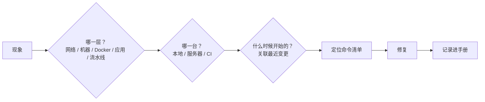

# 第 19 章 故障演练手册

> 难度：★★★　预计耗时：精读 60 分钟 / 随查随用
> 本章目标：一本"症状 → 定位 → 根因 → 修复"的查表手册。**遇到故障的正确姿势：先查这张表，10 分钟内没解决再翻对应章节深读。**

---

## 一、为什么需要这一章

故障排查最重要的不是"会多少命令"，而是**排除法**。所有故障都可以放进一个漏斗：



**三条通用原则**：

1. **先看日志再猜**：`docker logs`、`journalctl -u nginx`、Jenkins Console Output，90% 的答案在日志里。
2. **只改一个变量**：一次改两个东西，好了也不知道是哪个的功劳。
3. **修复后记录**：本手册就是这么攒出来的——每修一次加一行。

---

## 二、30+ 故障案例

> 定位命令都在对应机器上执行。标注 ⭐ 的是本书实战中真实遇到过的。

### A. SSH 与网络

| # | 现象 | 定位 | 根因 | 修复 |
|---|---|---|---|---|
| 1 | ⭐ `ssh: connect timed out` | 本地 `ping IP`、控制台看实例状态 | 机器关机 / 安全组没放 22 / 公网 IP 变了 | 控制台核实 IP 与安全组；开机 |
| 2 | `Permission denied (publickey)` | `ssh -v yengxun-yun 2>&1 \| grep Offering` | 公钥不在服务器 `authorized_keys`；权限不对 | 重推公钥；`chmod 700 ~/.ssh && chmod 600 authorized_keys` |
| 3 | 密钥能登，脚本里不能 | 脚本里 `ssh -o BatchMode=yes` 试跑 | 脚本用的另一把钥匙 / known_hosts 冲突 | 指定 `-i`；`ssh-keygen -R IP` 清旧记录 |
| 4 | SSH 每次都要输密码 | `ls -l ~/.ssh` | `authorized_keys` 属主不是本用户或家目录权限过宽 | `chown -R $USER ~/.ssh; chmod 700 ~/.ssh; chmod 600 authorized_keys` |
| 5 | ⭐ PowerShell 传含引号的远端命令被剥离 | 命令在服务器上执行后引号消失 | PS 参数解析吃掉了双引号 | 复杂命令写成脚本 `scp` 上去执行（本书 probe/init 均如此） |
| 6 | scp 到 `/opt/apps` 权限拒绝 | 目录属主 | `/opt` 下目录归 root | 传 `/tmp` 再 `sudo mv`，或 `sudo chown` |

### B. Docker 与镜像

| # | 现象 | 定位 | 根因 | 修复 |
|---|---|---|---|---|
| 7 | ⭐ `permission denied while trying to connect to the Docker daemon socket` | `id` 看组 | 用户不在 docker 组 / 未重新登录 | `sudo usermod -aG docker $USER` 后**退出重登** |
| 8 | `docker pull` 超时 | `time docker pull`；`docker info \| grep Mirrors` | 走公网 / 没配镜像加速 | 配 `registry-mirrors`；同云用内网仓库域名 |
| 9 | `docker load` 报 `invalid tar header` | 看文件是 `.tar.gz` 还是 `.tar` | gzip 没解压 | `gunzip -c x.tar.gz \| docker load` |
| 10 | `docker compose up` 报 `port is already allocated` | `ss -tlnp \| grep :8000` | 旧容器/别的进程占端口 | `docker compose down --remove-orphans`；或换端口 |
| 11 | 容器反复重启（Restarting） | `docker logs --tail 50 <c>` | 启动崩溃（缺依赖/权限/配置错） | 按日志修；`docker inspect -f '{{.State.ExitCode}}'` 看退出码 |
| 12 | ⭐ 镜像构建每次都很慢 | `docker build` 日志无 `CACHED` | 层顺序错（COPY 全部在依赖安装前） | 依赖清单先 COPY；见第 10/16 章 |
| 13 | `no space left on device` | `df -h`；`docker system df` | 镜像/日志/构建缓存堆积 | `bash scripts/cleanup.sh --aggressive` |
| 14 | 构建上下文巨大（几十秒 Sending build context） | build 日志第一行 | 没有 `.dockerignore` | 加 `node_modules/`、`.venv/`、`.git` |
| 15 | Windows 构建的镜像里脚本带 `\r` | 容器内 `cat -A script.sh` 见 `^M` | Git CRLF | `.gitattributes` 强制 LF；`git add --renormalize .` |
| 16 | `docker compose ps` 有两个 project 并存 | `docker compose ls` | 不同目录名导致 project 名不同 | compose 里固定 `name: cicd-demo` |

### C. Nginx 与 TLS

| # | 现象 | 定位 | 根因 | 修复 |
|---|---|---|---|---|
| 17 | ⭐ 浏览器 `ERR_CERT_COMMON_NAME_INVALID` | `openssl x509 -noout -ext subjectAltName` | SAN 缺少访问地址 | 重签含 `IP:` 的 SAN（第 13 章） |
| 18 | `ERR_CERT_AUTHORITY_INVALID` | 证书 issuer | 自签 CA 未被客户端信任 | 导入 `ca.crt`；或换真证书 |
| 19 | ⭐ `502 Bad Gateway` | `docker logs web`；`docker compose exec web curl api:8000` | `proxy_pass http://127.0.0.1:8000`（容器内指向自己） | 改 `http://api:8000` |
| 20 | 刷新页面 404 | curl `/tasks` | 缺 SPA 回退 | `try_files $uri $uri/ /index.html` |
| 21 | `nginx: [emerg] cannot load certificate` | 路径检查 | 挂载路径/权限错 | 确认 `/etc/nginx/certs/` 存在且 600 key |
| 22 | `413 Request Entity Too Large` | 响应码 | `client_max_body_size` 默认 1m | 调 20m |
| 23 | 改了 site.conf 不生效 | 容器内 `nginx -T` | 挂载没覆盖 / 没 restart | 确认挂载到 `conf.d/default.conf`；`docker compose restart web` |
| 24 | 接口路径变成 `/api/api/...` | Nginx access log | `proxy_pass` 带了 URI 部分 | `proxy_pass http://api:8000;` 不带路径 |

### D. 应用运行时

| # | 现象 | 定位 | 根因 | 修复 |
|---|---|---|---|---|
| 25 | ⭐ `sqlite3.OperationalError: unable to open database file` | `ls -ldn /data`；`docker exec api whoami` | 数据目录属主不是 10001 | `chown -R 10001:10001` |
| 26 | `database is locked` | 应用日志并发写点 | 多 worker / 长事务 | 单 worker；WAL；短事务 |
| 27 | 容器时间差 8 小时 | `docker exec api date` | 无 TZ | `ENV TZ=Asia/Shanghai` + tzdata |
| 28 | 优雅退出没生效，发布时 502 | `docker stop` 耗时 | `stop_grace_period` 小于应用退出时间 | compose 里 30s；uvicorn `--timeout-graceful-shutdown 20` |
| 29 | ⭐ 健康检查一直 unhealthy | `docker inspect -f '{{.State.Health}}'` | start-period 太短 / 检查命令缺工具 | 加大 start-period；用 python 发探测请求 |
| 30 | OOM 被杀（进程消失） | `dmesg -T \| grep -i 'killed process'`；`journalctl -k` | 内存超限 | 单 worker；查内存大户；加/加大 Swap（仅兜底） |
| 31 | 新版本接口 404 但旧版本正常 | 比对镜像 tag | 部署没生效（current 没切/没 up） | `readlink current`；`compose ps` 镜像 tag |

### E. CI/流水线

| # | 现象 | 定位 | 根因 | 修复 |
|---|---|---|---|---|
| 32 | ⭐ Jenkinsfile 里 `$'\r': command not found` | `git ls-files --eol` | CRLF | `.gitattributes`；`renormalize`（第 17 章） |
| 33 | `npm ci` 报 EUSAGE / lock 不一致 | 对比 `package.json` | 改了依赖没提交 lock | 本地 `npm install` 后一并提交 |
| 34 | `ModuleNotFoundError` 但本地能跑 | 服务器/容器 Python 版本 | 环境不一致 | 一律容器内跑（本书 Python 3.14 系统案例） |
| 35 | `Cannot find module @rollup/rollup-linux-x64-gnu` | lock 生成平台 | Windows lock 缺 Linux 可选依赖 | Linux 容器重装生成 lock |
| 36 | 流水线挂起等输入 | 构建页日志 | 之前插入的 `input` 没配 timeout | 加 `timeout`；取消当前构建 |
| 37 | Webhook 不触发 | Jenkins 系统日志 / 仓库 Webhook 投递记录 | URL/secret 错、匿名 403 | 校对 URL 与 token（第 05/17 章） |
| 38 | 并发部署互相打架 | `docker compose ls` 两个 project | 未禁并发 | `disableConcurrentBuilds(abortPrevious: true)` |
| 39 | ⭐ 体积门禁突然红 | `npx vite-bundle-visualizer` | 误引入大依赖 | 排查最近 `package.json` 变更；按需引入 |
| 40 | Trivy 阻断在"无修复版本"漏洞 | `--ignore-unfixed` 看剩余 | 上游未修 | `.trivyignore` + 复查日期（第 09 章） |

---

## 三、三个完整演练（建议亲手做一遍）

**演练 1：模拟容器崩溃 → 观察 restart 与告警**

```bash
# 【服务器】
docker exec cicd-demo-api-1 kill 1        # 杀掉主进程
docker compose -f /opt/apps/cicd-demo/current/docker-compose.yml ps   #几秒后 Restarting→Running
```

预期：`restart: unless-stopped` 拉起；mini-monitor 若在窗口期内失败会告警。**学到什么**：进程级自愈不需要人，但"反复崩溃"要靠告警发现。

**演练 2：磁盘水位压测**

```bash
# 【服务器】制造一个 3GB 的大文件（放在测试目录，演练后删除）
fallocate -l 3G /tmp/bigfile; df -h /
```

预期：监控在磁盘 ≥85% 时告警；`cleanup.sh --aggressive` + 删文件恢复。**学到什么**：磁盘是长跑项目，水位告警是最后一道防线。

**演练 3：证书过期前兆**

```bash
# 把 checkend 阈值临时调大到足够大，观察告警触发
openssl x509 -in /opt/apps/cicd-demo/shared/certs/server.crt -noout -checkend 315360000
```

**学到什么**：证书过期是"可完全预防"的故障——有监控就不该发生。

---

## 四、通用定位命令速查（贴在工位上）

```bash
# 一台机器的第一分钟（按顺序）
free -h                     # 内存死了吗
df -h /                     # 磁盘满了吗
uptime                      # 负载多久了
sudo ss -tlnp | head        # 端口谁在听
docker ps -a                # 容器状态
docker logs --tail 50 <c>   # 容器日志
journalctl -u nginx --since "10 min ago"   # 系统服务日志
dmesg -T | tail -20         # 内核级事件（OOM 在这里）
```

---

## 五、横向对照

| 场景 | 自建服务器（本书） | K8s 环境 |
| --- | --- | --- |
| 容器崩溃 | restart + 告警 | `kubectl rollout status` + Probe 自动重启 |
| 内存不够 | OOM killer 随机杀 | requests/limits 精确配额 +驱逐 |
| 磁盘满 | 清理脚本 | 本地盘 ephemeral-storage 驱逐 / 存储类告警 |
| 证书过期 | checkend 告警 | cert-manager 自动续期 |
| 部署失败 | 脚本回滚 | rollout undo |

> 同一类故障，在集群里大多有"平台级"解法。这是第 20 章讨论"什么时候该迁移"的核心理由之一。

---

## 六、检查清单与练习

### 检查清单

- [ ] 通读一遍 40 条案例，知道每条该用哪个定位命令
- [ ] 三个演练全部做过一遍
- [ ] "第一分钟"速查命令能默写
- [ ] 遇到过的新故障已补进团队手册

### 练习

**练习 1**：`docker ps` 显示容器 Up 但接口 503，`docker inspect` 的 Health 显示 unhealthy。请给出完整排查路径。
<details><summary>参考要点</summary>

① `docker logs` 看应用日志；② `docker exec` 进容器本地 curl 服务；③ 若容器内通、宿主机不通，查端口映射与防火墙；④ 若容器内也不通，查应用监听地址（`0.0.0.0` vs `127.0.0.1`）与依赖（数据库连接）。Health 只反映"探测命令结果"，Unhealthy 的原因要顺着探测命令本身查。
</details>

**练习 2**：为什么 OOM 排查要看 `dmesg` 而不是 `docker logs`？
<details><summary>参考要点</summary>

OOM killer 是内核行为，被杀进程来不及写日志；记录在内核环形缓冲（dmesg）与 journalctl -k 里，格式含 "Killed process"。容器日志只会显示进程突然消失。
</details>

**练习 3**：把手册中 #19（502）与 #25（SQLite 权限）串成一个可能的真实故障链。
<details><summary>参考要点</summary>

SQLite 目录权限错 → api 启动崩溃 → 容器反复重启 → Nginx 上游连不上 → 用户看到 502。一个根因（权限）在链路末端表现为完全不同的症状（502）。教训：看到 502 不要先改 Nginx，先 `docker ps` 看后端是否活着——排查要逆着故障链从最底层开始。
</details>

---

## 下一章预告

最后一章回答一个战略问题：**这台 4 核 3.6G 的单机，什么时候会撑不住？** 演进信号、K8s/GitOps 能解决什么与解决不了什么、迁移路径与真实成本——不做实操，只给决策依据。
